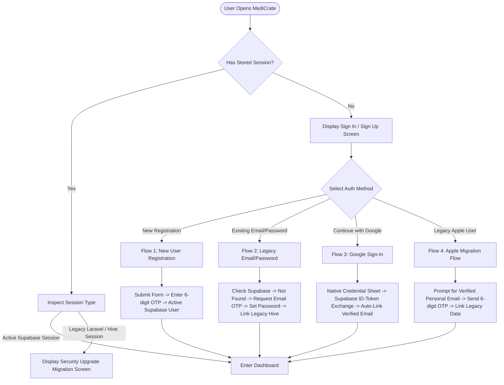
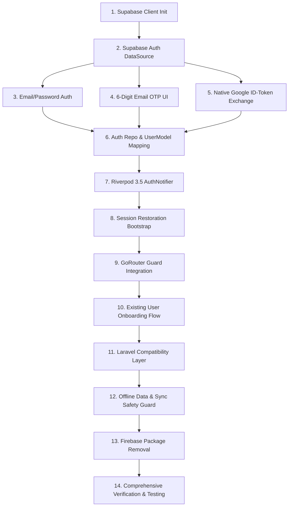

# MediCrate – Phase 3A.1: Authentication Transition Architecture & Legacy Identity Migration

> **Document Type:** Architecture Design & Legacy Migration Specification  
> **Status:** Completed Architecture Design (Audit & Design Only – Pre-Implementation)  
> **Reference Commit:** `da629f6` (`MEDICRATE_PHASE3A_SUPABASE_AUTH_AUDIT.md`)  
> **Supabase Project:** `wnaflcytkubqmrymbmcn`  
> **Target Framework:** Flutter 3.47.x / Dart 3.13.x / Riverpod 3.5.0  
> **Date:** November 2026  

---

## Executive Summary

Phase 3A concluded with an audit of the inherited MediVault authentication codebase, establishing that:
1. Firebase Auth served only as an ephemeral client-side credential exchange shim for Google/Apple social sign-ins.
2. The Laravel REST backend (`phplaravel-1505866-6585565.cloudwaysapps.com/api/v1`) is the current identity authority, issuing database-backed Laravel Sanctum personal access tokens.
3. Clinical data is profile-isolated in local Hive storage, with records referencing `profile_id` strings owned by `ownerUserId`.
4. Apple Sign-In is deprecated and will not be reintroduced.
5. Google Sign-In must use native ID-token exchange (`supabase.auth.signInWithIdToken`) rather than browser-based OAuth flows.

This Phase 3A.1 architectural document resolves the critical transition questions:
- **Token Incompatibility:** Laravel Sanctum expects database-backed token strings (`id|token`) and **cannot validate Supabase JWTs** without server-side changes.
- **Identity Discrepancy:** Laravel user IDs are **integers** (e.g. `12`), while Supabase user IDs are **UUIDs** (e.g. `a1d2f71e-9929-408d-ad19-e019d7699caf`). Naively replacing `ownerUserId` with a Supabase UUID in Hive will immediately orphan all local profiles and hide existing clinical records.
- **OTP Length:** The existing UI is hardcoded for **4-digit** OTPs; Supabase defaults to **6-digit** tokens.
- **Offline Sync Safety:** Background WorkManager workers and offline sync queues currently send requests with Sanctum tokens. Sending Supabase JWTs to Laravel endpoints will result in HTTP 401, triggering token purging and sync deadlocks.

This document presents the verified source code audit, evaluates transitional compatibility options, specifies secure legacy identity migration flows, details email OTP verification, defines Google/Apple migration, and lays out a 14-step Phase 3B implementation sequence.

---

## 1. Laravel and Supabase Token Compatibility Audit

### 1.1 Locations Attaching Sanctum Tokens to Dio Requests
In MediCrate, HTTP requests are handled centrally through [`ApiClient`](file:///home/blackhat/Documents/medi_crate/lib/core/api/api_client.dart#L9). The injection of authentication credentials occurs in:

1. **[`AuthInterceptor.onRequest`](file:///home/blackhat/Documents/medi_crate/lib/core/api/dio_interceptor.dart#L42-L66)**:
   - Injects static `x-api-key` header on all requests ([`dio_interceptor.dart:47-49`](file:///home/blackhat/Documents/medi_crate/lib/core/api/dio_interceptor.dart#L47)).
   - Injects `Authorization: Bearer <token>` on all non-public endpoints if not already present ([`dio_interceptor.dart:52-63`](file:///home/blackhat/Documents/medi_crate/lib/core/api/dio_interceptor.dart#L52)).
   - Reads the token directly from [`SecureStorageService.getAuthToken()`](file:///home/blackhat/Documents/medi_crate/lib/core/storage/secure_storage_service.dart#L134).
   - Only 9 endpoints bypass token injection via `_isPublicAuthEndpoint` ([`dio_interceptor.dart:29-39`](file:///home/blackhat/Documents/medi_crate/lib/core/api/dio_interceptor.dart#L29)): `/auth/signup`, `/auth/verify-email`, `/auth/resend-otp`, `/auth/login`, `/auth/forgot-password`, `/auth/reset-password`, `/auth/refresh-token`, `/auth/google-login`, `/auth/apple-login`.
   - **All other endpoints** (including `/auth/logout`, user profile, family members, and the 7 clinical domains) require the `Authorization: Bearer <token>` header.

2. **[`AuthInterceptor.onError`](file:///home/blackhat/Documents/medi_crate/lib/core/api/dio_interceptor.dart#L69-L110)**:
   - On HTTP 401 Unauthorized, intercepts the failure and attempts automatic token refresh via `_performTokenRefresh()` ([`dio_interceptor.dart:78`](file:///home/blackhat/Documents/medi_crate/lib/core/api/dio_interceptor.dart#L78)).
   - Upon receiving a new access token, retries the original request with `retryOptions.headers['Authorization'] = 'Bearer $newAccessToken'` ([`dio_interceptor.dart:83`](file:///home/blackhat/Documents/medi_crate/lib/core/api/dio_interceptor.dart#L83)).

3. **[`NetworkDiagnosticService`](file:///home/blackhat/Documents/medi_crate/lib/core/api/network_diagnostic.dart#L279-L300)**:
   - Instantiates an isolated Dio client to test endpoint reachability against `/auth/login` without interceptors.

### 1.2 Token Storage, Refresh, and Invalidation Lifecycle
- **Storage:** Managed by [`SecureStorageService`](file:///home/blackhat/Documents/medi_crate/lib/core/storage/secure_storage_service.dart#L13) using `FlutterSecureStorage` backed by Android KeyStore (`resetOnError: true`) and iOS Keychain (`KeychainAccessibility.first_unlock`).
  - Access Token Key: `auth_bearer_token` ([`secure_storage_service.dart:32`](file:///home/blackhat/Documents/medi_crate/lib/core/storage/secure_storage_service.dart#L32)).
  - Refresh Token Key: `auth_refresh_token` ([`secure_storage_service.dart:33`](file:///home/blackhat/Documents/medi_crate/lib/core/storage/secure_storage_service.dart#L33)).
- **Refresh:** Executed by `AuthInterceptor._performTokenRefresh()` ([`dio_interceptor.dart:112-186`](file:///home/blackhat/Documents/medi_crate/lib/core/api/dio_interceptor.dart#L112)):
  - Calls `POST /api/v1/auth/refresh-token` with payload `{'refresh_token': refreshToken}` on an independent Dio instance ([`dio_interceptor.dart:147-150`](file:///home/blackhat/Documents/medi_crate/lib/core/api/dio_interceptor.dart#L147)).
  - Saves rotated access and refresh tokens via `secureStorage.saveTokens()`.
- **Invalidation:**
  - On permanent refresh failure (HTTP 400, 401, 403, 422), `AuthInterceptor` calls `secureStorage.clearAuthToken()` and fires `onSessionExpired?.call()` ([`dio_interceptor.dart:103-106`](file:///home/blackhat/Documents/medi_crate/lib/core/api/dio_interceptor.dart#L103)).
  - On user logout, [`AuthRepository.signOut()`](file:///home/blackhat/Documents/medi_crate/lib/features/auth/data/repositories/auth_repository.dart) calls `POST /api/v1/auth/logout`, purges `SecureStorageService`, and invokes `AuthLocalDataSource.clearSession()`.

### 1.3 Repositories and Remote Services Requiring Laravel Authentication
Every data domain outside initial onboarding connects to Laravel via `ApiClient` and requires a valid Sanctum token:
1. **User Account & Security:** [`UserRemoteDataSource`](file:///home/blackhat/Documents/medi_crate/lib/features/profile/data/datasources/remote/user_remote_data_source.dart#L11) (`/users/me`, `/users/me/password`, `/users/me/email`, `/users/me/email/confirm`, DELETE `/users/me`).
2. **Family Profiles:** [`ProfileRemoteDataSource`](file:///home/blackhat/Documents/medi_crate/lib/features/profile/data/datasources/remote/profile_remote_data_source.dart#L11) (`/family-members`, `/family-members/{id}`, `/family-members/{id}/photo`).
3. **Consultations:** [`ConsultationRemoteDataSource`](file:///home/blackhat/Documents/medi_crate/lib/features/consultations/data/datasources/remote/consultation_remote_data_source.dart#L14) (`/consultations`, `/consultations/{id}`).
4. **Medical Departments:** [`MedicalDepartmentRemoteDataSource`](file:///home/blackhat/Documents/medi_crate/lib/features/consultations/data/datasources/remote/medical_department_remote_data_source.dart#L11) (`/medical-departments`).
5. **Medical Reports:** [`ReportRemoteDataSource`](file:///home/blackhat/Documents/medi_crate/lib/features/reports/data/datasources/remote/report_remote_data_source.dart#L14) (`/reports`, `/reports/{id}`, multipart uploads).
6. **Prescriptions & Medicines:** [`MedicineRemoteDataSource`](file:///home/blackhat/Documents/medi_crate/lib/features/medicines/data/datasources/remote/medicine_remote_data_source.dart#L10) (`/medicines`, `/medicines/{id}`).
7. **Vitals & Measurements:** [`VitalsRemoteDataSource`](file:///home/blackhat/Documents/medi_crate/lib/features/vitals/data/datasources/remote/vitals_remote_data_source.dart#L10) (`/vitals`, `/vitals/{id}`).
8. **Appointments:** [`AppointmentRemoteDataSource`](file:///home/blackhat/Documents/medi_crate/lib/features/appointments/data/datasources/remote/appointment_remote_data_source.dart#L10) (`/appointments`, `/appointments/{id}`).
9. **Doctors Directory:** [`DoctorRemoteDataSource`](file:///home/blackhat/Documents/medi_crate/lib/features/doctors/data/datasources/remote/doctor_remote_data_source.dart#L10) (`/doctors`, `/doctors/{id}`).
10. **Hospitals Directory:** [`HospitalRemoteDataSource`](file:///home/blackhat/Documents/medi_crate/lib/features/hospitals/data/datasources/remote/hospital_remote_data_source.dart#L11) (`/hospitals`, `/hospitals/{id}`).
11. **Dashboard & Analytics:** [`HomeRemoteDataSource`](file:///home/blackhat/Documents/medi_crate/lib/features/home/data/datasources/remote/home_remote_data_source.dart#L12) and [`AnalyticsRemoteDataSource`](file:///home/blackhat/Documents/medi_crate/lib/features/insights/data/datasources/remote/analytics_remote_data_source.dart#L12) (`/family/dashboard`, `/family/analytics`).
12. **Timeline:** [`TimelineRemoteDataSource`](file:///home/blackhat/Documents/medi_crate/lib/features/timeline/data/datasources/remote/timeline_remote_data_source.dart#L12).

### 1.4 Background Jobs Requiring Authenticated Access
1. **Periodic Background Sync (`com.medicrate.sync.periodic`):**
   - Orchestrated by [`BackgroundSyncService.executeBackgroundTask`](file:///home/blackhat/Documents/medi_crate/lib/core/sync/background_sync_service.dart#L123) registered with WorkManager to run every 15 minutes ([`background_sync_service.dart:67-74`](file:///home/blackhat/Documents/medi_crate/lib/core/sync/background_sync_service.dart#L67)).
   - Runs headless in a separate Dart isolate.
   - Pushes queued mutations via `SyncService.syncPending(force: true, lockAlreadyHeld: true)` ([`background_sync_service.dart:187`](file:///home/blackhat/Documents/medi_crate/lib/core/sync/background_sync_service.dart#L187)).
   - Pulls 7 clinical domains for all known profiles via [`BackgroundClinicalPull.run()`](file:///home/blackhat/Documents/medi_crate/lib/core/sync/background_clinical_pull.dart#L52).
   - `BackgroundClinicalPull` checks for a valid access token in `SecureStorageService` before starting ([`background_clinical_pull.dart:68-70`](file:///home/blackhat/Documents/medi_crate/lib/core/sync/background_clinical_pull.dart#L68)). If missing, it immediately aborts.
2. **One-Off Mutation Push (`com.medicrate.sync.oneoff`):**
   - Scheduled whenever an offline mutation is enqueued while disconnected ([`sync_service.dart:234`](file:///home/blackhat/Documents/medi_crate/lib/core/sync/sync_service.dart#L234)).
   - Executes the same headless push+pull pipeline when connectivity is restored.

### 1.5 Can Laravel Validate Supabase JWTs Directly?
**No. Laravel Sanctum cannot natively validate Supabase JWTs.**

**Technical Reason:**
- Laravel Sanctum operates as a **database token driver**. It expects Bearer tokens formatted as `<id>|<plaintext_token>` (or an opaque SHA-256 hash). When a request hits `auth:sanctum` middleware, Sanctum:
  1. Parses the integer ID preceding the pipe `|`.
  2. Hashes the token value following the pipe.
  3. Queries the `personal_access_tokens` table in MySQL: `SELECT * FROM personal_access_tokens WHERE id = ?`.
  4. Compares the hash and resolves the `tokenable_id` (`User` model instance).
- A Supabase Access Token is an **asymmetric or HMAC-signed RFC 7519 JSON Web Token (JWT)** composed of three base64url segments (`header.payload.signature`).
- If a Supabase JWT is sent in `Authorization: Bearer <supabase_jwt>` to any Laravel Sanctum route:
  - Sanctum attempts to parse an ID before a pipe `|`, finds none, or fails token lookup in MySQL.
  - The middleware rejects the request with **HTTP 401 Unauthorized**.
  - In response, `AuthInterceptor` triggers silent refresh against `/auth/refresh-token`, fails, purges stored credentials, and locks the user out of all clinical endpoints.

### 1.6 Existing Backend Token-Exchange Mechanisms
The Laravel backend **already uses an external identity token exchange mechanism** for social logins:
- **Google Login:** `POST /api/v1/auth/google-login` accepts `{'firebase_id_token': token}` ([`auth_remote_data_source.dart:318-323`](file:///home/blackhat/Documents/medi_crate/lib/features/auth/data/datasources/remote/auth_remote_data_source.dart#L318)).
- **Apple Login:** `POST /api/v1/auth/apple-login` accepts `{'firebase_id_token': token}` ([`auth_remote_data_source.dart:343-348`](file:///home/blackhat/Documents/medi_crate/lib/features/auth/data/datasources/remote/auth_remote_data_source.dart#L343)).
- On the server, Laravel uses the Firebase Admin SDK (`kreait/firebase-php`) to cryptographically verify the token, resolve the Firebase UID and email, locate or create the corresponding user in the MySQL `users` table, and issue a genuine pair of **Laravel Sanctum access and refresh tokens** ([`auth_response_models.dart:44-73`](file:///home/blackhat/Documents/medi_crate/lib/features/auth/data/models/responses/auth_response_models.dart#L44)).

The backend does **not** currently possess an endpoint that accepts a Supabase JWT.

---

### 1.7 Evaluation of Transition Options

| Dimension | Option A: Laravel Validates Supabase JWTs Directly | Option B: Transitional Laravel Exchange Endpoint Issues Sanctum Tokens | Option C: Sanctum Remains Temporarily Active Alongside Supabase Auth | Option D: Clinical Endpoints Migrated to Supabase Before Laravel Auth Deprecation |
| :--- | :--- | :--- | :--- | :--- |
| **Architectural Concept** | Replace `auth:sanctum` with custom JWT middleware on Laravel verifying Supabase signatures. | Add `POST /auth/supabase-login` to Laravel; client exchanges Supabase JWT for Sanctum token. | Client maintains dual independent login sessions (Laravel password/social + Supabase). | Phase 3B builds Supabase Auth; Phase 4 migrates clinical repos to Supabase PostgreSQL; Laravel is retired. |
| **Client Complexity** | **Low:** Client only manages Supabase session; sends Supabase JWT in Dio header. | **Medium:** Client logs into Supabase, immediately exchanges JWT for Sanctum token, stores both. | **Extreme:** Brittle dual-login; desynchronized passwords; breaks for Google users without Firebase. | **Clean & Decoupled:** Client auth moves to Supabase in 3B; clinical repos move to Supabase in Phase 4. |
| **Laravel Server Changes Required?** | **Yes (Major):** Custom Guard, composer dependencies (`lcobucci/jwt`), database schema changes (`supabase_id`). | **Yes (Minor):** One new controller endpoint (`/auth/supabase-login`) verifying Supabase JWT. | **No:** Keeps existing endpoints untouched. | **No:** Zero changes to Laravel server; endpoints migrated directly to Supabase. |
| **Sync & WorkManager Safety** | Requires all background sync isolates to handle JWT rotation. | Safe: Background sync continues using existing Sanctum token pipeline. | Fragile: Dual session expiration causes desynchronized failures. | Safe: Repositories migrate cleanly to Supabase PostgREST client without token headers. |
| **Feasibility Under Read-Only Backend Access** | **Impossible:** Cannot be done without SSH/Git access to Cloudways Laravel backend. | **Impossible:** Cannot be done without SSH/Git access to Cloudways Laravel backend. | **Impractical:** Fails for Google OAuth without keeping Firebase packages. | **100% Viable & Independent:** Does not require modifying or deploying to Laravel. |

---

### 1.8 Recommended Practical Strategy

#### Recommendation
**The safest and most practical architecture is a phased combination of Option B (if backend deployment access is available) and Option D (if backend deployment access is restricted):**

1. **If the project team has access to the Laravel Cloudways deployment environment:**
   - Implement **Option B (Transitional Token Exchange)**:
     - Deploy a single endpoint `POST /api/v1/auth/supabase-login` to Laravel.
     - When the Flutter app signs in via Supabase (Email/Password or native Google), it sends `supabaseSession.accessToken` to `/auth/supabase-login`.
     - Laravel validates the JWT signature against the Supabase Project Secret (or JWKS), extracts `sub` and `email`, matches the user, and issues a standard Sanctum access token.
     - The Flutter client saves this Sanctum token in `SecureStorageService`.
     - **Result:** 100% compatibility with all existing clinical endpoints, sync queues, and WorkManager background tasks during Phase 3B without breaking changes.

2. **If the project team has NO access to modify or deploy the Laravel server:**
   - Execute **Option D (Target Migration Architecture)**:
     - In Phase 3B: Implement Supabase Auth, Riverpod session management, 6-digit OTP verification, and native Google ID-token exchange.
     - In Phase 4: Migrate clinical tables (consultations, vitals, medicines, reports, appointments, doctors, hospitals) to Supabase PostgreSQL with Row Level Security (RLS).
     - Transition repository remote data sources from Dio/Sanctum to the native `SupabaseClient` (`supabase.from('consultations')`).
     - **Result:** Complete elimination of the legacy Cloudways PHP dependency without intermediate token hacks.

> [!WARNING]
> Under no circumstances should Option C (dual-login with stored passwords) or direct transmission of Supabase JWTs to Sanctum endpoints be attempted. Sending a Supabase JWT to an unmodified Laravel endpoint will trigger immediate HTTP 401 cascades and purge local user credentials.

---

### 1.9 Backend Changes Requiring Laravel Server Access (For Option B)
If Option B is approved by backend administrators, the following server changes must be deployed:
1. **Composer Dependencies:** Install JWT verification library:
   ```bash
   composer require firebase/php-jwt
   ```
2. **Environment Configuration (`.env` on Cloudways):**
   ```env
   SUPABASE_URL=https://wnaflcytkubqmrymbmcn.supabase.co
   SUPABASE_JWT_SECRET=your-supabase-jwt-secret
   ```
3. **Database Migration:**
   ```sql
   ALTER TABLE users ADD COLUMN supabase_id VARCHAR(36) NULL UNIQUE AFTER id;
   ```
4. **Route Definition (`routes/api.php`):**
   ```php
   Route::post('/auth/supabase-login', [AuthController::class, 'supabaseLogin']);
   ```
5. **Controller Logic (`AuthController.php`):**
   - Decodes and verifies Supabase JWT using `SUPABASE_JWT_SECRET` (HS256) or JWKS (`https://wnaflcytkubqmrymbmcn.supabase.co/auth/v1/.well-known/jwks.json`).
   - Verifies issuer (`https://wnaflcytkubqmrymbmcn.supabase.co/auth/v1`) and audience (`authenticated`).
   - Finds user by `supabase_id` or verified `email`.
   - Links `supabase_id` if matched by verified email.
   - Issues Sanctum token: `$user->createToken('auth_token')->plainTextToken`.
   - Returns standard `AuthTokensResponseData` JSON.

---

## 2. Existing User Identity Migration

### 2.1 The Six Identity Layers & Their Exact Relationships

```
┌─────────────────────────────────────────────────────────────┐
│ 1. Firebase UID (e.g. "xK91jL...")                          │
│    - Ephemeral OAuth transit only; NEVER persisted in Hive  │
└──────────────────────────────┬──────────────────────────────┘
                               │ (Discarded)
                               ▼
┌─────────────────────────────────┐       ┌─────────────────────────────────┐
│ 2. Laravel User ID (int)        │       │ 3. Supabase Auth UUID           │
│    - MySQL PK: users.id (12)    │       │    - RFC 4122 v4 UUID           │
│    - UserModel.id = "12"        │       │    - auth.users.id              │
└────────────────┬────────────────┘       └────────────────┬────────────────┘
                 │                                         │
                 │   Linked via legacy_laravel_user_id     │
                 │◄───────────────────────────────────────►│
                 │                                         │
                 ▼                                         ▼
┌───────────────────────────────────────────────────────────────────────────┐
│ 4. Application Profile ID (ProfileModel.profileId)                        │
│    - Primary Profile: "prof_primary_" + ownerUserId (e.g. "prof_primary_12"│
│    - Secondary Profile: "prof_" + timestamp / "prof_" + serverProfileId   │
│    - ProfileModel.ownerUserId: string matching the User ID                │
│    - ProfileModel.clientUuid: random UUID v4 for sync deduplication       │
│    - ProfileModel.serverProfileId: integer foreign key on Laravel backend │
└─────────────────────────────────────┬─────────────────────────────────────┘
                                      │
                                      ▼
┌───────────────────────────────────────────────────────────────────────────┐
│ 5. Clinical Record Profile Linkage (Consultations, Reports, Vitals, etc.) │
│    - Record.profileId = ProfileModel.profileId                            │
│    - Clinical records DO NOT store ownerUserId directly!                  │
│    - All clinical domain isolation is mediated strictly through profileId │
└───────────────────────────────────────────────────────────────────────────┘
```

1. **Firebase UID:** Ephemeral string (e.g. `zX8y...`). Existed solely during the Firebase ID-token exchange. Verified: **Zero occurrences of Firebase UID are stored in Hive.**
2. **Laravel Integer User ID:** Stored as integer on server (`users.id = 12`), serialized as string in Hive:
   - `HiveService.userBox['current_user']['id'] = "12"`.
   - `HiveService.profileBox['prof_primary_12']['owner_user_id'] = "12"`.
3. **Supabase Auth UUID:** Standard UUID v4 (e.g. `a1d2f71e-9929-408d-ad19-e019d7699caf`). Assigned by Supabase GoTrue on registration or Google OAuth.
4. **Application Profile ID (`ProfileModel.profileId`):**
   - **Primary Profile ID:** Formatted deterministically as `'prof_primary_' + ownerUserId` ([`profile_repository.dart:69,165,727`](file:///home/blackhat/Documents/medi_crate/lib/features/profile/data/repositories/profile_repository.dart#L69)).
   - **Secondary Profile ID:** Formatted as `'prof_' + microsecondsSinceEpoch` or `'prof_' + serverProfileId` ([`profile_repository.dart:315,370`](file:///home/blackhat/Documents/medi_crate/lib/features/profile/data/repositories/profile_repository.dart#L315)).
   - **Client UUID:** Each profile has a random UUID v4 string (`clientUuid`) generated via `UuidUtils.generateV4()` for offline mutation idempotency.
5. **Clinical Record `ownerUserId`:**
   - **Verified finding:** Clinical records ([`ConsultationModel`](file:///home/blackhat/Documents/medi_crate/lib/features/consultations/data/models/consultation_model.dart#L8), [`ReportModel`](file:///home/blackhat/Documents/medi_crate/lib/features/reports/data/models/report_model.dart#L194), [`MedicineModel`](file:///home/blackhat/Documents/medi_crate/lib/features/medicines/data/models/medicine_model.dart#L4), [`MeasurementModel`](file:///home/blackhat/Documents/medi_crate/lib/features/vitals/data/models/measurement_model.dart#L12), [`AppointmentModel`](file:///home/blackhat/Documents/medi_crate/lib/features/appointments/data/models/appointment_model.dart)) **do NOT possess an `ownerUserId` field**.
   - Ownership is entirely hierarchical: `Clinical Record -> profile_id -> ProfileModel -> ownerUserId -> User`.
6. **Clinical Record `profile_id`:** String property present on every clinical model matching `ProfileModel.profileId`.

---

### 2.2 Deep Audit of Hive Storage Structures

| Hive Box | Key Pattern | Stored Structure | Identity Fields | Risk During Migration |
| :--- | :--- | :--- | :--- | :--- |
| **`auth_box`** | `is_logged_in` | `{'isLoggedIn': bool}` | None | If cleared, app drops to `/login` |
| **`auth_box`** | `current_user` | Serialized `UserModel` map | `id: "12"`, `email`, `authProvider` | Stale user ID if not updated |
| **`user_box`** | `current_user` | Serialized `UserModel` map | `id: "12"`, `email` | Primary user identity cache |
| **`user_box`** | `active_profile_id` | `{'id': 'prof_primary_12'}` | `id: string` | If desynchronized, UI displays empty profile |
| **`user_box`** | `consultation_{id}` | Serialized consultation map | `profile_id: "prof_primary_12"` | High: Orphaned if `profileId` changes |
| **`user_box`** | `report_{id}` | Serialized report map | `profile_id: "prof_primary_12"` | High: Orphaned if `profileId` changes |
| **`user_box`** | `vital_{id}` | Serialized vitals map | `profile_id: "prof_primary_12"` | High: Orphaned if `profileId` changes |
| **`user_box`** | `medicine_{id}` | Serialized medicine map | `profile_id: "prof_primary_12"` | High: Orphaned if `profileId` changes |
| **`profile_box`**| `prof_primary_12` | Serialized primary profile | `profile_id: "prof_primary_12"`, `owner_user_id: "12"` | **CRITICAL:** Missing if queried by UUID |
| **`profile_box`**| `prof_{timestamp}` | Serialized family profile | `profile_id`, `owner_user_id: "12"`, `client_uuid: UUID` | **CRITICAL:** Filtered out if `ownerUserId` mismatches |
| **`sync_queue_box`**| `sync_prof_{id}` | Serialized `SyncQueueItem` | `payload['profile_id']` | Pending mutations blocked if profile unmapped |

---

### 2.3 Verification of Hive Profile UUIDs
**Audit Question:** Are existing Hive profile UUIDs already associated with a stable user identity, or are they independently generated identifiers?

**Verified Finding:**
- `ProfileModel.clientUuid` is generated via [`UuidUtils.generateV4()`](file:///home/blackhat/Documents/medi_crate/lib/core/utils/uuid_utils.dart) as a **pseudorandom UUID v4** at the exact moment a profile is instantiated.
- It is **not derived from, hashed from, or mathematically linked to** any user identity, email, or server ID.
- Its sole purpose in the codebase is to provide a unique idempotency key when pushing offline profile creations to Laravel's `/api/v1/family-members` endpoint.
- In contrast, the primary profile ID is constructed deterministically as `'prof_primary_' + ownerUserId` ([`profile_repository.dart:69`](file:///home/blackhat/Documents/medi_crate/lib/features/profile/data/repositories/profile_repository.dart#L69)).

### 2.4 The Local Data Isolation Hazard
In [`ProfileLocalDataSource.getProfilesForUser`](file:///home/blackhat/Documents/medi_crate/lib/features/profile/data/datasources/local/profile_local_data_source.dart#L12-L25):
```dart
// lib/features/profile/data/datasources/local/profile_local_data_source.dart:21
if (ownerUserId.isEmpty || profile.ownerUserId == ownerUserId) {
  profiles.add(profile);
}
```
**The Failure Cascade:**
1. A legacy user had `UserModel.id = "12"`. Their primary profile is stored at key `prof_primary_12` with `ownerUserId = "12"`.
2. The user migrates to Supabase Auth. Supabase issues UUID `a1d2f71e-9929-408d-ad19-e019d7699caf`.
3. If `AuthNotifier` sets `user.id = "a1d2f71e-..."`:
   - `getProfilesForUser("a1d2f71e-...")` runs.
   - It checks every profile in `profileBox`. Because all existing profiles have `ownerUserId == "12"`, **every single profile is excluded**.
   - `getProfilesForUser` returns an empty list `[]`.
   - The UI concludes the user has no profiles and initializes a fresh, empty primary profile: `prof_primary_a1d2f71e-...`.
   - The active profile switches to this empty profile.
   - All existing consultations, reports, vitals, and medicines have `profile_id == "prof_primary_12"`.
   - **Result:** The user opens the app after authenticating with Supabase and sees **complete data loss**—zero consultations, zero reports, zero vitals, and zero family members.

---

### 2.5 Secure Legacy Identity Mapping Specification

To guarantee zero data loss, strict access boundaries, and failure recoverability, the following mapping architecture must be established:

#### 1. Dual-Key Local Identity Map
In `HiveService.authBox`, maintain a dedicated `identity_mapping` table:
```dart
{
  "supabase_user_id": "a1d2f71e-9929-408d-ad19-e019d7699caf",
  "legacy_laravel_user_id": "12",
  "verified_email": "patient@example.com",
  "migrated_at": "2026-11-08T12:00:00Z",
  "migration_status": "completed" // "pending" | "completed" | "failed"
}
```

#### 2. Profile Repository Owner Aliasing
Update [`ProfileLocalDataSource.getProfilesForUser`](file:///home/blackhat/Documents/medi_crate/lib/features/profile/data/datasources/local/profile_local_data_source.dart#L12) to accept both active Supabase UUID and mapped legacy IDs:
```dart
Future<List<ProfileModel>> getProfilesForUser(
  String ownerUserId, {
  String? legacyOwnerUserId,
}) async {
  final box = hiveService.profileBox;
  final profiles = <ProfileModel>[];

  for (final key in box.keys) {
    final raw = box.get(key);
    if (raw != null) {
      final map = Map<String, dynamic>.from(raw);
      final profile = ProfileModel.fromMap(map);
      final matchesActive = ownerUserId.isNotEmpty && profile.ownerUserId == ownerUserId;
      final matchesLegacy = legacyOwnerUserId != null && profile.ownerUserId == legacyOwnerUserId;
      
      if (ownerUserId.isEmpty || matchesActive || matchesLegacy) {
        profiles.add(profile);
      }
    }
  }
  return profiles;
}
```

#### 3. Atomic Profile Re-Linking Transaction
When a user establishes verified ownership of their legacy account:
1. **Primary Profile Aliasing:** 
   - Load `ProfileModel` from `prof_primary_12`.
   - Clone record to `prof_primary_<supabaseUuid>` with `ownerUserId = supabaseUuid`.
   - Preserve existing `serverProfileId` intact.
   - Retain `prof_primary_12` as a read-only tombstone pointing to `prof_primary_<supabaseUuid>`.
2. **Clinical Record Re-Keying:**
   - In `userBox`, scan records with `profile_id == 'prof_primary_12'`.
   - Update `profile_id` to `'prof_primary_<supabaseUuid>'`.
   - Maintain a local mapping table so sync handlers know `'prof_primary_<supabaseUuid>'` corresponds to Laravel's numeric `serverProfileId`.
3. **Secondary Profile Ownership Update:**
   - Update `ownerUserId` on family member profiles from `"12"` to `<supabaseUuid>`.
4. **Sync Queue Re-Binding:**
   - Update any pending `SyncQueueItem` payloads to reference the new primary profile key while preserving `serverProfileId`.

#### 4. Safety Constraints
- **Never rely on unverified emails:** Account linking occurs ONLY after cryptographic proof (Google ID token or Supabase Email OTP verification).
- **Never overwrite integer server IDs:** `serverProfileId` is preserved; it represents the MySQL foreign key on Laravel.
- **Rollback Journaling:** Before modifying Hive keys, write a pre-migration journal to `auth_box['migration_journal']`. If a crash occurs mid-migration, startup recovery reads the journal and finishes or rolls back the re-keying.

---

## 3. Existing Account Onboarding Flows



### Flow 1: New Users
1. User enters Full Name, Email, Password, Date of Birth, Gender on `SignUpScreen`.
2. App calls `supabase.auth.signUp(email: email, password: password, data: {'full_name': name, 'dob': dob})`.
3. Supabase creates `auth.users` row with `email_confirmed_at = null`. No session is returned.
4. App navigates to `OtpVerificationScreen(email: email, type: 'signup')`.
5. User inputs 6-digit OTP from email.
6. App calls `supabase.auth.verifyOTP(email: email, token: otp, type: OtpType.signup)`.
7. Supabase confirms email, establishes session, and returns JWT.
8. App initializes fresh primary profile `prof_primary_<supabaseUuid>` in Hive.
9. Router navigates to `/dashboard`.

### Flow 2: Existing Laravel Email/Password Users
1. **Password Hash Reality:** Laravel stores passwords hashed with `bcrypt` in MySQL. Client-side code cannot access these hashes, and Supabase cannot verify Laravel bcrypt hashes directly without a custom authentication hook.
2. **Onboarding UX:**
   - User enters email and password on `SignInScreen`.
   - App attempts `supabase.auth.signInWithPassword(email, password)`.
   - Supabase returns `Invalid login credentials` (user does not exist in Supabase yet).
   - App automatically detects that this email exists in legacy local storage or initiates the **Account Upgrade Flow**.
   - UI displays: *"Welcome to MediCrate! We have upgraded our security platform. Please verify your email to activate your account."*
   - App triggers `supabase.auth.signInWithOtp(email: email)` or `signUp` with a temporary migration state.
   - User enters 6-digit OTP received in email.
   - App prompts user to set their password for Supabase Auth.
   - Upon successful verification, the app locates the local Hive record where `email == verifiedEmail`.
   - App executes the **Atomic Profile Re-Linking Transaction** (Section 2.5), linking legacy `user_id = 12` to the new Supabase UUID.
   - All existing clinical data is instantly available.

### Flow 3: Existing Google Users
1. User taps "Continue with Google" on `SignInScreen`.
2. App invokes `google_sign_in` using native Android Credential Manager / iOS authentication sheet.
3. Retrieves `account.authentication.idToken`.
4. App calls `supabase.auth.signInWithIdToken(provider: OAuthProvider.google, idToken: idToken)`.
5. Supabase cryptographically verifies the Google ID token against Google's public certs.
6. Supabase confirms the email automatically (`email_confirmed_at = now()`) and issues a session.
7. Flutter checks Hive `user_box`: locates legacy user with matching email and legacy ID `12`.
8. App executes the **Atomic Profile Re-Linking Transaction** (Section 2.5).
9. User is directed to `/dashboard` with full access to all historical records. Zero friction.

### Flow 4: Existing Apple-Authenticated Users
1. **Constraint:** Apple Sign-In is deprecated and **must not be reintroduced** as a sign-in option in the UI.
2. **Scenario A (Real Email Used):**
   - User previously signed in with Apple but opted to share their real email (e.g. `jane@gmail.com`).
   - User signs in with Google (if Gmail) or uses the Email OTP activation flow (Flow 2).
   - Verified email matches legacy record in Hive -> automated re-linking succeeds.
3. **Scenario B (Apple Private Relay Used – App Updated on Same Device):**
   - User selected "Hide My Email" when originally registering via Apple, resulting in an address like `xyz123@privaterelay.appleid.com`.
   - On first launch after update, the app inspects `user_box['current_user']` and identifies an active legacy session with `authProvider == 'apple'`.
   - The app displays a dedicated one-time banner:
     *"Your account was created using Apple Private Relay (`xyz...@privaterelay.appleid.com`). To maintain uninterrupted access, please enter your personal email address to complete your security upgrade."*
   - User enters their personal email (e.g. `jane@work.com`).
   - App sends 6-digit OTP to `jane@work.com`.
   - User enters OTP -> Supabase account is created under `jane@work.com`.
   - App executes atomic re-linking: maps legacy user (with Apple private relay) to the new Supabase UUID.
   - Historical clinical records remain completely intact.
4. **Scenario C (Apple Private Relay – Fresh Install / New Device):**
   - User reinstalled the app on a new device. They cannot use Apple Sign-In and do not know their private relay address.
   - Must use manual account recovery: User contacts support or submits a recovery request with previous consultation/report metadata for manual reconciliation.

### Flow 5: Accounts with Unverified or Mismatched Email Addresses
- **Strict Isolation Rule:** If a user authenticates with `userB@example.com` on a device containing local clinical records for `userA@example.com`, **local accounts must never be linked**.
- The app detects an email mismatch:
  - Local cached clinical data for `userA` is quarantined into an isolated namespace (`quarantined_userA_records`).
  - A clean new profile environment is initialized for `userB`.
  - Under no circumstances is User A's health data shown to User B.

### Flow 6: Users Unable to Establish Account Ownership
- User cannot access their legacy email inbox or verify ownership.
- App treats the user as a completely new registration (Flow 1).
- Legacy local data remains quarantined and inaccessible without verified proof of ownership.

---

## 4. Email OTP Verification Specification

### 4.1 Audit of Existing `OtpInputRow` & Required UI Changes
Inspection of [`OtpInputRow`](file:///home/blackhat/Documents/medi_crate/lib/features/auth/presentation/widgets/otp_input_row.dart#L8) and [`OtpVerificationScreen`](file:///home/blackhat/Documents/medi_crate/lib/features/auth/presentation/screens/otp_verification_screen.dart#L18) revealed:

1. **Hardcoded 4-Digit Length:**
   - `List.generate(4, ...)` hardcoded in [`otp_input_row.dart:26`](file:///home/blackhat/Documents/medi_crate/lib/features/auth/presentation/widgets/otp_input_row.dart#L26).
   - Padding logic hardcoded to index 3: `right: index == 3 ? 0 : 8` ([`otp_input_row.dart:30`](file:///home/blackhat/Documents/medi_crate/lib/features/auth/presentation/widgets/otp_input_row.dart#L30)).
   - Controller & FocusNode lists hardcoded to length 4 ([`otp_verification_screen.dart:26-29`](file:///home/blackhat/Documents/medi_crate/lib/features/auth/presentation/screens/otp_verification_screen.dart#L26)).
   - Paste handling checks `digits.length >= 4` ([`otp_verification_screen.dart:106`](file:///home/blackhat/Documents/medi_crate/lib/features/auth/presentation/screens/otp_verification_screen.dart#L106)).
   - Auto-advance checks `index < 3` ([`otp_verification_screen.dart:117`](file:///home/blackhat/Documents/medi_crate/lib/features/auth/presentation/screens/otp_verification_screen.dart#L117)).
2. **Screen Overflow Risk:**
   - Each input cell has `width: 56` ([`otp_input_row.dart:33`](file:///home/blackhat/Documents/medi_crate/lib/features/auth/presentation/widgets/otp_input_row.dart#L33)) with `8dp` horizontal padding.
   - For 6 digits: `(6 * 56) + (5 * 16) = 416dp`.
   - On standard mobile viewports (360dp to 390dp width), 416dp **will trigger a RenderFlex horizontal overflow exception**.

#### Exact UI Refactoring Required for Phase 3B:
- **Parameterize Length:** Update `OtpInputRow` to accept `int length = 6`.
- **Responsive Layout:**
  - Wrap cells in a `LayoutBuilder` or use `Flexible`/`Expanded` with maximum cell width `44dp`–`48dp` and `4dp` horizontal margins.
  - Total width: `(6 * 44) + (5 * 8) = 304dp`, fitting comfortably within 360dp screens.
- **Adaptive Typography:** Scale text style from `AppTypography.h1` (32sp) to `22sp–24sp` to avoid vertical clipping in 48dp cells.
- **Paste & Traversal:**
  - Update paste handler: `for (int i = 0; i < 6 && i < digits.length; i++)`.
  - Update auto-advance: `if (index < 5) focusNodes[index + 1].requestFocus()`.
  - Auto-submit: When `index == 5` and valid digit entered, unfocus and trigger `onVerify()`.

---

### 4.2 Supabase Dashboard Email Confirmation Settings
The target Supabase configuration for project `wnaflcytkubqmrymbmcn`:
1. **Email Provider:** Authentication → Providers → Email → Enabled.
2. **Confirm Email:** Enabled (mandatory email verification before session issuance).
3. **Secure Email Change:** Enabled.
4. **OTP Expiry:** 600 seconds (10 minutes).
5. **Rate Limiting:** Default 60 seconds cooldown between resend requests.

### 4.3 Email Template Requirements
The confirmation email template in Supabase (Authentication → Email Templates → "Confirm signup") must use token replacement rather than confirmation URLs:
- **Subject:** `Your MediCrate verification code: {{ .Token }}`
- **Body Template:**
  ```html
  <div style="font-family: sans-serif; max-width: 480px; margin: 0 auto; padding: 24px;">
    <h2 style="color: #1A365D;">Welcome to MediCrate</h2>
    <p>Please enter the following 6-digit verification code to confirm your email address:</p>
    <div style="background: #F7FAFC; border: 1px solid #E2E8F0; border-radius: 8px; padding: 16px; text-align: center; margin: 24px 0;">
      <span style="font-size: 32px; font-weight: bold; letter-spacing: 6px; color: #2B6CB0;">{{ .Token }}</span>
    </div>
    <p style="color: #718096; font-size: 14px;">This code will expire in 10 minutes. If you did not create a MediCrate account, please ignore this email.</p>
  </div>
  ```

### 4.4 Expiration, Resend, and Invalid OTP Handling
- **Resend Cooldown:** UI enforces a 60-second timer (`_secondsRemaining = 60`) via [`otp_resend_section.dart`](file:///home/blackhat/Documents/medi_crate/lib/features/auth/presentation/widgets/otp_resend_section.dart). Resend button is disabled until countdown reaches zero.
- **Resend Execution:** Calls `supabase.auth.resend(type: OtpType.signup, email: email)`.
- **429 Rate Limit Handling:** If user triggers resend prematurely, Supabase returns HTTP 429 (`over_email_send_rate_limit`). App catches `AuthApiException` and displays: *"Please wait before requesting another code."*
- **Invalid / Expired Token Handling:**
  - Calling `supabase.auth.verifyOTP(email: email, token: otp, type: OtpType.signup)` with an incorrect or expired code throws `AuthApiException` with message *"Token has expired or is invalid"*.
  - App displays error text below the OTP row, clears input controllers, and sets focus to cell 0. The screen does not pop.

### 4.5 Access Gate: Can Unverified Users Access Protected Screens?
**No. Under no circumstances.**
- In Supabase, calling `signUp` with email confirmation enabled creates a user in `auth.users` with `confirmed_at = null`. **No session JWT is issued.**
- [`RouterNotifier.redirect`](file:///home/blackhat/Documents/medi_crate/lib/app/routes/app_router.dart#L27-L66) evaluates `authState.isAuthenticated`.
- Because `supabase.auth.currentSession == null`, `isAuthenticated` evaluates to `false`.
- If an unverified user attempts to navigate to any protected route (`/dashboard`, `/consultations`, `/profile`), `RouterNotifier.redirect` intercepts and forces a redirect to `/login` ([`app_router.dart:53-58`](file:///home/blackhat/Documents/medi_crate/lib/app/routes/app_router.dart#L53)).
- If an unconfirmed user attempts `signInWithPassword`, Supabase rejects with HTTP 400 (`Email not confirmed`).

---

## 5. Google and Apple Account Migration

### 5.1 Google Native ID-Token Exchange Architecture
The target Google Sign-In architecture eliminates Firebase entirely:

```
[User Taps Google Button]
          │
          ▼
[google_sign_in: GoogleSignIn.authenticate()]
 (Native Android Credential Manager / iOS Sheet)
          │
          ▼
[GoogleSignInAccount.authentication.idToken]
          │
          ▼
[supabase.auth.signInWithIdToken(
   provider: OAuthProvider.google,
   idToken: account.authentication.idToken!,
   nonce: rawNonce, // Anti-replay nonce
 )]
          │
          ▼
[Supabase Auth Server]
 (Validates token against Google JWKS)
          │
          ▼
[Active Supabase Session Established]
 (auth.users UUID + Session JWT + Refresh Token)
```

**Eliminated Redundancies:**
- Eliminates `GoogleAuthProvider.credential()` ([`google_auth_service.dart:115`](file:///home/blackhat/Documents/medi_crate/lib/features/auth/data/services/google_auth_service.dart#L115)).
- Eliminates `FirebaseAuth.instance.signInWithCredential()` ([`google_auth_service.dart:119`](file:///home/blackhat/Documents/medi_crate/lib/features/auth/data/services/google_auth_service.dart#L119)).
- Eliminates `user.getIdToken()` Firebase ID-token generation ([`google_auth_service.dart:136`](file:///home/blackhat/Documents/medi_crate/lib/features/auth/data/services/google_auth_service.dart#L136)).

### 5.2 Required Client IDs & Configuration Matrix

| Platform / Entity | Client ID Type | Value / Source | Destination Configuration |
| :--- | :--- | :--- | :--- |
| **Google Cloud Console** | Web Application Client ID | `kGoogleWebServerClientId` (from `.env` / `google_auth_service.dart:8`) | `serverClientId` in `GoogleSignIn.initialize()` AND Client ID in Supabase Google Provider |
| **Google Cloud Console** | Web Client Secret | Generated in Google Cloud Console | Client Secret in Supabase Google Provider |
| **Google Cloud Console** | Android Client ID | Configured with package name `com.medicrate.app` and SHA-1 | Google Cloud Console OAuth Credentials |
| **Supabase Dashboard** | Authorized Client IDs | Android Client ID string | Supabase Authentication → Providers → Google → "Authorized Client IDs (skip verification)" |
| **iOS / macOS** | iOS Client ID | Configured with iOS Bundle ID `com.medicrate.app` | `Info.plist` URL Schemes (`CFBundleURLSchemes`) |

> [!IMPORTANT]
> Listing the Android Client ID under **"Authorized Client IDs (skip verification)"** in Supabase is mandatory. When `google_sign_in` runs on Android via Credential Manager, the `aud` claim in the issued ID token matches the Android Client ID. Without this setting in Supabase, the Supabase server will reject the token with an audience mismatch error.

### 5.3 Android and iOS Native Configuration Dependencies
1. **Android (`android/app/build.gradle.kts`):**
   - Retain `coreLibraryDesugaring` (verified in commit `bf0460b`).
   - Package name consistency: Keystore SHA-1 fingerprints (both debug and release) must match the Android Client ID in Google Cloud Console.
2. **iOS (`ios/Runner/Info.plist`):**
   - Add reversed Google Client ID to `CFBundleURLTypes` for Google Sign-In redirect handling.
   - Remove `sign_in_with_apple` entitlements and capabilities in Xcode project.

### 5.4 Apple Deprecation & Account Retention
- **UI Clean-up:**
  - Remove Apple button from [`AuthSocialSignInButtons`](file:///home/blackhat/Documents/medi_crate/lib/features/auth/presentation/widgets/auth_social_sign_in_buttons.dart).
  - Expand Google button to full width.
- **Service Retirement:**
  - Delete [`apple_auth_service.dart`](file:///home/blackhat/Documents/medi_crate/lib/features/auth/data/services/apple_auth_service.dart).
  - Remove `sign_in_with_apple` from `pubspec.yaml` in Phase 3B.
- **Account Retention:**
  - Existing Apple users maintain full access via Flow 4 (Section 3.4) through email verification and account password setup.

---

## 6. Clinical Data and Offline Sync Safety

### 6.1 Hive Box Ownership & Storage Map
All application state is stored locally across 6 Hive boxes ([`hive_service.dart:17-23`](file:///home/blackhat/Documents/medi_crate/lib/core/storage/hive_service.dart#L17)):
1. `auth_box`: Session status (`is_logged_in`), session token metadata.
2. `user_box`: User profile model (`current_user`), `active_profile_id`, and all 7 clinical entity records.
3. `profile_box`: Health profile models (`prof_primary_*`, `prof_*`).
4. `sync_queue_box`: Pending offline mutations (`SyncQueueItem`).
5. `settings_box`: Cross-isolate synchronization lock leases (`sync_lease_holder`, `sync_lease_expires_at`).
6. `consent_box`: Clinical data processing consents.

### 6.2 Sync Queue & Dirty Mutation Protection
- Mutations enqueued while offline are tracked in `syncQueueBox` via [`SyncQueueItem`](file:///home/blackhat/Documents/medi_crate/lib/core/sync/models/sync_queue_item.dart#L2).
- Items maintain states: `pending`, `syncing`, `failed`, `auth_required`, `deferred` ([`sync_queue_item.dart:11`](file:///home/blackhat/Documents/medi_crate/lib/core/sync/models/sync_queue_item.dart#L11)).
- [`PendingMutationGuard`](file:///home/blackhat/Documents/medi_crate/lib/core/sync/pending_mutation_guard.dart): When background pulls occur, `PendingMutationGuard` checks if an entity has an un-synced mutation in `syncQueueBox`. If present, the remote server pull **will not overwrite** the local record, preventing user data loss.

### 6.3 Risk Mitigation During Authentication Transition

#### Hazard 1: Sending Supabase JWTs to Sanctum-Only Endpoints
- **Consequence:** HTTP 401 response -> `AuthInterceptor` clears `SecureStorageService` -> session marked expired -> all queued mutations marked `auth_required`.
- **Protection:** 
  - If Option B is adopted, `ApiClient` continues sending valid Sanctum tokens issued by `/auth/supabase-login`.
  - If Option D is adopted, clinical sync handlers are switched to native Supabase PostgREST queries, and `ApiClient` is restricted strictly to non-migrated endpoints.

#### Hazard 2: Uploading Records Under the Wrong Account
- **Consequence:** If User A logs out with pending sync items and User B logs in, the queue processor could push User A's health records into User B's server profile.
- **Protection:**
  - Each `SyncQueueItem` must record `creatorUserId`.
  - During `SyncService.syncPending()`, if `item.creatorUserId != activeUserId`, the mutation is skipped and quarantined.

#### Hazard 3: Premature Local Data Deletion
- **Consequence:** Calling `clearSession()` naively deletes cached data.
- **Protection:**
  - [`AuthLocalDataSource.clearSession()`](file:///home/blackhat/Documents/medi_crate/lib/features/auth/data/datasources/local/auth_local_data_source.dart#L36-L41) explicitly deletes **only** `current_user`, `active_profile_id`, and `is_logged_in`.
  - It **never deletes `profile_box`, `user_box` clinical records, or `sync_queue_box`**. This behavior must be preserved.

---

### 6.4 Sync Functionality Phasing Matrix

| Subsystem / Feature | Phase 3B Status | Transition Mechanism | Phase 4 Target |
| :--- | :--- | :--- | :--- |
| **Foreground Manual Sync** | Active | Paused during active auth migration re-linking | Migrated to Supabase Realtime / PostgREST |
| **Offline Mutation Queue** | Active | Items tagged with user ID; queued locally | Processed via Supabase PostgREST batching |
| **WorkManager Periodic Sync** | Active | Reuses Sanctum token (Option B) or held idle | Re-targeted to Supabase background pull |
| **Attachment File Uploads** | Preserved in Hive | Attachments retained locally with disk path | Uploaded to Supabase Storage Buckets |
| **Profile Reconciliation** | Active | Re-links primary profile to Supabase UUID | Directly backed by Supabase `profiles` table |

---

## 7. Final Phase 3B Implementation Plan

### 7.1 Ordered Implementation Sequence



#### Step 1: Core Supabase Client Initialization
- Create `lib/core/supabase/supabase_client_provider.dart` exposing `Provider<SupabaseClient>`.
- Initialize `Supabase.initialize(url: SUPABASE_URL, anonKey: SUPABASE_ANON_KEY)` in `lib/main.dart` within the existing `Future.wait` startup block.

#### Step 2: Supabase Auth Remote Data Source
- Implement `SupabaseAuthRemoteDataSource` wrapping `supabase.auth`:
  - `signUpWithEmail(email, password, metadata)`
  - `signInWithEmail(email, password)`
  - `signInWithGoogleIdToken(idToken, rawNonce)`
  - `verifyEmailOtp(email, token, type)`
  - `resendOtp(email, type)`
  - `resetPasswordForEmail(email)`
  - `updatePassword(newPassword)`
  - `signOut()`

#### Step 3: Email/Password Registration and Login
- Wire `SignInScreen` and `SignUpScreen` to `SupabaseAuthRemoteDataSource`.
- Handle unconfirmed email states by routing to `OtpVerificationScreen`.

#### Step 4: 6-Digit Email OTP Verification UI & Handling
- Refactor `OtpInputRow` to support `length: 6` with responsive `44dp` width cells and auto-advance.
- Update `OtpVerificationScreen` to handle 6 digits, 60s countdown timer, and `verifyOTP`.

#### Step 5: Native Google ID-Token Exchange
- Refactor `GoogleAuthService` to pass `account.authentication.idToken` directly to `SupabaseAuthRemoteDataSource`.
- Remove Firebase credential exchange steps.

#### Step 6: Auth Repository & UserModel Mapping
- Implement `SupabaseAuthRepository`:
  - Maps Supabase `User` and `Session` into `UserModel`.
  - Caches `UserModel` in Hive `userBox['current_user']`.
  - Updates `AuthLocalDataSource` session flags.

#### Step 7: Riverpod 3.5 Authentication State Notifier
- Update `AuthNotifier` to listen to `supabase.auth.onAuthStateChange`.
- Map Supabase auth events (`signedIn`, `signedOut`, `tokenRefreshed`, `userUpdated`) to `AuthState`.

#### Step 8: Session Restoration & Startup Bootstrap
- In `SplashScreen` / `AuthNotifier.checkInitialSession`:
  - Check `supabase.auth.currentSession`. If valid, restore `user` and set `isAuthenticated = true`.
  - Ensure `initialSessionReady` completes before splash screen transitions.

#### Step 9: GoRouter Integration & Protected Route Guards
- Verify `RouterNotifier` evaluates `isAuthenticated` from Riverpod 3.5.
- Confirm unverified and unauthenticated users are redirected to `/login`.

#### Step 10: Existing-User Onboarding & Legacy Identity Migration Layer
- Implement the local `identity_mapping` table in Hive.
- Implement the **Atomic Profile Re-Linking Transaction** (Section 2.5) to bridge legacy user IDs (`"12"`) with Supabase UUIDs.

#### Step 11: Laravel Compatibility Strategy Execution
- Execute Option B (if endpoint deployed) or configure Option D bridge.
- Ensure `SecureStorageService` and `AuthInterceptor` maintain valid tokens for protected calls.

#### Step 12: Offline Data and Sync Queue Safety Enforcement
- Tag queued mutations with `creatorUserId`.
- Enforce `PendingMutationGuard` during profile re-keying.

#### Step 13: Firebase & Apple Package Removal
- Once all auth methods run through Supabase:
  - Delete `apple_auth_service.dart` and `firebase_options.dart`.
  - Remove `firebase_core`, `firebase_auth`, and `sign_in_with_apple` from `pubspec.yaml`.
  - Remove Firebase initialization in `lib/main.dart`.

#### Step 14: Verification, Testing & Acceptance
- Execute test suites: `flutter test`.
- Verify static analysis: `flutter analyze`.
- Verify Android build: `flutter build apk --debug`.

---

### 7.2 Strict Separation of Responsibilities

| Responsibility Area | Environment | Responsible Team / Agent | Scope of Action |
| :--- | :--- | :--- | :--- |
| **Flutter Mobile App** | Local Workspace | Flutter Developer / Coding Agent | Refactor UI, Riverpod providers, Supabase data source, Hive re-linking, test suites. |
| **Supabase Configuration** | Hosted Dashboard (`wnaflcytkubqmrymbmcn`) | Project Administrator | Enable Email & Google providers, configure Web/Android Client IDs, set 6-digit OTP email template. |
| **Google Cloud Console** | GCP Console | Project Administrator | Verify Web OAuth Client ID, add Android package name and SHA-1 fingerprints. |
| **Laravel Backend** | Cloudways PHP Server | Backend Server Admin | If Option B chosen: deploy `/auth/supabase-login` endpoint and run DB migration. |

---

### 7.3 Inter-Step Dependency Graph

```
[Step 1: Supabase Client]
     │
     ▼
[Step 2: Supabase DataSource]
     │
     ├───────────────────────┬───────────────────────┐
     ▼                       ▼                       ▼
[Step 3: Email Auth]    [Step 4: 6-Digit OTP]   [Step 5: Google Native]
     │                       │                       │
     └───────────────────────┼───────────────────────┘
                             ▼
                 [Step 6: Repo & Mapper]
                             │
                             ▼
                 [Step 7: Riverpod Notifier]
                             │
                             ▼
                 [Step 8: Session Bootstrap]
                             │
                             ▼
                 [Step 9: GoRouter Guards]
                             │
                             ▼
                 [Step 10: Legacy Onboarding]
                             │
                             ▼
                 [Step 11: Laravel Strategy]
                             │
                             ▼
                 [Step 12: Sync Safety Guard]
                             │
                             ▼
                 [Step 13: Firebase Removal]
                             │
                             ▼
                 [Step 14: Tests & Build]
```

---

## 8. Assumptions, Unresolved Questions & Approval Gate

### 8.1 Verified Facts
1. Firebase Auth is strictly a client-side token generator; no application databases, Firestore collections, or storage buckets reside in Firebase.
2. Clinical records in Hive reference `profile_id` strings and do not store `ownerUserId`.
3. Laravel Sanctum expects database-backed personal access tokens and rejects Supabase JWTs with HTTP 401.
4. `clientUuid` on `ProfileModel` is a random, independently generated UUID v4 used for offline mutation tracking.
5. Primary profile IDs in Hive are deterministically derived from the owner user ID (`prof_primary_$ownerUserId`).

### 8.2 Working Assumptions
1. **Google Web Client ID:** The Google Web Client ID configured in `.env.example` (`kGoogleWebServerClientId`) is registered in Google Cloud Console and matches the Supabase project configuration.
2. **Apple Users:** Existing Apple-authenticated users either have access to their real email address or will update their email upon initial post-migration launch on their existing device.
3. **Clinical Migration (Phase 4):** Clinical data repositories will migrate to native Supabase PostgreSQL with RLS in Phase 4, allowing the complete retirement of the Cloudways Laravel backend.

### 8.3 Unresolved Architectural Decisions for Approval

1. **Transitional Backend Path Selection:**
   - **Decision Required:** Does the project team have deployment access to the Cloudways Laravel server to deploy the transitional `/auth/supabase-login` endpoint (Option B), or should Phase 3B operate in decoupled mode while Phase 4 migrates clinical repositories directly to Supabase (Option D)?
2. **Email OTP Length Confirmation:**
   - **Decision Required:** Confirm acceptance of 6-digit OTP verification with adaptive `44dp` width cells in `OtpInputRow`.
3. **Apple Private Relay Onboarding Policy:**
   - **Decision Required:** Confirm the proposed in-app email migration prompt (Flow 4, Scenario B) for existing Apple users on updated devices.

---

*End of Phase 3A.1 Architecture Design Document. All findings are strictly non-destructive. Awaiting explicit user approval before beginning Phase 3B implementation.*
