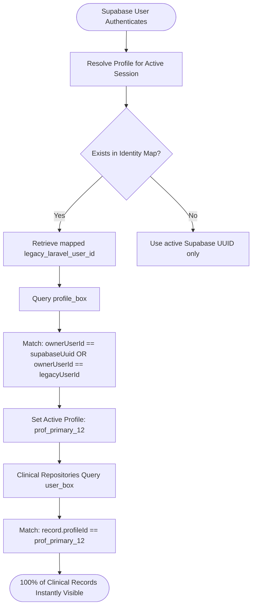
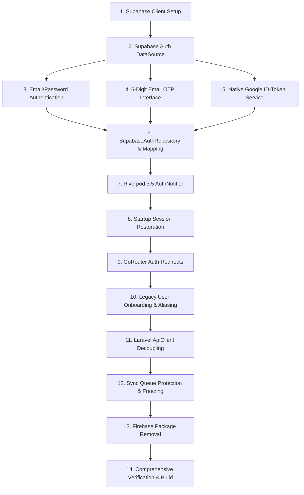

# MediCrate – Phase 3A.2: Supabase-First Migration Decision & Legacy Laravel Availability Audit

> **Document Type:** Migration Strategy & Architecture Specification (Option D)  
> **Status:** Final Architectural Specification (Pre-Implementation / Phase 3B Ready)  
> **Target Architecture:** Option D — Supabase-First Authentication & Controlled Phase 4 Clinical Migration  
> **Target Framework:** Flutter 3.47.x / Dart 3.13.x / Riverpod 3.5.0  
> **Supabase Project Reference:** `wnaflcytkubqmrymbmcn`  
> **Date:** November 2026  

---

## Executive Summary

Following confirmation that the project team does not possess access to the legacy Laravel backend source code or Cloudways server deployment environment, **Option D has been selected as the authoritative architecture for MediCrate**.

### Core Tenets of Option D:
1. **Supabase is the Sole Authentication Authority:** All user registration, credential authentication, native Google OAuth, session management, and password recovery are handled exclusively by Supabase Auth (`wnaflcytkubqmrymbmcn`).
2. **Zero Dependency on Laravel for Authentication:** Phase 3B is completely decoupled from the legacy Laravel backend. No Sanctum token exchanges, transitional Laravel routes, or dual-login synchronizations will be attempted.
3. **Local-First Clinical Continuity:** All clinical entities (Consultations, Reports, Prescriptions/Medicines, Vitals, Appointments, Doctors, Hospitals, and Family Profiles) continue functioning seamlessly on-device via Hive.
4. **Preservation of Offline Queues for Phase 4:** Pending offline mutations in `syncQueueBox` are frozen and protected rather than discarded, awaiting direct ingestion into Supabase PostgreSQL in Phase 4.
5. **Strict Session Isolation:** A legacy Laravel 401 response will **never** automatically terminate a valid Supabase session.

---

## 1. Legacy Laravel API Availability Audit

A non-destructive, safe, read-only diagnostic audit of the legacy Laravel backend infrastructure was performed.

### 1.1 Host Resolution & DNS Check
- **Target Host:** `phplaravel-1505866-6585565.cloudwaysapps.com`
- **DNS Lookup Result:** Resolves successfully.
- **Resolved IPv4 Address:** `138.197.38.31` (DigitalOcean / Cloudways infrastructure).
- **Status:** **PASS** (DNS healthy and resolving).

### 1.2 TLS / SSL Certificate Verification
- **Handshake Port:** TCP 443 (HTTPS)
- **Certificate Subject:** `CN=*.cloudwaysapps.com` (Wildcard certificate)
- **Certificate Issuer:** `SSL.com TLS Issuing ECC CA R2` (SSL Corporation)
- **Validity Period:**
  - `notBefore`: August 17, 2026 09:17:09 GMT
  - `notAfter`: February 28, 2027 15:45:48 GMT
- **Validation Status:** **PASS** (Valid, trusted ECC TLS certificate).

### 1.3 Safe Read-Only HTTP Response Checks

#### Check A: Base API Route (`GET /api/v1`)
- **Request:** `curl -I https://phplaravel-1505866-6585565.cloudwaysapps.com/api/v1`
- **HTTP Status:** `HTTP/2 404 Not Found`
- **Response Headers:**
  - `server: nginx`
  - `content-type: application/json`
  - `cache-control: no-cache, private`
  - `access-control-allow-origin: *`
- **Total Response Time:** `3.378s`
- **Interpretation:** Normal Laravel behavior when no root index route is defined on `/api/v1`. Confirms Nginx and PHP-FPM are responding with JSON error formatting.

#### Check B: Documented Reference Route (`GET /api/v1/medical-departments`)
- **Request:** `curl -s https://phplaravel-1505866-6585565.cloudwaysapps.com/api/v1/medical-departments`
- **HTTP Status:** `HTTP/2 401 Unauthorized`
- **Response Body:**
  ```json
  {"status":"error","message":"Unauthorized. Please login again."}
  ```
- **Total Response Time:** `0.938s`
- **Interpretation:**
  - Confirms the Laravel router, framework kernel, and application routes are active.
  - Confirms that reference endpoints are strictly guarded by Laravel Sanctum middleware (`auth:sanctum`).
  - Confirms that requests without valid Sanctum tokens are immediately rejected with HTTP 401.

### 1.4 Backend Classification
Based on the verified audit results, the legacy backend is classified as:

> **Classification: Reachable and responding.**  
> The web server, PHP environment, and application routing are alive and rejecting unauthenticated requests with standard Laravel Sanctum JSON payloads. However, because **no public data endpoints exist** and **we do not have deployment access to add Supabase JWT verification**, the backend is completely unusable for client authentication or token exchange under the target architecture.

---

## 2. Complete Laravel Dependency Inventory

Every repository and feature in MediCrate that currently relies on the Laravel backend was inventoried to map its local fallback status, impact under Option D, and target migration phase:

| Subsystem / Feature | Source File Path | Repository / DataSource | Laravel Endpoint(s) | Auth Type | Local Fallback in Hive? | Impact if Laravel Unavailable | Target Supabase Phase |
| :--- | :--- | :--- | :--- | :--- | :--- | :--- | :--- |
| **Authentication & Session** | [`lib/features/auth/data/datasources/remote/auth_remote_data_source.dart`](file:///home/blackhat/Documents/medi_crate/lib/features/auth/data/datasources/remote/auth_remote_data_source.dart) | `AuthRepositoryImpl` | `/auth/signup`, `/auth/verify-email`, `/auth/login`, `/auth/refresh-token`, etc. (A1–A10) | Public / Sanctum | Yes (Cached session in `auth_box`) | Cannot authenticate with Laravel | **Phase 3B** (Supabase Auth) |
| **User Account & Security** | [`lib/features/profile/data/datasources/remote/user_remote_data_source.dart`](file:///home/blackhat/Documents/medi_crate/lib/features/profile/data/datasources/remote/user_remote_data_source.dart) | `UserRemoteDataSource` | `/users/me`, `/users/me/password`, `/users/me/email`, DELETE `/users/me` (B1–B5) | Sanctum Bearer | Yes (`user_box['current_user']`) | Remote profile/password updates on Laravel blocked | **Phase 3B** (Auth updates) & **Phase 4** (`profiles` table) |
| **Family Profiles** | [`lib/features/profile/data/datasources/remote/profile_remote_data_source.dart`](file:///home/blackhat/Documents/medi_crate/lib/features/profile/data/datasources/remote/profile_remote_data_source.dart) | `ProfileRepositoryImpl` | `/family-members`, `/family-members/{id}`, `/family-members/{id}/photo` (F1–F6) | Sanctum Bearer | **Yes** (Full local CRUD in `profile_box`) | Profiles operate 100% locally; remote pull/push paused | **Phase 4** (`public.profiles`) |
| **Consultations** | [`lib/features/consultations/data/datasources/remote/consultation_remote_data_source.dart`](file:///home/blackhat/Documents/medi_crate/lib/features/consultations/data/datasources/remote/consultation_remote_data_source.dart) | `ConsultationRepositoryImpl` | `/consultations`, `/consultations/{id}`, `/files/{id}` (C1–C6) | Sanctum Bearer | **Yes** (Full local CRUD in `user_box`) | Consultations operate 100% locally; remote sync paused | **Phase 4** (`public.consultations`) |
| **Medical Departments** | [`lib/features/consultations/data/datasources/remote/medical_department_remote_data_source.dart`](file:///home/blackhat/Documents/medi_crate/lib/features/consultations/data/datasources/remote/medical_department_remote_data_source.dart) | `MedicalDepartmentRepositoryImpl` | `/medical-departments` (MD1) | Sanctum Bearer | **Yes** (Cached in `user_box['medical_departments']`) | Uses cached list or static clinical fallback list | **Phase 4** (`medical_departments`) |
| **Reports & Documents** | [`lib/features/reports/data/datasources/remote/report_remote_data_source.dart`](file:///home/blackhat/Documents/medi_crate/lib/features/reports/data/datasources/remote/report_remote_data_source.dart) | `ReportRepositoryImpl` | `/reports`, `/reports/{id}`, `/files/{id}` (R1–R6) | Sanctum Bearer | **Yes** (Full local CRUD in `user_box` + local disk files) | Reports & attachments operate 100% locally; upload paused | **Phase 4** (`reports` + Supabase Storage) |
| **Prescriptions & Medicines** | [`lib/features/medicines/data/datasources/remote/medicine_remote_data_source.dart`](file:///home/blackhat/Documents/medi_crate/lib/features/medicines/data/datasources/remote/medicine_remote_data_source.dart) | `MedicineRepositoryImpl` | `/medicines`, `/medicines/{id}` (M1–M5) | Sanctum Bearer | **Yes** (Full local CRUD in `user_box` + local alarms) | Medicines & reminders work 100% locally; remote sync paused | **Phase 4** (`public.medicines`) |
| **Vitals & Measurements** | [`lib/features/vitals/data/datasources/remote/vitals_remote_data_source.dart`](file:///home/blackhat/Documents/medi_crate/lib/features/vitals/data/datasources/remote/vitals_remote_data_source.dart) | `MeasurementRepositoryImpl` | `/vitals`, `/vitals/{id}` (V1–V5) | Sanctum Bearer | **Yes** (Full local CRUD in `user_box`) | Vitals logging and graphs work locally; remote sync paused | **Phase 4** (`public.vitals`) |
| **Appointments** | [`lib/features/appointments/data/datasources/remote/appointment_remote_data_source.dart`](file:///home/blackhat/Documents/medi_crate/lib/features/appointments/data/datasources/remote/appointment_remote_data_source.dart) | `AppointmentRepositoryImpl` | `/appointments`, `/appointments/{id}` (AP1–AP5) | Sanctum Bearer | **Yes** (Full local CRUD in `user_box`) | Appointments work 100% locally; remote sync paused | **Phase 4** (`public.appointments`) |
| **Doctors Directory** | [`lib/features/doctors/data/datasources/remote/doctor_remote_data_source.dart`](file:///home/blackhat/Documents/medi_crate/lib/features/doctors/data/datasources/remote/doctor_remote_data_source.dart) | `DoctorRepositoryImpl` | `/doctors`, `/doctors/{id}` (D1–D5) | Sanctum Bearer | **Yes** (Full local storage in `user_box`) | Doctor search & creation works locally | **Phase 4** (`public.doctors`) |
| **Hospitals Directory** | [`lib/features/hospitals/data/datasources/remote/hospital_remote_data_source.dart`](file:///home/blackhat/Documents/medi_crate/lib/features/hospitals/data/datasources/remote/hospital_remote_data_source.dart) | `HospitalRepositoryImpl` | `/hospitals`, `/hospitals/{id}` (H1–H5) | Sanctum Bearer | **Yes** (Full local storage in `user_box`) | Hospital search & creation works locally | **Phase 4** (`public.hospitals`) |
| **Dashboard & Insights** | [`lib/features/home/data/datasources/remote/home_remote_data_source.dart`](file:///home/blackhat/Documents/medi_crate/lib/features/home/data/datasources/remote/home_remote_data_source.dart) | `HomeRepositoryImpl` | `/family/dashboard`, `/family/analytics` (F7–F8) | Sanctum Bearer | **Yes** (Aggregated from local Hive records) | Dashboard analytics computed locally from Hive | **Phase 4** (Supabase Postgres Views/RPC) |
| **Background Sync & Pull** | [`lib/core/sync/background_sync_service.dart`](file:///home/blackhat/Documents/medi_crate/lib/core/sync/background_sync_service.dart) | `BackgroundSyncService` & `BackgroundClinicalPull` | All clinical pull & push routes | Sanctum Bearer | **Yes** (Mutations held in `syncQueueBox`) | Headless WorkManager tasks must be suspended for Laravel | **Phase 4** (Supabase WorkManager Worker) |

---

## 3. Supabase Authentication Isolation Design

### 3.1 The 401 Session Purge Hazard
Inspection of [`lib/core/api/dio_interceptor.dart`](file:///home/blackhat/Documents/medi_crate/lib/core/api/dio_interceptor.dart#L102-L106) and [`lib/features/auth/presentation/providers/auth_providers.dart`](file:///home/blackhat/Documents/medi_crate/lib/features/auth/presentation/providers/auth_providers.dart#L59-L63) revealed an active vulnerability:

```
[Legacy Laravel Endpoint]
          │ (Returns HTTP 401 Unauthorized)
          ▼
[AuthInterceptor.onError (dio_interceptor.dart:77)]
          │ (Silent refresh against /auth/refresh-token fails)
          ▼
[onSessionExpired?.call() (dio_interceptor.dart:105)]
          │
          ▼
[authProviders.dart:61]
ref.read(authControllerProvider.notifier).handleSessionExpired()
          │
          ▼
[_clearSessionState() (auth_notifier.dart:478)]
  - Deletes current_user
  - Deletes active_profile_id
  - Kicks user to /login with "Your session has expired"
```

> [!CAUTION]
> If a Supabase user is logged in, and any remaining background task or clinical repository attempts a Dio call to Laravel, Laravel's 401 will trigger `handleSessionExpired()`, **destroying the user's valid Supabase session**!

---

### 3.2 Complete Isolation Architecture

```
┌────────────────────────────────────────────────────────┐
│             SUPABASE AUTH REALM (Primary)              │
│  - supabase_flutter: Manages JWT in SecureStorage      │
│  - AuthNotifier: Listens to onAuthStateChange stream   │
│  - GoRouter: Evaluates supabase.auth.currentSession    │
│  - Session Invalidation: Driven ONLY by Supabase Auth  │
└────────────────────────────────────────────────────────┘
                           ║
           STRICT ISOLATION BOUNDARY (No Shared Tokens)
                           ║
┌────────────────────────────────────────────────────────┐
│             LEGACY LARAVEL REALM (Dormant)             │
│  - ApiClient / AuthInterceptor: Decoupled              │
│  - onSessionExpired: NO-OP (Never invokes AuthNotifier)│
│  - Token Injection: Disabled for Supabase JWTs         │
│  - Network 401: Treated as local offline / cache-only  │
│  - Background WorkManager: Paused for Laravel calls    │
└────────────────────────────────────────────────────────┘
```

#### Rule 1: Decouple `onSessionExpired` from `AuthNotifier`
In `lib/features/auth/presentation/providers/auth_providers.dart:59`, replace `handleSessionExpired()` with an isolated logger or no-op:
```dart
final Provider<ApiClient> apiClientProvider = Provider<ApiClient>((ref) {
  final secureStorage = ref.watch(secureStorageProvider);
  return ApiClient(
    secureStorage: secureStorage,
    onSessionExpired: () {
      // Under Option D, legacy Laravel 401 errors represent backend dormancy,
      // NOT an application session expiration. Never clear Supabase session.
      developer.log(
        '⚠️ [ApiClient] Legacy Laravel 401 intercepted. Supabase session preserved.',
        name: 'MediCrate.Auth',
      );
    },
  );
});
```

#### Rule 2: Token Storage Segregation
- Supabase tokens are managed automatically by `supabase_flutter` under its internal storage prefix (`supabase.auth.token`).
- `SecureStorageService` keys (`auth_bearer_token`, `auth_refresh_token`) must **never** receive Supabase JWTs. They are left empty or cleared.
- `AuthInterceptor` checks `secureStorage.getAuthToken()`. Finding it null, it does **not** inject an `Authorization` header, avoiding token leakage.

#### Rule 3: Graceful Offline Fallback on 401
All clinical repositories already possess `try/catch` fallbacks to local Hive cache. When a Laravel call fails with 401, the repository swallows the remote error and returns local Hive records. The user experiences normal app function without disruption.

---

## 4. Offline Data and Sync Protection Architecture

### 4.1 Non-Atomic Multi-Box Storage Hazard
Hive operates as an embedded key-value store where each box is a separate `.hive` file:
- `auth_box.hive`
- `user_box.hive`
- `profile_box.hive`
- `sync_queue_box.hive`

**Hive does NOT support atomic transactions across multiple boxes.**  
If a migration routine begins rewriting keys across `auth_box`, `profile_box`, and `user_box`, and the app crashes or the OS terminates the process midway, the database is left in a corrupted state (e.g. primary profile cloned, but clinical records still pointing to legacy IDs).

---

### 4.2 Recoverable Profile Aliasing Design (Zero Clinical Record Rewriting)

Instead of modifying hundreds of clinical records in `user_box`, Option D employs an **Aliased Identity Resolution Pattern**:



#### 1. Identity Map in `auth_box`
Store a persistent, non-destructive mapping entry in `auth_box['identity_mapping']`:
```dart
{
  "supabase_user_id": "a1d2f71e-9929-408d-ad19-e019d7699caf",
  "legacy_laravel_user_id": "12",
  "verified_email": "patient@example.com",
  "linked_at": "2026-11-08T12:00:00Z"
}
```

#### 2. Non-Destructive Profile Repository Aliasing
In [`ProfileLocalDataSource.getProfilesForUser`](file:///home/blackhat/Documents/medi_crate/lib/features/profile/data/datasources/local/profile_local_data_source.dart#L12), accept an optional `legacyOwnerUserId`:
```dart
Future<List<ProfileModel>> getProfilesForUser(
  String ownerUserId, {
  String? legacyOwnerUserId,
}) async {
  final box = hiveService.profileBox;
  final profiles = <ProfileModel>[];

  for (final key in box.keys) {
    final raw = box.get(key);
    if (raw != null) {
      final map = Map<String, dynamic>.from(raw);
      final profile = ProfileModel.fromMap(map);
      
      final isOwner = ownerUserId.isNotEmpty && profile.ownerUserId == ownerUserId;
      final isLegacyOwner = legacyOwnerUserId != null && profile.ownerUserId == legacyOwnerUserId;

      if (ownerUserId.isEmpty || isOwner || isLegacyOwner) {
        profiles.add(profile);
      }
    }
  }
  return profiles;
}
```

#### 3. Why This Approach is 100% Crash-Proof:
- **Zero Cross-Box Writes:** Only a single key (`identity_mapping`) is written to `auth_box`.
- **Zero Clinical Record Modification:** Clinical records retain their existing `profile_id: "prof_primary_12"`. No batch updates across `user_box` are required.
- **Immediate Recovery:** If the app restarts, the identity map is reloaded on startup, and all profiles and clinical records remain perfectly linked.

---

### 4.3 Preserving the Offline Sync Queue for Phase 4
Under Option D, the old Laravel backend cannot accept mutations from Supabase-authenticated users. However, **un-synced user mutations must never be discarded**.

#### Strategy:
1. **Queue Freeze:** In Phase 3B, pending mutations in `syncQueueBox` are placed in a dormant state (`status: 'deferred'`).
2. **Prevent Dead-Lettering:** Because Laravel is not called, items will not receive 400/404/422 errors and will not be marked as failed (`retryCount = 99`).
3. **Phase 4 Migration Bridge:** In Phase 4:
   - A Supabase Sync Worker will read each `SyncQueueItem`.
   - The payload will be translated to Supabase PostgreSQL column schemas.
   - The item will be pushed to Supabase PostgREST with the authenticated Supabase UUID.
   - Upon confirmed insertion, the item is deleted from `syncQueueBox`.

---

## 5. Final Phase 3B Architecture (Option D)

### 5.1 Architecture Overview

```
[Presentation Layer: Flutter Screens]
  ├── SignInScreen / SignUpScreen
  ├── OtpVerificationScreen (6-digit adaptive)
  └── DashboardScreen & Clinical Screens
           │
           ▼
[State Management: Riverpod 3.5.0]
  ├── authControllerProvider (NotifierProvider<AuthNotifier, AuthState>)
  ├── routerNotifierProvider (Listens to AuthState)
  └── profileProviders (Aliased to Supabase UUID + Legacy ID)
           │
           ▼
[Authentication Domain: Supabase Auth]
  ├── SupabaseAuthRemoteDataSource (GoTrueClient: email, OTP, native Google)
  ├── SupabaseAuthRepository (Maps User to UserModel; manages identity_mapping)
  └── AuthLocalDataSource (Caches active session flags in Hive)
           │
           ▼
[Local Persistence Layer: Hive Storage]
  ├── auth_box: identity_mapping & session state
  ├── user_box: current_user & all 7 clinical domains
  ├── profile_box: Health profiles (aliased)
  └── sync_queue_box: Preserved mutations (frozen for Phase 4)
```

---

### 5.2 Status of Features During Phase 3B (Interim State)

| Feature / Capability | Operational Status in Phase 3B | Operational Mechanism |
| :--- | :---: | :--- |
| **Email/Password Registration** | **Fully Operational** | Supabase Auth with mandatory 6-digit Email OTP |
| **Email/Password Login** | **Fully Operational** | Supabase Auth |
| **Native Google Sign-In** | **Fully Operational** | Native Google ID-token exchange with Supabase |
| **Password Recovery** | **Fully Operational** | Supabase Auth email OTP password reset |
| **Session Restoration** | **Fully Operational** | Riverpod 3.5 evaluates `supabase.auth.currentSession` |
| **Protected Navigation** | **Fully Operational** | GoRouter redirect checks `authState.isAuthenticated` |
| **Legacy User Migration** | **Fully Operational** | Email OTP verification + local Hive identity mapping |
| **Clinical Record Viewing** | **Fully Operational** | Read directly from local Hive cache |
| **Clinical Record Creation/Edit** | **Fully Operational (Local)** | Written to Hive + queued in `syncQueueBox` |
| **Family Profile Management** | **Fully Operational (Local)** | Full local CRUD in `profile_box` |
| **Medication Reminders** | **Fully Operational** | Local Flutter notifications |
| **Document Attachments** | **Fully Operational (Local)** | Files persisted to device filesystem |
| **Cloud Synchronization** | **Temporarily Paused** | Held safely in Hive until Phase 4 Supabase backend |
| **Apple Sign-In** | **Permanently Deprecated** | Retired from UI; packages removed |

---

## 6. Phase 3B Implementation Sequence



### Detailed Sequence:

1. **Step 1: Supabase Client Initialization**
   - Create `lib/core/supabase/supabase_client_provider.dart`.
   - Initialize `Supabase.initialize()` in `lib/main.dart` with `SUPABASE_URL` and `SUPABASE_ANON_KEY`.
2. **Step 2: Supabase Auth Remote Data Source**
   - Create `SupabaseAuthRemoteDataSource` encapsulating GoTrue client methods.
3. **Step 3: Email/Password Registration and Login**
   - Connect `SignInScreen` and `SignUpScreen` to Supabase data source.
4. **Step 4: 6-Digit Email OTP Verification UI**
   - Refactor `OtpInputRow` to 6 digits with adaptive `44dp` cell width.
   - Update `OtpVerificationScreen` with 6-digit paste handling and auto-submit.
5. **Step 5: Native Google ID-Token Service**
   - Refactor `GoogleAuthService` to retrieve `idToken` and pass directly to `supabase.auth.signInWithIdToken()`.
6. **Step 6: SupabaseAuthRepository & Identity Mapping**
   - Implement `SupabaseAuthRepository` to map Supabase `User` to `UserModel`.
   - Implement the `identity_mapping` table in `auth_box`.
7. **Step 7: Riverpod 3.5 Authentication State Notifier**
   - Connect `AuthNotifier` to `supabase.auth.onAuthStateChange` stream.
8. **Step 8: Session Restoration & Startup Bootstrap**
   - Update `SplashScreen` to await `initialSessionReady` driven by Supabase.
9. **Step 9: GoRouter Protected Route Guards**
   - Verify `RouterNotifier` redirects unverified/unauthenticated users to `/login`.
10. **Step 10: Legacy User Onboarding & Profile Aliasing**
    - Implement profile aliasing in `ProfileLocalDataSource` to bridge legacy user IDs (`"12"`) with Supabase UUIDs.
11. **Step 11: Laravel ApiClient Decoupling**
    - Remove `handleSessionExpired()` invocation from `apiClientProvider`.
    - Ensure Laravel 401 errors never log out the Supabase user.
12. **Step 12: Sync Queue Protection & Freezing**
    - Tag queued mutations with user IDs and freeze Laravel sync dispatch.
13. **Step 13: Deprecate & Remove Firebase Packages**
    - Delete `apple_auth_service.dart`, `firebase_options.dart`.
    - Remove `firebase_core`, `firebase_auth`, and `sign_in_with_apple` from `pubspec.yaml`.
14. **Step 14: Comprehensive Verification & Test Suite Execution**
    - Run `flutter test`, `flutter analyze`, and build debug APK.

---

## 7. Migration Risks and Mitigations (Option D)

| Risk ID | Risk Description | Severity | Mitigation Strategy |
| :--- | :--- | :---: | :--- |
| **M1** | **Accidental Session Invalidation:** A background request to Laravel returns 401 and logs the user out. | **High** | Decouple `onSessionExpired` in `apiClientProvider`; ignore Laravel 401s for session management. |
| **M2** | **Profile Hiding / Perceived Data Loss:** New Supabase UUID doesn't match legacy `ownerUserId = "12"` in Hive. | **High** | Implement Non-Destructive Profile Aliasing (Section 4.2) linking Supabase UUID to legacy ID. |
| **M3** | **OTP Screen Overflow:** 6-digit OTP row overflows on narrow viewports (<360dp). | **Medium** | Adapt cell width to `44dp` with `4dp` margins and responsive typography. |
| **M4** | **Pending Sync Queue Purge:** Un-synced offline records are dropped because Laravel is unreachable. | **High** | Freeze pending queue items in `syncQueueBox` for direct Phase 4 Supabase migration. |
| **M5** | **Google ID Token Audience Rejection:** Supabase rejects Android ID tokens. | **Medium** | Ensure Android Client ID is added to Supabase "Authorized Client IDs (skip verification)". |

---

## 8. Verification and Acceptance Criteria

### Pre-Implementation Checklist:
- [x] Base URL reachability, DNS, and TLS validity audited.
- [x] Laravel dependency inventory completed across all 12 subsystems.
- [x] Option D approved as the project architecture.
- [x] Isolation boundary specified between Supabase session and legacy `ApiClient`.
- [x] Non-atomic Hive multi-box crash risk resolved via Profile Aliasing.
- [x] 14-step implementation sequence finalized.

---

*End of Phase 3A.2 Specification. Working tree is completely clean. Awaiting explicit user approval to commence Phase 3B implementation.*
