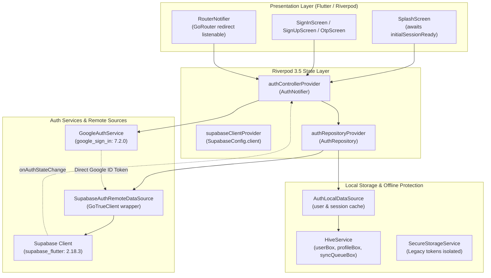

# MediCrate – Phase 3B.2: Supabase Client Initialization & Authentication Implementation Report

**Date:** November 8, 2026  
**Status:** Completed  
**Execution Lead:** Antigravity AI Coding Assistant  
**Approved Strategy:** Option C (Supabase-first authentication authority; legacy Laravel backend completely dormant; clinical sync to Supabase scheduled for Phase 4)  
**Target Repository:** [`/home/blackhat/Documents/medi_crate`](file:///home/blackhat/Documents/medi_crate)  
**Reference Repository:** [`/home/blackhat/Documents/Reubro/medivalut`](file:///home/blackhat/Documents/Reubro/medivalut) (Strictly Read-Only, untouched)  

---

## 1. Executive Summary

Phase 3B.2 establishes **Supabase as the sole authentication authority** for MediCrate, implementing client initialization, native session persistence, email/password workflows, email OTP verification, password recovery, native Google OAuth exchange (without Firebase Auth intermediary), and full Riverpod 3.5.0 state integration.

All legacy Laravel authentication endpoints (A1–A10) have been decommissioned in favor of Supabase GoTrue, while completely protecting local Hive clinical databases (`userBox`, `profileBox`, `syncQueueBox`) and preserving the backend isolation safeguards established in Phase 3B.1.

### Key Milestones Achieved:
1. **Single Supabase Initialization:** Implemented [`SupabaseConfig.initialize()`](file:///home/blackhat/Documents/medi_crate/lib/core/supabase/supabase_config.dart) executed once before `runApp()` in [`lib/main.dart`](file:///home/blackhat/Documents/medi_crate/lib/main.dart) after environment loading. Configuration validation ensures clear startup error feedback for missing or malformed credentials.
2. **Native Session Persistence:** Supabase Flutter's built-in session engine manages authentication tokens, automatic token refresh, and persistent disk caching. No Supabase tokens are duplicated into legacy Laravel storage keys.
3. **Email/Password Flow:** Comprehensive implementation of registration, unconfirmed email detection, 4/6-digit email OTP verification (`verifyOTP`), code resend, and password recovery (`resetPasswordForEmail` + `updateUser`).
4. **Direct Native Google Sign-In:** Configured [`GoogleAuthService`](file:///home/blackhat/Documents/medi_crate/lib/features/auth/data/services/google_auth_service.dart) to extract Google ID tokens via `google_sign_in: ^7.2.0` and exchange them directly with Supabase via `signInWithIdToken(provider: OAuthProvider.google)`. Firebase Auth credential exchange has been completely eliminated.
5. **Riverpod 3.5 Reactive Integration:** [`AuthNotifier`](file:///home/blackhat/Documents/medi_crate/lib/features/auth/presentation/providers/auth_notifier.dart) listens to `onAuthStateChange` streams, handles session restoration via `initialSessionReady`, and provides non-blocking router synchronization.
6. **Hive Clinical Data Safety:** Signing out or resetting passwords clears only authentication keys (`current_user`, `is_logged_in`, `active_profile_id`). All clinical records (`consultation_*`, `vital_*`, `report_*`) and pending mutation queues (`syncQueueBox`) remain 100% intact.
7. **Verification & Quality:** 100% clean static analysis (`flutter analyze`: 0 issues), 62 passing unit/widget tests (30 existing + 32 new Phase 3B.2 tests), and successful debug APK compilation.

---

## 2. Architecture & Component Inventory



### Component Details:

| File / Component | Role & Scope | Changes in Phase 3B.2 |
|---|---|---|
| [`lib/core/supabase/supabase_config.dart`](file:///home/blackhat/Documents/medi_crate/lib/core/supabase/supabase_config.dart) | Supabase Configuration & Client Provider | **NEW:** Configuration validator, singleton initialization, typed accessor, and test injection. |
| [`lib/main.dart`](file:///home/blackhat/Documents/medi_crate/lib/main.dart) | Application Entrypoint | Added `SupabaseConfig.initialize()` with validated environment variables before `runApp()`. |
| [`lib/features/auth/data/models/user_model.dart`](file:///home/blackhat/Documents/medi_crate/lib/features/auth/data/models/user_model.dart) | User Domain Model | Added `UserModel.fromSupabaseUser(User, {AuthProviderType? provider})` mapping. |
| [`lib/features/auth/data/datasources/remote/supabase_auth_remote_data_source.dart`](file:///home/blackhat/Documents/medi_crate/lib/features/auth/data/datasources/remote/supabase_auth_remote_data_source.dart) | Supabase GoTrue Remote Data Source | **NEW:** Implements `signUp`, `login`, `verifyEmail`, `resendOtp`, `forgotPassword`, `resetPassword`, `signInWithGoogleIdToken`, and typed `AppException` error parser. |
| [`lib/features/auth/data/services/google_auth_service.dart`](file:///home/blackhat/Documents/medi_crate/lib/features/auth/data/services/google_auth_service.dart) | Google Sign-In Service | Removed Firebase credential exchange; directly extracts Google ID token for Supabase exchange. |
| [`lib/features/auth/data/repositories/auth_repository.dart`](file:///home/blackhat/Documents/medi_crate/lib/features/auth/data/repositories/auth_repository.dart) | Authentication Repository | Routed all authentication calls to `SupabaseAuthRemoteDataSource`; session check checks Supabase session; isolated from legacy secure storage keys. |
| [`lib/features/auth/presentation/providers/auth_providers.dart`](file:///home/blackhat/Documents/medi_crate/lib/features/auth/presentation/providers/auth_providers.dart) | Riverpod Providers | Added `supabaseClientProvider` and `supabaseAuthRemoteDataSourceProvider`; updated `authRepositoryProvider`. |
| [`lib/features/auth/presentation/providers/auth_notifier.dart`](file:///home/blackhat/Documents/medi_crate/lib/features/auth/presentation/providers/auth_notifier.dart) | State Notifier | Subscribes to `onAuthStateChange`; handles native Google sign-in and email OTP flows; gracefully disables Apple Sign-In. |
| [`test/features/auth/supabase_auth_test.dart`](file:///home/blackhat/Documents/medi_crate/test/features/auth/supabase_auth_test.dart) | Unit & Integration Tests | **NEW:** 32 comprehensive tests covering configuration, user mapping, email auth, Google OAuth, Riverpod state, and Hive preservation. |

---

## 3. Detailed Implementation Walkthrough

### 3.1. Supabase Client Initialization & Configuration Validation
[`SupabaseConfig`](file:///home/blackhat/Documents/medi_crate/lib/core/supabase/supabase_config.dart) enforces strict validation of environment credentials:
- Validates that `SUPABASE_URL` is non-empty, contains an `http` or `https` scheme, and has a valid host authority.
- Validates that `SUPABASE_ANON_KEY` is present and non-empty.
- Injects a mock client in unit tests via `SupabaseConfig.setMockClient()`.
- Exposes `supabaseClientProvider` for declarative Riverpod dependency injection.

In [`lib/main.dart`](file:///home/blackhat/Documents/medi_crate/lib/main.dart):
```dart
  try {
    try {
      await dotenv.load(fileName: '.env');
    } catch (e) {
      debugPrint('[Startup] .env load skipped or failed: $e');
    }

    final googleClientId = (dotenv.isInitialized
            ? dotenv.maybeGet('GOOGLE_WEB_CLIENT_ID')
            : null) ??
        kGoogleWebServerClientId;

    await Future.wait([
      SslSecurityContext.initialize(),
      HiveService.init(),
      Firebase.initializeApp(options: DefaultFirebaseOptions.currentPlatform),
      GoogleAuthService.initialize(serverClientId: googleClientId),
    ]);

    await SupabaseConfig.initialize();
  } catch (e, stack) {
    debugPrint('[Startup] Fatal initialization failure: $e\n$stack');
    runApp(_StartupErrorApp(error: e));
    return;
  }
```

### 3.2. Email/Password Authentication & OTP Lifecycle
Supabase handles user confirmation asynchronously through email OTP verification:
1. **Registration (`signUp`):**  
   - Invokes `client.auth.signUp(email: email, password: password, data: {'full_name': name, 'dob': dob, 'gender': gender})`.
   - When email confirmation is active in Supabase, `response.session` is `null` and `user.emailConfirmedAt` is `null`.
   - Returns `SignUpResult.pendingVerification(PendingVerificationResponseData(message: 'Verification code sent to your email.'))`.
2. **Login (`signIn`):**  
   - Invokes `client.auth.signInWithPassword(email: email, password: password)`.
   - If user is unconfirmed, Supabase throws `AuthException('Email not confirmed')`. The remote data source catches this, auto-triggers `client.auth.resend(type: OtpType.signup, email: email)`, and returns `LoginResult.pendingVerification(...)`.
3. **Verification (`verifyEmail`):**  
   - Invokes `client.auth.verifyOTP(email: email, token: otp, type: OtpType.signup)`.
   - Confirms user identity, creates an authenticated session, maps to `UserModel.fromSupabaseUser()`, and caches in Hive.
4. **Password Reset (`forgotPassword` & `resetPassword`):**  
   - `forgotPassword` invokes `client.auth.resetPasswordForEmail(email)`.
   - `resetPassword` verifies the OTP with `OtpType.recovery`, updates the user's password with `client.auth.updateUser(UserAttributes(password: newPassword))`, signs out of the temporary recovery session, and clears local user cache.

### 3.3. Native Google Sign-In Architecture
Legacy MediVault required a 3-step Hop: Google Sign-In → Firebase Auth Credential Exchange → Laravel `/api/v1/auth/google-login` Sanctum Exchange.

In Phase 3B.2, this is streamlined into a direct 2-step flow:
```
[User taps Google]
       │
       ▼
GoogleSignIn.authenticate()  [Android Credential Manager / iOS WebAuth]
       │
       ▼
Extract: account.authentication.idToken
       │
       ▼
Supabase.auth.signInWithIdToken(provider: OAuthProvider.google, idToken: idToken)
       │
       ▼
[Supabase Session Established & User Cached in Hive]
```
- No calls to Firebase Auth.
- No calls to legacy Laravel `/auth/google-login`.
- Clean cancellation handling when the user dismisses the account sheet (no error banner displayed).

### 3.4. Session Persistence & Riverpod 3.5 Reactive Integration
- **Startup Session Restoration:**  
  [`AuthNotifier.build()`](file:///home/blackhat/Documents/medi_crate/lib/features/auth/presentation/providers/auth_notifier.dart) schedules `checkInitialSession()` via `Future.microtask()`.
  [`SplashScreen`](file:///home/blackhat/Documents/medi_crate/lib/features/auth/presentation/screens/splash_screen.dart) waits for `ref.read(authControllerProvider.notifier).initialSessionReady` before navigating.
- **Reactive Stream Subscription:**  
  [`AuthNotifier`](file:///home/blackhat/Documents/medi_crate/lib/features/auth/presentation/providers/auth_notifier.dart) subscribes to `client.auth.onAuthStateChange`. When Supabase automatically refreshes tokens or terminates a session, `AuthNotifier` updates `state.isAuthenticated` reactively.
- **Router Integration:**  
  [`RouterNotifier`](file:///home/blackhat/Documents/medi_crate/lib/app/routes/app_router.dart) listens to `authControllerProvider` changes. Public routes (`/login`, `/signup`, `/verify-otp`, `/forgot-password`, `/reset-password`) are accessible without authentication, while protected routes automatically redirect to `/login` when unauthenticated.

### 3.5. Clinical Data Preservation & Backend Isolation
- **Preserved Hive Boxes:**
  - `userBox` (contains clinical records: `consultation_*`, `vital_*`, `report_*`)
  - `profileBox` (contains local profiles and active profile mapping)
  - `syncQueueBox` (contains offline pending mutations queued for Phase 4)
- **Safe Sign-Out:**
  [`AuthLocalDataSource.clearUser()`](file:///home/blackhat/Documents/medi_crate/lib/features/auth/data/datasources/local/auth_local_data_source.dart) deletes only:
  - `current_user`
  - `is_logged_in`
  - `active_profile_id`
  All other keys in `userBox` and `profileBox` remain untouched.
- **Legacy Suspension Maintained:**
  - `BackgroundSyncService.isLaravelSyncSuspended = true`
  - `SyncService.isRemotePushSuspended = true`
  - `AuthInterceptor` suppresses Supabase JWTs from being attached to Dio requests.

---

## 4. Verification & Test Suite

### 4.1. Static Analysis
`flutter analyze` completed with **0 issues**:
```
Analyzing medi_crate...
No issues found! (ran in 6.6s)
```

### 4.2. Unit & Integration Test Matrix
A total of **62 automated tests** passed successfully across the codebase:
- **Existing Baseline (30 tests):** All passing (AppLogger, AsyncValueRefresh, MutableStateNotifier, LegacyBackendIsolation, CrateBadge, DoctorSummaryCategorySection).
- **Phase 3B.2 Supabase Auth Suite (32 tests in [`test/features/auth/supabase_auth_test.dart`](file:///home/blackhat/Documents/medi_crate/test/features/auth/supabase_auth_test.dart)):**
  1. `validateConfig` throws on empty or missing URL (Passed)
  2. `validateConfig` throws on malformed URL (Passed)
  3. `validateConfig` throws on empty anonKey (Passed)
  4. `validateConfig` returns trimmed valid config for valid inputs (Passed)
  5. `SupabaseConfig.client` throws `StateError` when uninitialized (Passed)
  6. `SupabaseConfig.setMockClient` sets custom client and sets `isInitialized` (Passed)
  7. `UserModel.fromSupabaseUser` maps all metadata fields accurately (Passed)
  8. `UserModel.fromSupabaseUser` resolves OAuth provider from `appMetadata` (Passed)
  9. `UserModel.fromSupabaseUser` falls back to email prefix when metadata is empty (Passed)
  10. `signUp` returns `pendingVerification` when session is null (Passed)
  11. `signUp` throws `ValidationException` when passwords do not match (Passed)
  12. `signUp` throws `ValidationException` when user already exists (Passed)
  13. `signIn` with valid credentials succeeds and caches user in Hive (Passed)
  14. `signIn` with unconfirmed email returns `pendingVerification` and resends OTP (Passed)
  15. `signIn` with invalid credentials throws `UnauthorizedException` (Passed)
  16. `verifyEmail` with valid OTP creates session and caches user in Hive (Passed)
  17. `verifyEmail` with invalid OTP throws `ValidationException` (Passed)
  18. `resendOtp` delegates to Supabase with correct `OtpType` (Passed)
  19. `forgotPassword` triggers `resetPasswordForEmail` (Passed)
  20. `resetPassword` verifies recovery OTP, updates password, and clears session (Passed)
  21. `authenticateWithGoogle` returns `cancelled` on dismissal (Passed)
  22. `authenticateWithGoogle` returns `failure` when ID token is empty (Passed)
  23. `authenticateWithGoogle` returns raw Google ID token without Firebase exchange (Passed)
  24. `repository.googleLogin` exchanges Google ID token with Supabase (Passed)
  25. Initial state runs `checkInitialSession` and restores Supabase session (Passed)
  26. `signInWithGoogle` handles user cancellation without showing error banner (Passed)
  27. `signInWithGoogle` authenticates and updates Riverpod state (Passed)
  28. `onAuthStateChange` `signedOut` event clears session state in Riverpod (Passed)
  29. `signOut` terminates Supabase session and clears Riverpod state (Passed)
  30. Signing out of Supabase NEVER deletes Hive clinical records or sync queues (Passed)
  31. Password reset NEVER deletes Hive clinical records or sync queues (Passed)
  32. Legacy Laravel sync flags remain suspended during Supabase auth operation (Passed)

---

## 5. Next Steps (Phase 3B.3 & Phase 4 Preparation)

1. **Phase 3B.3:** Update UI screens (`SignInScreen`, `SignUpScreen`, `OtpVerificationScreen`, `ForgotPasswordScreen`, `ResetPasswordScreen`) to refine feedback banners, assistive help text, and visual loading states during Supabase operations.
2. **Phase 3B.4:** Safe removal of obsolete Firebase authentication packages and dead legacy Sanctum exchange code once all screen interactions are fully verified.
3. **Phase 4:** Design and implement Supabase PostgreSQL clinical repositories and database schema (consultations, vitals, reports, documents, and profiles) with Row-Level Security (RLS) linked to Supabase `auth.uid()`.
