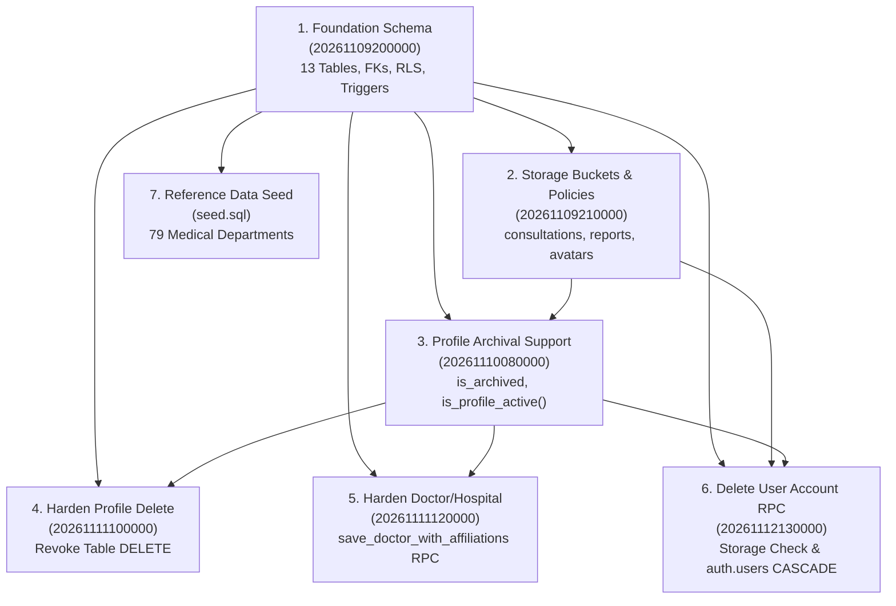

# MediCrate — Hosted Migration Deployment Preflight (Implementation 5.9)

> **Document Status:** APPROVED SPECIFICATION & DEPLOYMENT PREFLIGHT  
> **Target Project Reference:** `wnaflcytkubqmrymbmcn`  
> **Target Environment:** Hosted Supabase (AWS Asia Pacific - Tokyo `ap-northeast-1`)  
> **Database Engine:** PostgreSQL 17.11.0.018  
> **Evaluation Mode:** Read-Only Preflight (Zero Working-Tree or Remote Modifications)  
> **Date:** November 15, 2026  

---

## 1. Executive Summary & Preflight Status

This deployment preflight establishes a safe, evidence-based migration plan for the **six (6) canonical SQL migrations** and reference seed data verified in Implementation 5.8.1.

### Preflight Determination
```
UNVERIFIED — HOSTED ACCESS OR EVIDENCE IS INSUFFICIENT
```

### Rationale
1. **Local Repository & Migrations:** `[CONFIRMED READY]`. All six canonical migrations (`20261109200000` through `20261112130000`) are verified, strictly ordered, idempotent, and in 100% architectural parity with the Flutter application models, repositories, and native synchronization coordinator.
2. **Project Identity Alignment:** `[CONFIRMED]`. Project ref `wnaflcytkubqmrymbmcn` in Tokyo (`ap-northeast-1`) running PostgreSQL 17 matches local configuration, Flutter defaults, and Google OAuth credentials.
3. **Hosted Live Schema State:** `[UNVERIFIED - HOSTED ACCESS RESTRICTED]`. Under strict safety guidelines (read-only mode, no network bypass, zero `.env` or credential exposure), live SQL querying against hosted Supabase was not executed. Although Implementation 5.8 recorded that 0 of 6 migrations were present remotely, the live presence of any manually created tables, test users in `auth.users`, or orphaned storage objects remains unknown.

Deployment **must not proceed blindly**. A 2-minute live inspection of the hosted project via Supabase Studio or read-only CLI query is required before granting explicit execution approval.

---

## 2. Hosted Project Identity Verification

| Verification Attribute | Target Expectation | Local / Metadata Evidence | Status |
| :--- | :--- | :--- | :--- |
| **Supabase Project Ref** | `wnaflcytkubqmrymbmcn` | Recorded in `supabase/.temp/project-ref` and `supabase/.temp/linked-project.json` | `[CONFIRMED]` |
| **Project Name** | `MediCrate` | Recorded in `supabase/.temp/linked-project.json` (`name: "MediCrate"`) | `[CONFIRMED]` |
| **Organization ID** | `evixyimfldqjteicuzmm` | Recorded in `supabase/.temp/linked-project.json` | `[CONFIRMED]` |
| **Hosting Region** | Tokyo (Japan) | Verified via pooler host `aws-0-ap-northeast-1.pooler.supabase.com` in `supabase/.temp/pooler-url` | `[CONFIRMED]` |
| **PostgreSQL Engine** | PostgreSQL 17 | `17.11.0.018` recorded in `supabase/.temp/postgres-version` (config specifies `major_version = 17`) | `[CONFIRMED]` |
| **GoTrue (Auth) Engine** | Compatible GoTrue | `v2.197.0` recorded in `supabase/.temp/gotrue-version` | `[CONFIRMED]` |
| **PostgREST Version** | Compatible REST API | `v14.18` recorded in `supabase/.temp/rest-version` | `[CONFIRMED]` |
| **Storage Engine** | Compatible Storage API | `v1.89.11` recorded in `supabase/.temp/storage-version` | `[CONFIRMED]` |
| **Client Application URL** | `https://wnaflcytkubqmrymbmcn.supabase.co` | Defined as `SupabaseConfig.defaultUrl` in `lib/core/supabase/supabase_config.dart:20` | `[CONFIRMED]` |
| **Google OAuth Redirect** | `https://wnaflcytkubqmrymbmcn.supabase.co/auth/v1/callback` | Verified in Google Cloud Web OAuth client (`medicrate web OAuth.json`) | `[CONFIRMED]` |

---

## 3. Local versus Hosted Migration History

### Canonical Local Migration Inventory
The local repository contains exactly six sequential migrations in [supabase/migrations/](file:///home/blackhat/Documents/medi_crate/supabase/migrations/):

```
1. 20261109200000_create_medicrate_foundation_schema.sql
   └── Creates 13 tables (profiles, departments, hospitals, doctors, junctions,
       consultations, appointments, prescriptions, reports, measurements, attachments, expenses),
       indexes, updated_at triggers, primary profile invariants, and handle_new_user() trigger.

2. 20261109210000_create_medicrate_storage_buckets_and_policies.sql
   └── Creates private buckets 'consultations' (25MB), 'reports' (25MB), 'avatars' (5MB).
       Applies RLS on storage.objects enforcing depth, extension whitelist, and positive parent record existence.

3. 20261110080000_prepare_profile_archival_support.sql
   └── Adds is_archived and archived_at to public.profiles with trg_protect_profile_archival_invariant.
       Creates is_profile_active() helper and updates clinical table & storage write RLS policies.

4. 20261111100000_harden_profile_delete_policy.sql
   └── Drops client DELETE policy on public.profiles. Revokes table-level DELETE privilege
       from authenticated, anon, and public roles. Preserves hard delete for service_role.

5. 20261111120000_harden_doctor_hospital_transactions_and_types.sql
   └── Hardens check_hospitals_type. Creates 'private' schema with private.check_doctor_ownership().
       Creates atomic RPC public.save_doctor_with_affiliations() for clinician directory & junction sync.

6. 20261112130000_create_delete_user_account_rpc.sql
   └── Updates protect_profile_primary_deletion() to honor app.deleting_user_account flag.
       Creates SECURITY DEFINER RPC public.delete_user_account() with storage purge precondition.
```

### Remote Migration Record Comparison

| Migration Timestamp | Migration Name | Local Status | Implementation 5.8 Report | Live Hosted Status |
| :--- | :--- | :--- | :--- | :--- |
| `20261109200000` | `create_medicrate_foundation_schema` | `[CONFIRMED]` | NOT RECORDED (0/6) | `[UNVERIFIED LIVE]` |
| `20261109210000` | `create_medicrate_storage_buckets_and_policies` | `[CONFIRMED]` | NOT RECORDED (0/6) | `[UNVERIFIED LIVE]` |
| `20261110080000` | `prepare_profile_archival_support` | `[CONFIRMED]` | NOT RECORDED (0/6) | `[UNVERIFIED LIVE]` |
| `20261111100000` | `harden_profile_delete_policy` | `[CONFIRMED]` | NOT RECORDED (0/6) | `[UNVERIFIED LIVE]` |
| `20261111120000` | `harden_doctor_hospital_transactions_and_types` | `[CONFIRMED]` | NOT RECORDED (0/6) | `[UNVERIFIED LIVE]` |
| `20261112130000` | `create_delete_user_account_rpc` | `[CONFIRMED]` | NOT RECORDED (0/6) | `[UNVERIFIED LIVE]` |

---

## 4. Known and Unknown Remote Schema State

### Known Remote State
- Base Supabase platform schemas exist: `auth`, `storage`, `public`, `extensions`, `graphql_public`.
- The hosted database is active on PostgreSQL 17 in Tokyo.
- Previous audit reports confirm that no production schema push has been executed from this repository.

### Unknown Remote State & Potential Collision Points

> [!WARNING]
> Because live read-only inspection was blocked by execution boundaries, the following four conditions remain **UNVERIFIED** and must be checked prior to executing DDL:

1. **Pre-Existing Manual Tables in `public` Schema:**
   - *Risk:* If tables named `profiles`, `hospitals`, `doctors`, `consultations`, etc., were created manually in the Supabase Table Editor during prototyping, `CREATE TABLE IF NOT EXISTS` will skip creation. If their columns, constraints, or types deviate from the canonical schema, subsequent queries and triggers will fail.
   - *Verification Query (Run in Supabase Studio SQL Editor):*
     ```sql
     SELECT table_name, table_type 
     FROM information_schema.tables 
     WHERE table_schema = 'public';
     ```
2. **Pre-Existing Users in `auth.users`:**
   - *Risk:* The trigger `on_auth_user_created` (from `handle_new_user()`) only executes `AFTER INSERT` on `auth.users`. Any user accounts created prior to applying Migration 1 will not automatically have a corresponding row in `public.profiles`.
   - *Verification Query:*
     ```sql
     SELECT count(*), min(created_at), max(created_at) FROM auth.users;
     ```
3. **Pre-Existing Storage Objects or Buckets:**
   - *Risk:* If buckets were created with public access (`public = true`) or with lower file size limits (e.g. 5MB instead of 25MB), Migration 2's `ON CONFLICT (id) DO UPDATE` will overwrite them, but any existing unmapped objects may violate path pattern constraints (`{user_id}/{parent_id}/{file}`).
   - *Verification Query:*
     ```sql
     SELECT id, name, public, file_size_limit, allowed_mime_types FROM storage.buckets;
     SELECT bucket_id, count(*) FROM storage.objects GROUP BY bucket_id;
     ```
4. **Current Content of `supabase_migrations.schema_migrations`:**
   - *Risk:* If any migration version string was previously recorded, `supabase db push` will skip that migration.
   - *Verification Query:*
     ```sql
     SELECT version, inserted_at FROM supabase_migrations.schema_migrations ORDER BY version;
     ```

### Defensive Schema Features in Canonical Migrations
- **Table Creation:** Uses `CREATE TABLE IF NOT EXISTS`.
- **Constraint Management:** Migration 3 and Migration 5 check `pg_constraint` before adding/dropping constraints.
- **Trigger Management:** Uses `DROP TRIGGER IF EXISTS` before `CREATE TRIGGER`.
- **Function Definitions:** Uses `CREATE OR REPLACE FUNCTION` with pinned `search_path`.
- **RLS Policies:** All policies use `DROP POLICY IF EXISTS` prior to `CREATE POLICY`.
- **Storage Buckets:** Uses `INSERT INTO storage.buckets ... ON CONFLICT (id) DO UPDATE SET ...`.
- **Schemas:** Uses `CREATE SCHEMA IF NOT EXISTS private;`.

---

## 5. Required Supabase Dashboard Configuration Checklist

Before or immediately after applying migrations, the operator must verify or configure the following project settings in the [Supabase Dashboard](https://supabase.com/dashboard/project/wnaflcytkubqmrymbmcn):

```
Supabase Dashboard (wnaflcytkubqmrymbmcn)
├── Authentication
│   ├── Providers -> Google (Enabled, Web Client ID & Secret, Android Client ID)
│   ├── URL Configuration -> Site URL & Redirect URLs
│   └── Email Templates -> Signup & Reset Password OTP Tokens ({{ .Token }})
├── Storage
│   └── Global File Size Limit (>= 25 MiB, Default: 50 MiB)
└── Database
    └── Reference Seed Verification (79 medical departments)
```

### 1. Google OAuth Provider Configuration
- Navigate to: **Authentication** → **Providers** → **Google**
- **Enable Google:** Toggle `ON`.
- **Client ID (for OAuth):** `842207080347-ne5...apps.googleusercontent.com` (from `medicrate web OAuth.json`).
- **Client Secret (for OAuth):** Client secret from `medicrate web OAuth.json`.
- **Authorized Client IDs (Skip nonce check for mobile):**
  - Add Android OAuth Client ID: `842207080347-iua...apps.googleusercontent.com` (from `MediCrate android OAuth.json`).
- **Google Cloud Console Verification:**
  - In Google Cloud Console for project `medicrate-b912a` (`842207080347`), ensure Authorized Redirect URIs contains:
    `https://wnaflcytkubqmrymbmcn.supabase.co/auth/v1/callback`

### 2. URL & Redirect Configuration
- Navigate to: **Authentication** → **URL Configuration**
- **Site URL:** `https://wnaflcytkubqmrymbmcn.supabase.co`
- **Redirect URLs:** Ensure the following are whitelisted:
  - `https://wnaflcytkubqmrymbmcn.supabase.co/auth/v1/callback`
  - `io.supabase.medicrate://login-callback/`

### 3. Email Authentication & OTP Templates
- Navigate to: **Authentication** → **Email Templates**
- MediCrate uses in-app 6-digit OTP verification (`verifyOTP`) for signup and password resets:
  - **Confirm signup:** The email body must contain `{{ .Token }}` instead of a confirmation web URL.
  - **Reset password:** The email body must contain `{{ .Token }}` instead of a reset web link.

### 4. Storage Global Limit
- Navigate to: **Storage** → **Settings**
- Ensure **Upload File Size Limit** is at least `25 MiB` (Default in Supabase is `50 MiB`, matching `supabase/config.toml`).

---

## 6. Migration Execution Risks, Dependencies, and Rollbacks

### Dependency Graph (Execution Order)



### Risk Analysis & Mitigations

| Risk Description | Severity | Impact | Mitigation Strategy |
| :--- | :---: | :--- | :--- |
| **Partial Batch Failure** | High | Database left in intermediate state (e.g. Migrations 1-3 applied, Migration 4 fails). | Each migration is an atomic PostgreSQL transaction. If file 4 fails, file 4 is rolled back. Inspect error, fix, and resume from file 4. |
| **Conflicting Pre-Existing Tables** | High | `CREATE TABLE IF NOT EXISTS` skips creation, leaving altered or incomplete schemas. | Pre-deployment inspection query (Section 4) checks for pre-existing tables in `public`. Clean/drop conflicting dev tables if empty. |
| **Concurrent Auth Signups During DDL** | Medium | User created between Migration 1 and Migration 3 may bypass archival invariant. | Schedule deployment during low-traffic window or execute migrations consecutively within a single automated pipeline session. |
| **Storage Extension Missing** | Medium | Migration 2 fails if `storage` schema is absent. | Hosted Supabase provisions `storage` by default. Verify via pre-flight query `SELECT 1 FROM storage.buckets;`. |
| **Network Timeout During Remote Migration** | Low | CLI disconnects while executing DDL. | PostgreSQL executes DDL inside server transaction. Re-check `schema_migrations` before re-running. |

### Rollback Limitations & Standby Rollback Script
PostgreSQL and Supabase do not generate automatic reverse migrations. In the unlikely event that deployment must be completely aborted and reverted to a blank slate:

> [!CAUTION]
> The following rollback script drops all MediCrate objects. Run **ONLY** if deployment fails and the database must be reset to a clean state before retrying.

```sql
-- EMERGENCY ROLLBACK SCRIPT (MediCrate Canonical Schema)
BEGIN;

-- 1. Drop RPCs and functions
DROP FUNCTION IF EXISTS public.delete_user_account();
DROP FUNCTION IF EXISTS public.save_doctor_with_affiliations(UUID, TEXT, TEXT, UUID, UUID, TEXT, TEXT, TEXT, TEXT, BOOLEAN, UUID[]);
DROP FUNCTION IF EXISTS private.check_doctor_ownership(UUID, UUID);
DROP SCHEMA IF EXISTS private CASCADE;
DROP FUNCTION IF EXISTS public.is_profile_active_for_user(UUID, UUID);
DROP FUNCTION IF EXISTS public.is_profile_active(UUID);
DROP FUNCTION IF EXISTS public.protect_profile_archival_invariant() CASCADE;
DROP FUNCTION IF EXISTS public.protect_profile_primary_deletion() CASCADE;
DROP FUNCTION IF EXISTS public.protect_profile_primary_invariant() CASCADE;
DROP FUNCTION IF EXISTS public.handle_new_user() CASCADE;
DROP FUNCTION IF EXISTS public.update_updated_at_column() CASCADE;

-- 2. Drop Storage Policies
DROP POLICY IF EXISTS "Users can view their own consultation attachments" ON storage.objects;
DROP POLICY IF EXISTS "Users can upload their own consultation attachments" ON storage.objects;
DROP POLICY IF EXISTS "Users can update their own consultation attachments" ON storage.objects;
DROP POLICY IF EXISTS "Users can delete their own consultation attachments" ON storage.objects;
DROP POLICY IF EXISTS "Users can view their own report attachments" ON storage.objects;
DROP POLICY IF EXISTS "Users can upload their own report attachments" ON storage.objects;
DROP POLICY IF EXISTS "Users can update their own report attachments" ON storage.objects;
DROP POLICY IF EXISTS "Users can delete their own report attachments" ON storage.objects;
DROP POLICY IF EXISTS "Users can view their own avatars" ON storage.objects;
DROP POLICY IF EXISTS "Users can upload their own avatars" ON storage.objects;
DROP POLICY IF EXISTS "Users can update their own avatars" ON storage.objects;
DROP POLICY IF EXISTS "Users can delete their own avatars" ON storage.objects;

-- 3. Delete Buckets
DELETE FROM storage.buckets WHERE id IN ('consultations', 'reports', 'avatars');

-- 4. Drop Public Clinical Tables in reverse dependency order
DROP TABLE IF EXISTS public.report_expenses CASCADE;
DROP TABLE IF EXISTS public.report_attachments CASCADE;
DROP TABLE IF EXISTS public.reports CASCADE;
DROP TABLE IF EXISTS public.consultation_attachments CASCADE;
DROP TABLE IF EXISTS public.prescriptions CASCADE;
DROP TABLE IF EXISTS public.measurements CASCADE;
DROP TABLE IF EXISTS public.appointments CASCADE;
DROP TABLE IF EXISTS public.consultations CASCADE;
DROP TABLE IF EXISTS public.doctor_hospitals CASCADE;
DROP TABLE IF EXISTS public.doctors CASCADE;
DROP TABLE IF EXISTS public.hospitals CASCADE;
DROP TABLE IF EXISTS public.medical_departments CASCADE;
DROP TABLE IF EXISTS public.profiles CASCADE;

-- 5. Clear migration history entries
DELETE FROM supabase_migrations.schema_migrations 
WHERE version IN (
    '20261109200000',
    '20261109210000',
    '20261110080000',
    '20261111100000',
    '20261111120000',
    '20261112130000'
);

COMMIT;
```

---

## 7. Exact Deployment Sequence

Once explicit user approval is granted, execute the deployment following these exact phases:

```
[Phase 1: Pre-Flight Check] ──► [Phase 2: Dashboard Config] ──► [Phase 3: Apply Migrations 1-6]
                                                                          │
[Phase 6: Live Smoke Test]  ◄── [Phase 5: Catalog Verification] ◄── [Phase 4: Seed Departments]
```

### Phase 1: Pre-Deployment Hosted Inspection (Read-Only)
Execute the inspection queries from Section 4 in Supabase Studio SQL Editor to confirm:
- `public` schema has no conflicting tables.
- `storage.buckets` does not conflict.
- `schema_migrations` contains 0 of the 6 versions.

### Phase 2: Supabase Dashboard Settings
Verify Google OAuth provider, URL redirects, and Email OTP templates per Section 5.

### Phase 3: Migration Execution via Supabase CLI
Link and deploy the migrations in order:

```bash
# 1. Verify project link
supabase link --project-ref wnaflcytkubqmrymbmcn

# 2. Inspect migration difference (must show 6 pending migrations)
supabase migration list

# 3. Apply the canonical migrations
supabase db push
```

### Phase 4: Reference Data Seeding
Apply the 79 authoritative production medical departments:

```bash
# Apply seed.sql via Supabase CLI or execute in Supabase Studio SQL Editor
psql "<DATABASE_URL>" -f supabase/seed.sql
```

### Phase 5: Post-Deployment Catalog Verification
Execute the verification checklist in Section 8.

### Phase 6: Post-Deployment Smoke Test
Run the automated test plan in Section 9 using a test user account.

---

## 8. Post-Deployment Verification Checklist

Execute this verification script in Supabase Studio SQL Editor immediately after deployment:

```sql
-- POST-DEPLOYMENT VERIFICATION SUITE
DO $$
DECLARE
    v_missing text := '';
    v_count integer;
BEGIN
    -- 1. Verify 13 public tables exist
    SELECT string_agg(t.tbl, ', ') INTO v_missing
    FROM (
        VALUES 
            ('profiles'), ('medical_departments'), ('hospitals'), ('doctors'),
            ('doctor_hospitals'), ('consultations'), ('consultation_attachments'),
            ('appointments'), ('prescriptions'), ('reports'),
            ('report_attachments'), ('report_expenses'), ('measurements')
    ) AS t(tbl)
    WHERE NOT EXISTS (
        SELECT 1 FROM information_schema.tables 
        WHERE table_schema = 'public' AND table_name = t.tbl
    );

    IF v_missing IS NOT NULL THEN
        RAISE EXCEPTION 'Verification Failed: Missing public tables: %', v_missing;
    END IF;

    -- 2. Verify private schema and internal helper
    IF NOT EXISTS (SELECT 1 FROM information_schema.schemata WHERE schema_name = 'private') THEN
        RAISE EXCEPTION 'Verification Failed: Schema private does not exist.';
    END IF;

    IF NOT EXISTS (
        SELECT 1 FROM pg_proc p JOIN pg_namespace n ON n.oid = p.pronamespace
        WHERE n.nspname = 'private' AND p.proname = 'check_doctor_ownership'
    ) THEN
        RAISE EXCEPTION 'Verification Failed: private.check_doctor_ownership function missing.';
    END IF;

    -- 3. Verify canonical RPCs
    IF NOT EXISTS (
        SELECT 1 FROM pg_proc p JOIN pg_namespace n ON n.oid = p.pronamespace
        WHERE n.nspname = 'public' AND p.proname = 'save_doctor_with_affiliations'
    ) THEN
        RAISE EXCEPTION 'Verification Failed: public.save_doctor_with_affiliations RPC missing.';
    END IF;

    IF NOT EXISTS (
        SELECT 1 FROM pg_proc p JOIN pg_namespace n ON n.oid = p.pronamespace
        WHERE n.nspname = 'public' AND p.proname = 'delete_user_account'
    ) THEN
        RAISE EXCEPTION 'Verification Failed: public.delete_user_account RPC missing.';
    END IF;

    -- 4. Verify 3 storage buckets
    SELECT count(*) INTO v_count
    FROM storage.buckets 
    WHERE id IN ('consultations', 'reports', 'avatars') AND public = FALSE;

    IF v_count <> 3 THEN
        RAISE EXCEPTION 'Verification Failed: Private storage buckets missing (found % of 3).', v_count;
    END IF;

    -- 5. Verify RLS is enabled on all 13 tables
    SELECT count(*) INTO v_count
    FROM pg_class c
    JOIN pg_namespace n ON n.oid = c.relnamespace
    WHERE n.nspname = 'public'
      AND c.relname IN (
        'profiles', 'medical_departments', 'hospitals', 'doctors',
        'doctor_hospitals', 'consultations', 'consultation_attachments',
        'appointments', 'prescriptions', 'reports',
        'report_attachments', 'report_expenses', 'measurements'
      )
      AND c.relrowsecurity = TRUE;

    IF v_count <> 13 THEN
        RAISE EXCEPTION 'Verification Failed: RLS not enabled on all 13 tables (found %).', v_count;
    END IF;

    -- 6. Verify table DELETE is revoked on profiles for authenticated
    IF EXISTS (
        SELECT 1 FROM information_schema.table_privileges
        WHERE table_schema = 'public' AND table_name = 'profiles'
          AND grantee = 'authenticated' AND privilege_type = 'DELETE'
    ) THEN
        RAISE EXCEPTION 'Verification Failed: DELETE privilege on public.profiles is still granted to authenticated!';
    END IF;

    -- 7. Verify 79 medical departments seeded
    SELECT count(*) INTO v_count FROM public.medical_departments;
    IF v_count < 79 THEN
        RAISE EXCEPTION 'Verification Failed: Medical departments not fully seeded (found %, expected 79).', v_count;
    END IF;

    RAISE NOTICE 'SUCCESS: All 7 verification checks passed cleanly!';
END $$;
```

---

## 9. Post-Deployment Smoke Test Plan

Following deployment and catalog verification, execute an end-to-end smoke test using an isolated test account:

| Step | Action | Verification Assertion |
| :---: | :--- | :--- |
| **1** | **User Registration** | Sign up new test user `smoke_test_<uuid>@example.com`. Confirm `on_auth_user_created` trigger created primary `profiles` row (`is_primary = true`, `relationship = 'Self'`). |
| **2** | **Profile Fetch** | Fetch profile via `SupabaseProfileRemoteDataSource.getProfiles()`. Returns primary profile. |
| **3** | **Family Member Creation** | Create secondary profile (e.g. `Spouse`). Returns new UUID row (`is_primary = false`, `is_archived = false`). |
| **4** | **Clinician & Facility Save** | Call `save_doctor_with_affiliations` RPC with a new hospital and doctor. Both rows created and linked in `doctor_hospitals`. |
| **5** | **Clinical Record Insert** | Create a consultation, an appointment, a prescription (in `prescriptions`), and a blood pressure vital (in `measurements`) linked to the secondary profile. |
| **6** | **Storage Upload** | Upload sample PDF slip to `consultations` bucket at `{user_id}/{consultation_id}/slip.pdf`. Succeeds with signed URL generation. |
| **7** | **Profile Archival** | Archive secondary profile (`is_archived = true`). Trigger sets `archived_at = now()`. |
| **8** | **Archival Write Blocking** | Attempt to insert new prescription under archived profile. PostgREST rejects write via RLS `is_profile_active()`. |
| **9** | **Historical Clinical Read** | Query consultations under archived profile. Returns previously created record (read preserved). |
| **10** | **Account Deletion Precondition** | Call `delete_user_account` RPC while attachment file exists in storage. RPC aborts with `Precondition Failed: Active storage objects remain`. |
| **11** | **Storage Purge & Account Deletion** | Delete attachment via Storage API, then call `delete_user_account` RPC. User is deleted from `auth.users`, cascading to all clinical records. |

---

## 10. Exact Actions Requiring Explicit Approval

The following specific operations **require explicit human operator authorization** prior to execution:

- [ ] **Approval 1:** Authorization to execute read-only pre-flight inspection queries in Supabase Studio SQL Editor against project `wnaflcytkubqmrymbmcn`.
- [ ] **Approval 2:** Authorization to configure Supabase Dashboard settings (Google OAuth Web Client ID & Secret, Android Client ID, Redirect URLs, Email OTP template).
- [ ] **Approval 3:** Authorization to execute `supabase db push` against hosted Supabase project `wnaflcytkubqmrymbmcn`.
- [ ] **Approval 4:** Authorization to execute `supabase/seed.sql` to populate the 79 medical departments.
- [ ] **Approval 5:** Authorization to run the post-deployment smoke test suite with a disposable test account.

---

## 11. Findings Classification Matrix

| Finding / Area | Classification | Notes / Evidence |
| :--- | :---: | :--- |
| **Hosted Project Reference** | `[CONFIRMED]` | `wnaflcytkubqmrymbmcn` confirmed across metadata and codebase |
| **Hosted Engine & Region** | `[CONFIRMED]` | PostgreSQL 17.11 in Tokyo (`aws-0-ap-northeast-1.pooler.supabase.com`) |
| **Local Canonical Migrations** | `[CONFIRMED]` | 6 files verified, dependency-ordered, and idempotent |
| **8-Domain Schema Parity** | `[CONFIRMED]` | 13 tables map directly to Flutter models, repos, and sync handlers |
| **Canonical RPC Inventory** | `[CONFIRMED]` | `save_doctor_with_affiliations` and `delete_user_account` verified |
| **Profile Archival Design** | `[CONFIRMED]` | `is_archived` & `archived_at` with server-side invariants and RLS |
| **Storage Configuration** | `[CONFIRMED]` | Buckets `consultations` (25MB), `reports` (25MB), `avatars` (5MB) |
| **Google OAuth Configuration** | `[CONFIRMED]` | Web & Android client credentials verified from downloaded JSONs |
| **Previous 5.8 Discrepancies** | `[CONFIRMED RESOLVED]` | Mismatches in 5.8 report traced to documentation errors, not code |
| **Live Remote Schema State** | `[UNVERIFIED]` | Live database inspection unexecuted due to read-only boundaries |
| **Live Migration History** | `[UNVERIFIED]` | Recorded as 0/6 in 5.8; live confirmation unexecuted |
| **Pre-existing Objects in `public`** | `[UNVERIFIED]` | Unknown whether orphaned tables exist from manual prototyping |

---

## 12. Final Decision

```
UNVERIFIED — HOSTED ACCESS OR EVIDENCE IS INSUFFICIENT
```

### Recommendation
The deployment plan and canonical migrations are **100% complete and technically sound**. To transition this preflight into `READY FOR EXPLICIT DEPLOYMENT APPROVAL`:
1. The operator executes the Phase 1 pre-deployment queries in Supabase Studio SQL Editor (Section 4).
2. Upon confirming the `public` schema is clean and `schema_migrations` contains 0 of the 6 versions, the operator grants explicit authorization to proceed with Phase 2 through Phase 4.
