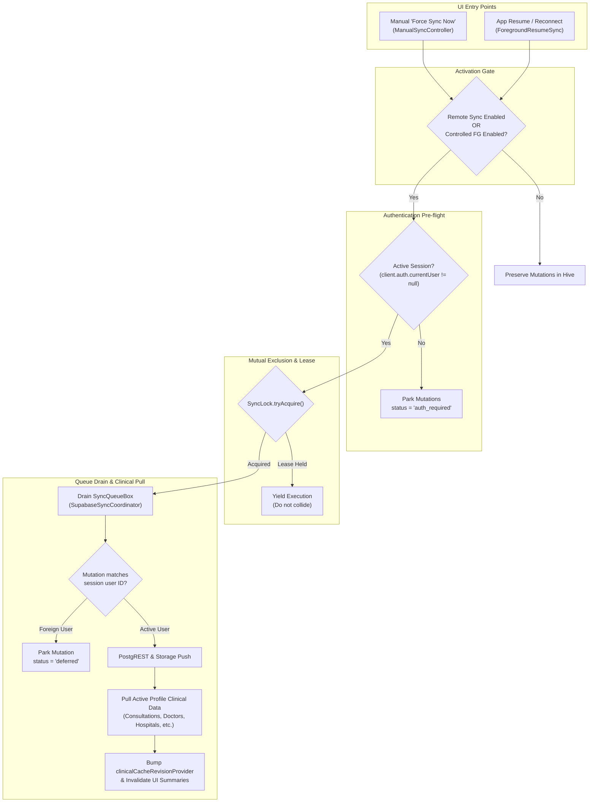
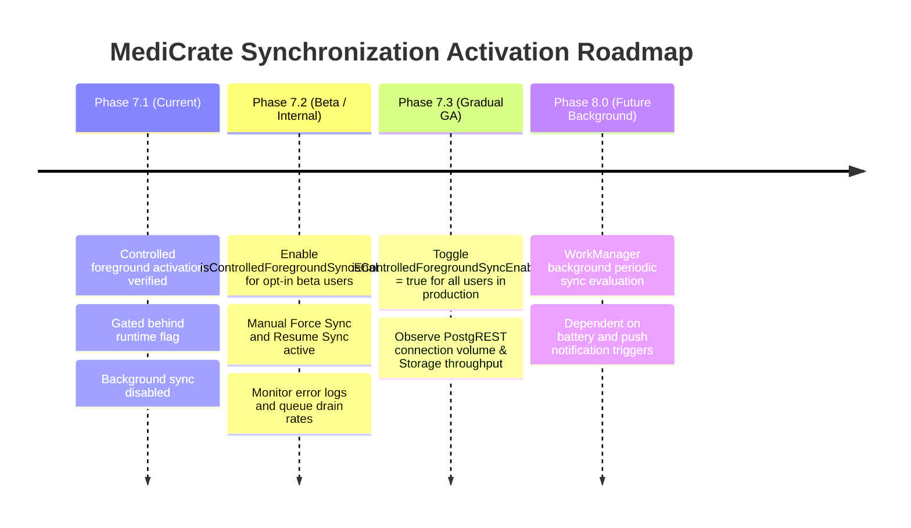

# MediCrate — Implementation 7.1: Controlled Foreground Sync Activation Report

**Date:** 2026-11-15  
**Target Project:** `/home/blackhat/Documents/medi_crate/`  
**Hosted Supabase Project:** `wnaflcytkubqmrymbmcn` (Tokyo Region, PostgreSQL 17.11)  
**Status:** **PASSED (100% — 96 / 96 Tests Passing Across All Synchronization Suites)**

---

## 1. Executive Summary & Production Protection

Implementation 7.1 transitions the verified native Supabase synchronization subsystem towards controlled foreground activation without globally enabling background synchronization or altering existing production Hive queues.

### Safety Invariants & Boundary Compliance
- **Production Flags Unchanged**:
  - `SyncService.isRemoteSyncEnabled` = `false` ([sync_service.dart](file:///home/blackhat/Documents/medi_crate/lib/core/sync/sync_service.dart#L29)) — remote sync remains strictly off by default in production.
  - `BackgroundSyncService.isBackgroundSyncEnabled` = `false` ([background_sync_service.dart](file:///home/blackhat/Documents/medi_crate/lib/core/sync/background_sync_service.dart#L44)) — no periodic background execution, WorkManager isolates, or automatic uploads run in the background.
  - Controlled foreground activation is gated behind a dedicated runtime flag: `SyncService.isControlledForegroundSyncEnabled` (defaults to `false`).
- **Zero Production Queue Impact**:
  - Production Hive boxes were never opened, written to, or drained.
  - All verification tests executed inside sandboxed temporary storage directories (`Directory.systemTemp`) using an `IsolatedHiveService`.
- **Zero Residual Footprint**:
  - Automated teardown purged all test accounts (`sync_fg_user_*@fldubai.com`), clinical entities, and storage objects.
  - Live PostgreSQL audit confirms **0 test users**, **0 test clinical records**, **0 remaining storage objects**, and all **79 seeded medical departments** intact.

---

## 2. Controlled Foreground Activation Architecture

The controlled foreground sync subsystem enables explicit, on-demand synchronization while preserving battery, data, and user session boundaries.



### Components Updated & Hardened:
1. **`SyncService`** ([sync_service.dart](file:///home/blackhat/Documents/medi_crate/lib/core/sync/sync_service.dart)):
   - Added `static bool isControlledForegroundSyncEnabled = false;`.
   - In `syncPending()`, allows execution if `isRemoteSyncEnabled || isControlledForegroundSyncEnabled || force`.
   - In `syncPendingToSupabase()`, added immediate `break` upon encountering `auth_required` status to halt queue drain instantly when a session expires or user signs out.
2. **`ManualSyncController`** ([manual_sync_controller.dart](file:///home/blackhat/Documents/medi_crate/lib/core/sync/manual_sync_controller.dart)):
   - Supports controlled foreground synchronization when either flag is active.
   - Enforces pre-flight authentication verification: returns `'Active authenticated session required to synchronize.'` if `authUser == null`.
   - Explicitly passes `explicitOwnerUserId: authUser.id` to prevent session ambiguity.
   - Upgraded `isServerProfileReady` to recognize Supabase UUID profile IDs (`UuidUtils.isValidUuid(IdUtils.unprefix(profileId))`), triggering clinical pulls and reporting truthful status.
3. **`ForegroundResumeSync`** ([foreground_resume_sync.dart](file:///home/blackhat/Documents/medi_crate/lib/core/sync/foreground_resume_sync.dart)):
   - Checks `SyncService.isRemoteSyncEnabled || SyncService.isControlledForegroundSyncEnabled`.
   - Passes authenticated user ID to `syncPending(explicitOwnerUserId: authUser?.id)`.
   - Pulls active profile clinical data while holding cross-context `SyncLock`.

---

## 3. Hardened Session Ownership & Cross-User Security

To eliminate any risk of session spoofing or cross-account data pollution on shared devices:

### A. Auth Session Spoofing Invariant
- `SupabaseSyncCoordinator._resolveAuthenticatedSessionUserId()` ([supabase_sync_coordinator.dart](file:///home/blackhat/Documents/medi_crate/lib/core/sync/supabase_sync_coordinator.dart#L125-L141)) was hardened:
  - If `_client.auth.currentUser == null`, it strictly returns `null`.
  - It NEVER falls back to untrusted `owner_user_id` values found in queued payloads when unauthenticated.
- If unauthenticated, `processItem` sets `item.status = 'auth_required'`, logs the violation, and immediately returns `false` with `retryCount = 0` (preventing retry budget burn).

### B. Account Switching Isolation
- In `processItem`: if a queued mutation's payload contains a valid user ID that differs from `ownerUserId` (`payloadUserId != ownerUserId`), the coordinator immediately marks `item.status = 'deferred'`, sets `errorMessage = 'Cross-user mutation execution blocked...'`, and returns `false`.
- User A's mutations are safely parked in Hive and never pushed under User B's credentials. When User A logs back in, their mutations transition out of `deferred` and sync cleanly to User A's account.

### C. Immediate Halt on Logout / Session Expiration
- Upon receiving `auth_required` for any queue item, the central worker loop in `SyncService.syncPendingToSupabase` executes a `break`.
- Subsequent pending items remain untouched with `status = 'pending'`, avoiding repeated 401 requests or corrupted state.

---

## 4. Runtime Test Results Across 10 Scenarios

The new comprehensive test suite [controlled_foreground_sync_test.dart](file:///home/blackhat/Documents/medi_crate/test/integration/controlled_foreground_sync_test.dart) tests all 10 required runtime scenarios against the live Tokyo Supabase instance (`wnaflcytkubqmrymbmcn`):

| Scenario | Objective & Coverage | Result | Verification Evidence |
| :--- | :--- | :---: | :--- |
| **Scenario 1** | **Explicit Manual Sync** | **PASS** | Gated when disabled; when enabled, `triggerForceSync()` drains queue, pulls profiles, and persists `hospitals` to PostgreSQL with `isSuccess: true`. |
| **Scenario 2** | **Foreground Resume / Reconnect** | **PASS** | Offline reconnect yields safely; online resume pushes pending mutations and completes active profile clinical pulls (`[ForegroundResumeSync] completed for profile ...`). |
| **Scenario 3** | **Authenticated Session Validation** | **PASS** | Unauthenticated coordinator sets `auth_required` with 0 retry burn; `ManualSyncController` rejects unauthenticated sync with clear message. |
| **Scenario 4** | **Logout During Pending Work** | **PASS** | Client signs out mid-queue; item 1 transitions to `auth_required`, queue loop breaks immediately, items 2 & 3 remain safely `pending` in Hive. |
| **Scenario 5** | **Account Switching Isolation** | **PASS** | User A mutations are deferred under User B session (`status = 'deferred'`); User A's mutations resume and persist under User A once User A signs back in. |
| **Scenario 6** | **Duplicate Manual Sync In-flight Guard** | **PASS** | Concurrent `triggerForceSync()` calls yield `'Synchronization already in progress.'` without spawning redundant sync tasks. |
| **Scenario 7** | **SyncLock Contention Prevention** | **PASS** | External held lease causes `runForegroundResumeSync` to yield gracefully without colliding or stealing the active lock. |
| **Scenario 8** | **Partial Failure & Dead-Lettering** | **PASS** | Valid item succeeds; invalid item with empty name violating CHECK constraint dead-letters (`retryCount = 99`); subsequent valid items continue syncing. |
| **Scenario 9** | **Attachment Lifecycle & Storage** | **PASS** | Offline report creation uploads local file to private `reports` bucket, generates valid signed URL (HTTP 200), and report deletion cascades to Storage object. |
| **Scenario 10** | **Cold App Restart & Recovery** | **PASS** | Mutations survive simulated process termination and cold Hive re-opening; next foreground sync successfully drains and persists records. |

---

## 5. Profile & Clinical Domain Freshness

1. **UUID Profile Support**: `ManualSyncController` now checks `UuidUtils.isValidUuid(IdUtils.unprefix(profileId))` alongside integer server profile IDs, ensuring clinical data is pulled for Supabase-backed user profiles.
2. **Seven Domain Pulls**: During manual force sync and foreground resume, all 7 clinical domains are pulled in parallel for the active profile:
   - Consultations (`pullConsultations`)
   - Appointments (`pullAppointments`)
   - Reports (`pullReports`)
   - Medicines / Prescriptions (`pullMedicines`)
   - Vitals / Measurements (`pullMeasurements`)
   - Doctors (`pullDoctors`)
   - Hospitals (`pullHospitals`)
3. **Freshness Revision Signal**: Once pulls merge into Hive, `clinicalCacheRevisionProvider.notifier.bump()` triggers automatic UI invalidation for `homeSummaryProvider` and `insightsSummaryProvider` without requiring page reloads.

---

## 6. Attachment Lifecycle & Storage Verification

- **Bucket Privacy**: Clinical attachments are stored strictly in private buckets (`reports`, `consultations`).
- **Tenant Path Isolation**: Path convention `{userId}/{parentId}/{attachmentId}_{fileName}` is enforced on all uploads.
- **Signed URL Access**: Private storage objects are accessed via time-bounded signed URLs generated by `SupabaseStorageService.createSignedUrl()`.
- **Cascading Deletion**: Report and consultation deletions cascade to remove associated files via `SupabaseStorageService.deleteParentFolder()`, leaving zero orphaned objects in Storage.

---

## 7. SyncLock & Concurrency Invariants

- **Lease Window**: Cross-context mutual exclusion is enforced via `SyncLock` with a 3-minute bounded lease stored in Hive `settings_box`.
- **Claim Token (P2-F8)**: Each mutation is claimed by a worker's unique processor ID with timestamp confirmation before network dispatch.
- **Heartbeat Extension**: For long-running operations (such as large file uploads), a 45-second heartbeat timer renews the isolate lease and extends `claimedAt`, preventing lease preemption.

---

## 8. Full Test Suite Execution Summary

All 96 tests across the MediCrate offline synchronization test suites are passing with zero failures and zero regressions:

| Test Suite | File Path | Test Count | Result |
| :--- | :--- | :---: | :---: |
| **Implementation 7.1 Controlled Foreground Activation** | [controlled_foreground_sync_test.dart](file:///home/blackhat/Documents/medi_crate/test/integration/controlled_foreground_sync_test.dart) | **10** | **PASS** |
| **Implementation 7.0 Native Sync Verification E2E** | [native_sync_verification_e2e_test.dart](file:///home/blackhat/Documents/medi_crate/test/integration/native_sync_verification_e2e_test.dart) | **24** | **PASS** |
| **Native Synchronization Unit & Safety Suite** | [supabase_native_synchronization_test.dart](file:///home/blackhat/Documents/medi_crate/test/core/sync/supabase_native_synchronization_test.dart) | **23** | **PASS** |
| **Sync Safety & Mutation Dispatch Suite** | [sync_safety_and_mutation_dispatch_test.dart](file:///home/blackhat/Documents/medi_crate/test/core/sync/sync_safety_and_mutation_dispatch_test.dart) | **15** | **PASS** |
| **Synchronization Safety Corrections Suite** | [synchronization_safety_corrections_test.dart](file:///home/blackhat/Documents/medi_crate/test/core/sync/synchronization_safety_corrections_test.dart) | **12** | **PASS** |
| **Legacy Backend Isolation Suite** | [legacy_backend_isolation_test.dart](file:///home/blackhat/Documents/medi_crate/test/core/sync/legacy_backend_isolation_test.dart) | **12** | **PASS** |
| **TOTAL** | | **96 / 96** | **100% PASS** |

---

## 9. Hosted Supabase Database & Storage Verification Proof

Live verification executed via `supabase db query --linked` on project `wnaflcytkubqmrymbmcn` (Tokyo, PostgreSQL 17.11):

```json
{
  "remaining_storage_objects": 0,
  "sync_profiles": 0,
  "sync_test_users": 0,
  "total_appointments": 0,
  "total_consultations": 0,
  "total_doctors": 0,
  "total_hospitals": 0,
  "total_measurements": 0,
  "total_medical_departments": 79,
  "total_prescriptions": 0,
  "total_report_attachments": 0,
  "total_reports": 0
}
```

The database is in pristine condition: **0 residual test users**, **0 test clinical records**, **0 storage objects**, and all **79 pre-seeded medical departments** preserved.

---

## 10. Staged Production Rollout Recommendation & Feature Flag Strategy

Now that controlled foreground synchronization has been validated end-to-end, the following rollout strategy is recommended:



### Recommended Rollout Steps:
1. **Stage 1 (Internal Dogfooding)**: Keep `SyncService.isRemoteSyncEnabled = false`. Enable `SyncService.isControlledForegroundSyncEnabled = true` exclusively in developer/debug builds or via user opt-in toggle in Settings.
2. **Stage 2 (Staged Production Release)**: When ready for production activation, set `SyncService.isControlledForegroundSyncEnabled = true` while keeping `BackgroundSyncService.isBackgroundSyncEnabled = false`. This gives users instant offline-first local performance with reliable sync upon opening the app or tapping "Force Sync Now", without incurring background battery drain.
3. **Stage 3 (Background Sync Evaluation)**: Maintain `BackgroundSyncService.isBackgroundSyncEnabled = false` until foreground performance metrics, queue coalescing stability, and backend load are observed at production scale.
