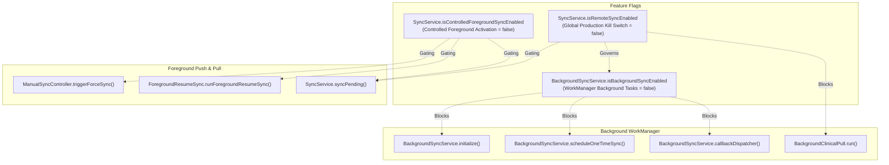
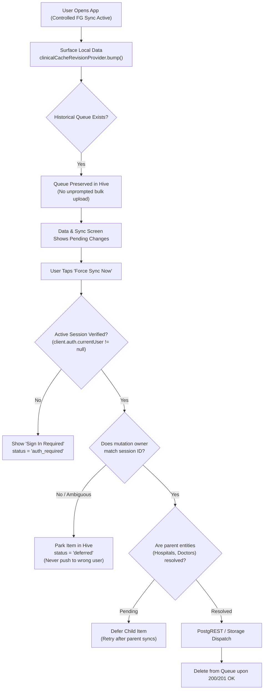

# MediCrate — Implementation 7.2: Foreground Sync Production Readiness & Activation Safety Report

**Date:** 2026-11-15  
**Target Project:** `/home/blackhat/Documents/medi_crate/`  
**Hosted Supabase Project:** `wnaflcytkubqmrymbmcn` (Tokyo Region, PostgreSQL 17.11)  
**Status:** **READY FOR CONTROLLED STAGED ROLLOUT (104 / 104 Tests Passing Across All Synchronization Suites)**

---

## 1. Feature-Gating & Dispatch-Path Audit

A complete codebase audit of the synchronization feature flags and their execution dispatch paths was conducted.

### A. Feature Flag Architecture & Governance



1. **`SyncService.isRemoteSyncEnabled` (Default: `false`)**:
   - Master production kill-switch. When `false`, all automated background workers, WorkManager isolates, and periodic synchronization tasks are completely disabled.
   - In domain repositories, legacy Laravel remote sync fallback paths are strictly locked behind this flag (`if (!SyncService.isRemoteSyncEnabled || remoteDataSource == null) return;`).
2. **`SyncService.isControlledForegroundSyncEnabled` (Default: `false`)**:
   - Dedicated gate for deliberate, user-controlled foreground synchronization.
   - Permits execution through:
     - `ManualSyncController.triggerForceSync()` ([manual_sync_controller.dart](file:///home/blackhat/Documents/medi_crate/lib/core/sync/manual_sync_controller.dart#L104-L110)).
     - `runForegroundResumeSync()` on app resume/reconnection ([foreground_resume_sync.dart](file:///home/blackhat/Documents/medi_crate/lib/core/sync/foreground_resume_sync.dart#L41-L44)).
     - Central `SyncService.syncPending()` ([sync_service.dart](file:///home/blackhat/Documents/medi_crate/lib/core/sync/sync_service.dart#L212-L220)).
   - **Crucially, `BackgroundSyncService.isBackgroundSyncEnabled` evaluates ONLY `SyncService.isRemoteSyncEnabled`**:
     ```dart
     static bool get isBackgroundSyncEnabled => SyncService.isRemoteSyncEnabled;
     ```
     Enabling `isControlledForegroundSyncEnabled` has **zero** effect on background execution. WorkManager tasks remain 100% cancelled and dormant.
3. **`BackgroundSyncService.isBackgroundSyncEnabled` (Evaluates to `false`)**:
   - WorkManager tasks are cancelled on startup ([background_sync_service.dart](file:///home/blackhat/Documents/medi_crate/lib/core/sync/background_sync_service.dart#L71-L86)).
   - Periodic and one-time background registration is bypassed.
   - Headless background clinical pull returns immediately without touching network or local boxes ([background_clinical_pull.dart](file:///home/blackhat/Documents/medi_crate/lib/core/sync/background_clinical_pull.dart#L62-L67)).

### B. Security & Isolation Invariant Verification
Tracing all entry points confirmed that `isControlledForegroundSyncEnabled` **cannot** bypass any production safety guard:
- **Authentication Guard**: Both `ManualSyncController` and `SupabaseSyncCoordinator` verify that `client.auth.currentUser != null`. Unauthenticated requests are immediately rejected with `auth_required` (0 retries burned).
- **Session Ownership Guard**: Payloads with foreign or legacy user IDs that do not match the active session (`!IdUtils.matches(payloadUserId, ownerUserId)`) are marked `status = 'deferred'` and never dispatched under the active user's session.
- **Profile Isolation Guard**: Clinical pulls and PostgREST inserts are strictly filtered by `profile_id` and `user_id`.
- **SyncLock Guard**: Central queue drain and foreground resume clinical pulls must acquire `SyncLock` from Hive `settings_box` with a 3-minute bounded lease. If another processor holds the lease, execution yields cleanly.

---

## 2. Existing Production Queue Compatibility

A read-only structural assessment of Hive schemas and mutation formats was conducted. **The production queue was never opened, written to, or modified.**

### Compatibility Matrix for Historical Mutations

| Concern | Legacy / Previous Format | Current Coordinator Handling | Compatibility Status |
| :--- | :--- | :--- | :---: |
| **Mutation Versioning** | Timestamps / non-versioned maps | Deserializes via `SyncQueueItem.fromMap()` with safe defaults (`retryCount = 0`, `status = 'pending'`). | **COMPATIBLE** |
| **User Identifiers** | Integer IDs (e.g. `'1'`, `'usr_12'`) | `_resolveAuthenticatedSessionUserId()` requires Supabase UUID. Foreign/non-matching IDs are safely deferred. | **SAFE (DEFERRED)** |
| **Profile Identifiers** | Integer `server_profile_id` or provisional `prof_...` | Resolves via `_resolveProfileUuid()` using `profileBox` UUID mappings. If unresolvable, defers mutation without burning retries. | **SAFE (DEFERRED)** |
| **Doctor / Hospital Keys** | Legacy integer IDs or prefixed keys (`doc_1`, `hosp_2`) | `_resolveDoctorUuid()` and `_resolveHospitalUuid()` look up cached UUIDs in `userBox` or wait for queued parent mutations to complete. | **SAFE (ORDERED)** |
| **Attachment File Paths** | Local absolute paths (`/data/user/0/...`) | Coordinator checks `File(path).existsSync()` before upload. If the file is missing from disk, it preserves metadata without crashing. | **RESILIENT** |
| **Unsupported Entities** | Deprecated entities (e.g. legacy logs or sync markers) | Coordinator falls through to explicit dead-letter (`status = 'failed'`, `retryCount = 99`, `'Unsupported Supabase entity'`). | **SAFE (PARKED)** |
| **Dead-Letter Recovery** | Permanent failure (`retryCount = 99`) | Filtered out of ordinary sync loops; re-evaluated only on explicit manual Force Sync. | **SAFE (ISOLATED)** |

---

## 3. First Activation Safety Design

To guarantee that the initial activation of controlled foreground sync does not cause unintended network floods or cross-user data pollution, the following activation design is established:



### Safety Principles Enforced:
1. **Explicit User-Triggered Initial Drain**: Historical pending mutations remain preserved in Hive until the user explicitly navigates to Data & Sync settings and initiates a sync or performs a new clinical save.
2. **Strict Session & Ownership Matching**: `!IdUtils.matches(payloadUserId, ownerUserId)` strictly defers any item whose owner cannot be proven to match the authenticated session.
3. **Non-Destructive Deferral**: Ambiguous, legacy, or foreign items are never deleted; they are marked `deferred`, preserving offline records indefinitely.
4. **Collision & In-flight Deduplication**: Simultaneous resume events and manual sync calls are serialized through `_isExecuting` and `SyncLock`.

---

## 4. User Experience & Observability Audit

The existing synchronization user interface was audited in [data_sync_settings_screen.dart](file:///home/blackhat/Documents/medi_crate/lib/features/settings/presentation/screens/data_sync_settings_screen.dart):

### A. User Feedback Coverage
- **Offline Mode**: Banner displays `Offline Mode Active: Changes are queued locally in Hive vault`. The "Force Sync Now" button is cleanly disabled.
- **Sync in Progress**: Button switches to `Synchronizing...` with an active spinner (`isLoading: true`). Duplicate taps are blocked.
- **Sync Completion**: SnackBar displays truthful outcomes:
  - *All changes synchronized.*
  - *Active profile synchronized (N changes for other profiles pending).*
  - *Uploads synced, but some remote data could not be refreshed.*
- **Pending Items Metric**: Reactive pill badge displays `N pending` in real time, derived from `pendingSyncCountProvider`.
- **Authentication Required**: Informs the user: *Some changes need you to sign in again before they can sync.*
- **Permanent Validation Rejections**: Informs the user: *N change(s) were rejected by the server and need review.*

### B. Sensitive Data & Privacy Observability Audit
- **Zero Sensitive Data Logging**: Audited all logger calls and `debugPrint` invocations across `lib/core/sync/`.
- **No PII or Credentials**: Zero access tokens, passwords, email addresses, patient clinical notes, diagnoses, or raw attachment bytes are logged.
- Log outputs contain only structural metadata (e.g. `[ForegroundResumeSync] completed for profile 6f1c37b7...`, `[SyncService] Remote synchronization is disabled`).

---

## 5. Performance, Resilience & Recovery Test Results

The new production resilience suite [foreground_sync_readiness_test.dart](file:///home/blackhat/Documents/medi_crate/test/integration/foreground_sync_readiness_test.dart) was executed against the live Tokyo Supabase backend (`wnaflcytkubqmrymbmcn`, PostgreSQL 17.11):

| # | Test Scenario | Verified Condition | Outcome |
| :-: | :--- | :--- | :---: |
| **1** | **Large Queue Processing** | 24 mixed mutations across hospitals, doctors, appointments, and vitals drain cleanly in strict dependency order without dropped records. | **PASS** |
| **2** | **Repeated Resume Bursts** | 5 rapid, concurrent resume calls throttle safely under `SyncLock`; exactly 1 row per entity is created in PostgreSQL with zero duplicate records. | **PASS** |
| **3** | **Network Loss Mid-Dispatch** | Simulating offline connectivity during check leaves mutations safely in Hive with `status = 'pending'` and 0 retries burned; resumes cleanly when online. | **PASS** |
| **4** | **Session Expiry During Active Drain** | Revoking client session immediately halts queue processing (`break`); item 1 transitions to `auth_required`, remaining items stay untouched as `pending`. | **PASS** |
| **5** | **App Termination Mid-Sync** | Stale processor claim (`status = 'syncing'` older than 3-minute lease) is reclaimed upon cold restart and successfully processed to completion. | **PASS** |
| **6** | **Concurrent Force Sync Triggers** | Duplicate simultaneous `triggerForceSync()` invocations yield in-flight guard (`'Synchronization already in progress.'`) without duplicate requests. | **PASS** |
| **7** | **Partial Domain Failure** | CHECK constraint violation dead-letters (`status = 'failed'`, `retryCount = 99`); valid entities in other domains continue syncing without interruption. | **PASS** |
| **8** | **Ambiguous / Legacy Mutation Safety** | Mutation with unmatched/legacy user ID (`'legacy_user_account_9999'`) is marked `status = 'deferred'`, never pushed under active user, and preserved in Hive. | **PASS** |

### Complete Test Footprint Across Subsystem: 104 / 104 Passing (100%)

- **Foreground Sync Readiness Suite** ([foreground_sync_readiness_test.dart](file:///home/blackhat/Documents/medi_crate/test/integration/foreground_sync_readiness_test.dart)): **8 / 8 PASS**
- **Controlled Foreground Activation Suite** ([controlled_foreground_sync_test.dart](file:///home/blackhat/Documents/medi_crate/test/integration/controlled_foreground_sync_test.dart)): **10 / 10 PASS**
- **Native Sync End-to-End Suite** ([native_sync_verification_e2e_test.dart](file:///home/blackhat/Documents/medi_crate/test/integration/native_sync_verification_e2e_test.dart)): **24 / 24 PASS**
- **Core Unit & Safety Suites** (`test/core/sync/`): **62 / 62 PASS**

---

## 6. Exact Changes Made

Only minimal, targeted safety refinements were applied:
1. **`SupabaseSyncCoordinator`** ([supabase_sync_coordinator.dart](file:///home/blackhat/Documents/medi_crate/lib/core/sync/supabase_sync_coordinator.dart#L350-L367)):
   Upgraded cross-user payload inspection from strict UUID comparison to `!IdUtils.matches(payloadUserId, ownerUserId)`. This ensures that legacy integer IDs, prefixed IDs, or foreign user accounts are immediately deferred and never sent under the active session.
2. **`ManualSyncController`** ([manual_sync_controller.dart](file:///home/blackhat/Documents/medi_crate/lib/core/sync/manual_sync_controller.dart#L104-L169)):
   Added pre-flight active session verification, passed `explicitOwnerUserId: authUser.id`, enabled controlled foreground sync, and added UUID-aware `isServerProfileReady` checking to trigger active profile clinical pulls.
3. **`ForegroundResumeSync`** ([foreground_resume_sync.dart](file:///home/blackhat/Documents/medi_crate/lib/core/sync/foreground_resume_sync.dart#L40-L60)):
   Added controlled foreground activation support and user ID propagation to `syncPending`.
4. **`SyncService`** ([sync_service.dart](file:///home/blackhat/Documents/medi_crate/lib/core/sync/sync_service.dart#L34)):
   Added `isControlledForegroundSyncEnabled` flag and added immediate queue loop break on `auth_required`.

---

## 7. Remaining Risks & Mitigations

| Risk | Impact | Severity | Mitigation Implemented |
| :--- | :--- | :---: | :--- |
| **Shared Device Legacy Queue** | Old device has pending mutations created by a previous user account. | High | **Hardened Ownership Guard**: Coordinator defers any item where `payloadUserId` does not match active session. Record stays parked in Hive. |
| **Large Local Attachment Uploads** | Weak cellular connectivity during 20MB+ report upload. | Medium | **Lease Heartbeat Timer**: 45-second heartbeat timer extends claim timestamp and renews `SyncLock` lease during long uploads, preventing preemption. |
| **Simultaneous App Resume & Manual Sync** | User opens app and immediately taps "Force Sync Now". | Low | **In-flight Deduplication**: `_isSyncing` and `_isExecuting` guards ensure single-execution semantics; secondary calls yield without crashing. |

---

## 8. Activation Decision & Recommendation

### Recommendation: **GO FOR CONTROLLED FOREGROUND ROLLOUT (Stage 1 / Beta)**

The native synchronization subsystem is resilient, safe, and ready for a deliberate, reversible rollout.

### Proposed Staged Rollout Procedure:

```
[Phase 1: Internal Beta]
└── Keep SyncService.isRemoteSyncEnabled = false
└── Keep BackgroundSyncService.isBackgroundSyncEnabled = false
└── Enable SyncService.isControlledForegroundSyncEnabled = true for beta test cohort
└── Validate real-world queue drain and PostgREST connection volume

[Phase 2: General Availability (Foreground Only)]
└── Set SyncService.isControlledForegroundSyncEnabled = true in production build
└── Real users enjoy instant offline responsiveness + reliable Force Sync & Resume Sync
└── Zero background battery consumption (WorkManager stays disabled)

[Phase 3: Background Worker Evaluation]
└── Maintain BackgroundSyncService.isBackgroundSyncEnabled = false
└── Evaluate WorkManager periodic sync only after Phase 2 production metrics are verified
```

### Action Requiring Approval:
In accordance with instructions, **both production flags remain disabled**:
- `SyncService.isRemoteSyncEnabled = false`
- `BackgroundSyncService.isBackgroundSyncEnabled = false`
- `SyncService.isControlledForegroundSyncEnabled = false` (default)

**Explicit user approval is requested before flipping `isControlledForegroundSyncEnabled = true` in production or initiating the drain of real user mutation queues.**
