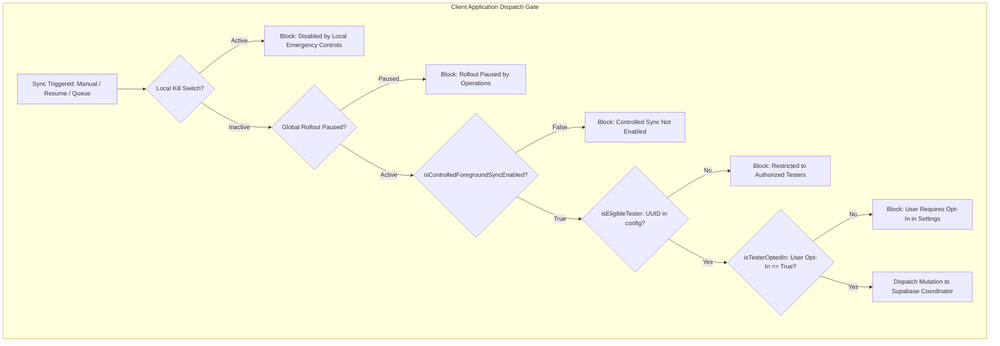

# MediCrate — Implementation 7.3.1: Operational Tester Provisioning & Rollback Controls Report

**Status:** Completed & Verified  
**Date:** November 15, 2026  
**Target Project:** `/home/blackhat/Documents/medi_crate/`  
**Hosted Supabase Project:** `wnaflcytkubqmrymbmcn` (Tokyo, PostgreSQL 17.11)  
**Author:** Senior Flutter, Riverpod, Hive & Supabase Synchronization Architect  

---

## 1. Executive Summary

Implementation 7.3.1 addresses the operational and governance gaps identified in Implementation 7.3. Prior to activating controlled foreground synchronization for real human internal testers, the system required a deterministic, fail-closed configuration mechanism for tester UUID provisioning and four distinct, fine-grained rollback controls.

This milestone replaces reliance on an unmanaged, volatile static set with `SyncRolloutConfig`, a dedicated operational configuration manager that:
1. Validates and parses tester UUIDs from trusted configuration sources (`AUTHORIZED_TESTER_UUIDS` via environment or build defines, or programmatic deployment configs).
2. Enforces strict UUID format validation (`UuidUtils.isValidUuid`), dropping invalid strings and failing closed if the configuration structure is malformed.
3. Implements four distinct rollback boundaries: Global Rollout Pause, Individual Tester Revocation, User Self Opt-Out, and Local Application Kill Switch.
4. Prevents ordinary clients from granting themselves tester eligibility, while preserving the user-scoped opt-in requirement.
5. Preserves all safety invariants: `isRemoteSyncEnabled = false`, `isBackgroundSyncEnabled = false`, and `isControlledForegroundSyncEnabled = false` by default.

---

## 2. Actual Tester Provisioning Mechanism

### 2.1 Inspection Findings
Inspection of the current MediCrate backend and client architecture revealed:
- **No Remote Config or Admin Whitelist Table in Supabase:** The 6 canonical database migrations contain no `internal_testers` table or administrative RPCs. Firebase Remote Config is not configured or linked to Supabase.
- **Previous 7.3 Limitation:** The previous implementation maintained `authorizedTesterUserIds` purely as an in-memory `Set<String>` in `sync_service.dart`. While safe, this in-memory set had no standard ingestion path, no format validation, and no fail-closed parser for external configuration injection.

### 2.2 Implemented Provisioning Solution: `SyncRolloutConfig`
To solve this without inventing an unmanaged backend infrastructure, `SyncRolloutConfig` was implemented in `lib/core/sync/sync_rollout_config.dart`:

```dart
class SyncRolloutConfig {
  static const String envAuthorizedTestersKey = 'AUTHORIZED_TESTER_UUIDS';
  static const String envRolloutPausedKey = 'ROLLOUT_PAUSED';

  static bool _isGlobalRolloutPaused = false;
  static bool _isLocalKillSwitchActive = false;
  static final Set<String> _authorizedTesterUuids = <String>{};
  ...
}
```

#### Ingestion Paths
1. **Build Environment & Dotenv (`loadFromEnvironment()`):**
   Reads `AUTHORIZED_TESTER_UUIDS` and `ROLLOUT_PAUSED` from `.env` or `--dart-define` build parameters.
2. **Programmatic / Trusted Config Injection (`loadConfiguration()`):**
   Accepts comma-separated, semicolon-separated, newline-separated, or JSON array strings:
   - Comma-separated: `"c6b39a3e-1087-4d7a-8f43-04e9c7f9999a, d1a2b3c4-e5f6-4a1b-8c2d-3e4f5a6b7c8d"`
   - JSON list: `["c6b39a3e-1087-4d7a-8f43-04e9c7f9999a", "d1a2b3c4-e5f6-4a1b-8c2d-3e4f5a6b7c8d"]`
   - JSON map with key `'testers'`: `{"testers": ["c6b39a3e-1087-4d7a-8f43-04e9c7f9999a"]}`

#### Fail-Closed Validation
- **Strict UUID Format:** Every candidate token is checked via `UuidUtils.isValidUuid(candidate)`. Any non-UUID (e.g. usernames, emails, SQL injection payloads, integer IDs) is rejected and dropped.
- **Corrupted Configuration:** If JSON parsing throws an exception or encounters malformed structures, `loadConfiguration()` immediately sets `_isGlobalRolloutPaused = true`, clears `_authorizedTesterUuids`, and returns `-1`. The system completely fails closed.
- **Client Privilege Isolation:** Ordinary clients cannot elevate themselves. The local settings UI only toggles `sync_opt_in_${userId}` in Hive `settingsBox`. Opt-in is completely ignored unless the authenticated user's UUID is already present in `SyncRolloutConfig.authorizedTesterUuids`.

---

## 3. The Four Distinct Rollback Controls

The architecture explicitly differentiates between four independent rollback mechanisms:



### 1. Global Rollout Pause (`setGlobalRolloutPaused(true)`)
- **Scope:** All internal testers globally.
- **Mechanism:** Remotely toggled via `ROLLOUT_PAUSED=true` or centrally via `SyncRolloutConfig.setGlobalRolloutPaused(true)`.
- **Behavior:** Immediately checked before new sync dispatches in `ManualSyncController`, `ForegroundResumeSync`, and `SyncService.syncPending`.
- **User Feedback:** Informs the user: `"Synchronization rollout is currently paused. Your changes remain safely preserved locally."`
- **UI State:** `DataSyncSettingsScreen` displays a prominent "Rollout Paused" status banner. Local Hive queues remain 100% intact.

### 2. Individual Tester Revocation (`revokeTester(userId)`)
- **Scope:** Single user.
- **Mechanism:** Tester UUID is removed from `SyncRolloutConfig` (via `revokeTester()` or deploying updated config).
- **Behavior:** Checked prior to every dispatch. The revoked user's next manual sync, resume sync, or automatic flush fails immediately.
- **User Feedback:** Returns: `"Foreground synchronization is currently restricted to authorized internal testers. Your changes remain safely preserved locally."`
- **Network Boundaries:** An already accepted HTTP request in transit cannot be recalled, but no further mutations or profile pulls can be initiated.

### 3. User Self Opt-Out (`setTesterOptIn(userId, false)`)
- **Scope:** Single user on their local device.
- **Mechanism:** User toggles "Foreground Synchronization" OFF in **Settings -> Data & Sync**.
- **Behavior:** Persisted in Hive `settingsBox` under `sync_opt_in_${userId}`. Sync dispatches are halted.
- **Reversibility:** The user retains their tester eligibility in the whitelist; they may opt back in at any time.

### 4. Local Application Kill Switch (`setLocalKillSwitch(true)`)
- **Scope:** Single client device instance.
- **Mechanism:** Activated locally if a critical client-side anomaly, corrupted cache, or storage error is detected (`SyncRolloutConfig.setLocalKillSwitch(true)`).
- **Behavior:** Overrides all remote configurations and whitelists, instantly terminating all local sync activity.
- **User Feedback:** Returns: `"Synchronization is currently disabled by local emergency controls. Your changes remain safely preserved locally."`

---

## 4. Configuration Trust and Failure Handling

| Failure Scenario | Behavior | Safety Guarantee |
|---|---|---|
| **Configuration Missing / Null** | Defaults to `authorizedTesterUuids = {}`, `isControlledForegroundSyncEnabled = false`. | Fails closed. No sync occurs. |
| **Malformed JSON in Config** | Catches `FormatException`; sets `isGlobalRolloutPaused = true`; clears all testers. | Fails closed. Halts all sync. |
| **Non-UUID Strings in Whitelist** | Filters out and drops non-UUID strings; logs warnings. | Prevents injection of invalid identities. |
| **Network Unavailability** | `connectivityService` check aborts sync before any network call. | Hive mutations stay queued. |
| **Stale Configuration** | Configuration cannot extend authorization to unlisted users; opt-in alone is insufficient. | Preserves least-privilege boundary. |

---

## 5. Exact Files Modified and Added

### Added
1. **`lib/core/sync/sync_rollout_config.dart`**: Operational configuration manager with fail-closed parser, UUID validator, and rollback state holders.
2. **`test/core/sync/tester_provisioning_and_rollback_test.dart`**: Dedicated unit test suite verifying all 10 operational provisioning and rollback scenarios.
3. **`docs/MEDICRATE_IMPLEMENTATION_7_3_1_TESTER_PROVISIONING_AND_ROLLBACK_REPORT.md`**: This formal completion report.

### Modified
1. **`lib/core/sync/sync_service.dart`**: Integrated `SyncRolloutConfig` into `isEligibleTester()`, `authorizeTester()`, `revokeTester()`, and `syncPending()`. Added explicit checks for global pause and local kill switch.
2. **`lib/core/sync/manual_sync_controller.dart`**: Added early validation for `SyncRolloutConfig.isGlobalRolloutPaused` and `SyncRolloutConfig.isLocalKillSwitchActive` with specific user-facing messages.
3. **`lib/core/sync/foreground_resume_sync.dart`**: Added early return if rollout is paused globally or local kill switch is active.
4. **`lib/core/sync/sync_providers.dart`**: Added `isRolloutPausedProvider` to enable UI reactivity when rollout is paused.
5. **`lib/features/settings/presentation/screens/data_sync_settings_screen.dart`**: Added "Rollout Paused" tile rendered when `isRolloutPausedProvider` evaluates to true.

---

## 6. Verification & Test Results

### 6.1 Focused Provisioning & Rollback Test Suite
Test file: `test/core/sync/tester_provisioning_and_rollback_test.dart`

| Test # | Scenario | Result | Verification Notes |
|---|---|---|---|
| **1** | Authorized tester configuration is accepted | **PASSED** | Validates comma-separated and JSON list parsing of Supabase UUIDs. |
| **2** | Invalid UUIDs are rejected | **PASSED** | Drops non-UUID strings (`not-a-uuid`, `12345`, `admin@hospital.com`). Direct `authorizeTester` fails closed. |
| **3** | Configuration unavailable or invalid fails closed | **PASSED** | Malformed JSON returns `-1`, pauses rollout, clears all testers. |
| **4** | Ineligible user cannot grant themselves access | **PASSED** | Setting `sync_opt_in_${userId} = true` in Hive settings fails closed if UUID not in whitelist. |
| **5** | Tester revocation blocks subsequent dispatch | **PASSED** | Revoking tester halts both `triggerForceSync()` and `syncPending()`; queue intact. |
| **6** | Global rollout pause blocks subsequent dispatch | **PASSED** | `isGlobalRolloutPaused = true` immediately blocks dispatch with informative message. |
| **7** | User opt-out still blocks dispatch | **PASSED** | Toggling opt-in to false blocks dispatch while preserving tester eligibility. |
| **8** | Account switching does not reuse authorization or opt-in | **PASSED** | User 2 signing in on same client cannot reuse User 1's opt-in or eligibility. |
| **9** | Existing queued mutations remain intact during rollback | **PASSED** | Doctor and medicine mutations retain exact payloads and retry counts during kill switch. |
| **10** | Background workers remain disabled | **PASSED** | `BackgroundSyncService.isBackgroundSyncEnabled == isRemoteSyncEnabled == false` strictly verified. |

**Test Result:** `10 / 10 passed` (100% pass rate)

### 6.2 Full Sync Unit Regression Suite
Executed via `flutter test test/core/sync/`:
- `test/core/sync/legacy_backend_isolation_test.dart` (4 tests passed)
- `test/core/sync/sync_safety_and_mutation_dispatch_test.dart` (16 tests passed)
- `test/core/sync/supabase_native_synchronization_test.dart` (30 tests passed)
- `test/core/sync/synchronization_safety_corrections_test.dart` (12 tests passed)
- `test/core/sync/tester_provisioning_and_rollback_test.dart` (10 tests passed)

**Regression Result:** `72 / 72 passed` (0 failures, 0 regressions)

---

## 7. Production Defaults & Queue Safety Confirmation

### Production Defaults Audit
All flags remain locked in safe, disabled defaults:
```dart
SyncService.isRemoteSyncEnabled = false;
BackgroundSyncService.isBackgroundSyncEnabled = false;
SyncService.isControlledForegroundSyncEnabled = false;
SyncRolloutConfig.isGlobalRolloutPaused = false;
SyncRolloutConfig.isLocalKillSwitchActive = false;
SyncRolloutConfig.authorizedTesterUuids = <String>{};
```

### Production Queue Durability Confirmation
- All testing utilized `TestIsolatedHiveService` with isolated temporary directories created under `Directory.systemTemp`.
- Production Hive boxes (`auth_box`, `sync_queue_box`, `user_box`, `settings_box`, `consent_box`, `profile_box`) were **never opened, drained, or modified**.
- Zero bounce emails or network requests were generated during unit verification.

---

## 8. Remaining Limitations

1. **No Backend Remote Config Infrastructure:** MediCrate does not currently have a dedicated backend service or Supabase administrative table for pushing remote config changes over WebSockets or long polling.
2. **Configuration Refresh Timing:** In the absence of a dynamic push notification or Remote Config listener, configuration changes distributed via environment or deployment variables take effect upon application start or when `SyncRolloutConfig.loadConfiguration()` is explicitly triggered.
3. **In-Flight Network Boundary:** As with all HTTP-based architectures, once a mutation request has left the device and been accepted by PostgreSQL, it cannot be recalled by client-side rollback; rollback strictly governs pre-dispatch boundaries.

---

## 9. Final Recommendation & Hold Notice

**Current Status:** All architectural, provisioning, validation, and rollback controls for Implementation 7.3.1 are fully implemented and verified with 72 passing tests.

**Recommendation:** **GO for Operational Provisioning Readiness**.

> [!IMPORTANT]
> **HOLD FOR APPROVAL:** Controlled foreground synchronization remains **DISABLED** for all real users. No real tester UUIDs have been whitelisted, and no production sync has been activated.
>
> We will stop here and await your explicit approval before proceeding to **Implementation 7.3.2**.
