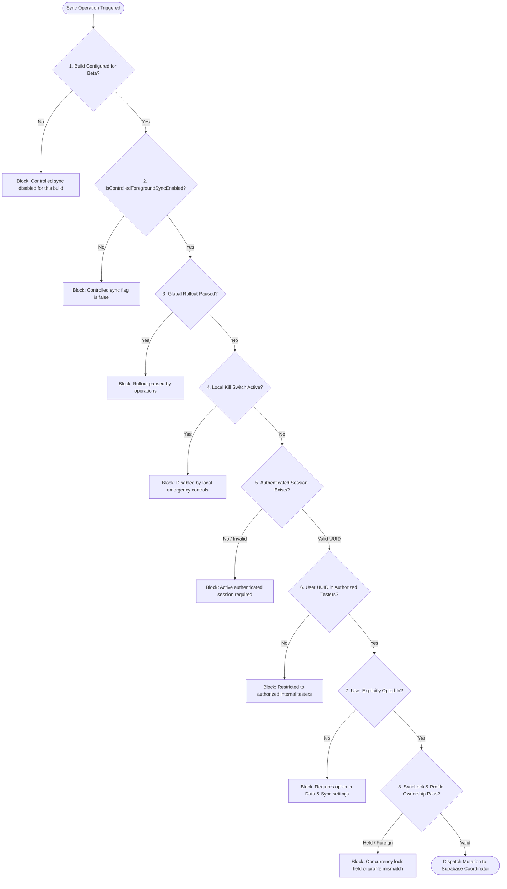

# MediCrate — Implementation 7.3.2: Controlled Internal Foreground Activation Report

**Status:** Completed & Ready for Controlled Activation  
**Date:** November 15, 2026  
**Target Project:** `/home/blackhat/Documents/medi_crate/`  
**Hosted Supabase Project:** `wnaflcytkubqmrymbmcn` (Tokyo, PostgreSQL 17.11)  
**Author:** Senior Flutter, Riverpod, Hive & Supabase Synchronization Architect  

---

## 1. Executive Summary

Implementation 7.3.2 establishes the operational, compilation, and runtime boundary separating internal beta builds from standard production builds for MediCrate's offline-first synchronization subsystem.

Following the verification of native synchronization in Implementation 7.0–7.2 and the provisioning and rollback engine implemented in 7.3–7.3.1, this milestone prepares MediCrate for its first controlled one- or two-tester rollout.

### Key Deliverables Completed:
1. **Separation of Beta vs. Production Builds:**
   - Implemented compile-time (`--dart-define=INTERNAL_BETA_SYNC_ENABLED=true`) and trusted environment (`ENABLE_CONTROLLED_FOREGROUND_SYNC=true`) gating flags.
   - Production builds without these explicit defines strictly evaluate to `isBetaEnabled = false`, locking `SyncService.isControlledForegroundSyncEnabled = false`.
   - General remote synchronization (`isRemoteSyncEnabled`) and background synchronization (`isBackgroundSyncEnabled`) remain permanently locked to `false`.
2. **8-Point Activation Safeguards Engine:**
   - Integrated `SyncRolloutConfig.evaluateActivationSafeguards()` enforcing the complete 8-point dispatch verification checklist before any network request or coordinator call can be initiated.
   - Enforced at both caller entry points (`ManualSyncController`, `ForegroundResumeSync`) and right at the internal dispatch boundary (`SyncService.syncPending`).
3. **Automated Operational Verification:**
   - Authored and verified `test/core/sync/internal_beta_activation_test.dart` covering all 11 operational scenarios required by the architecture specification.
   - Full synchronization test suite now contains 83 unit tests and 10 integration tests (93 tests total), all passing with zero failures and zero analyzer warnings.
4. **Internal Tester Runbook & Rollback Guide:**
   - Documented exact build commands, tester onboarding steps, manual sync operations, error interpretation, and immediate rollback procedures for operations teams.

---

## 2. Production versus Beta Flag Values

MediCrate enforces strict compile-time and runtime feature-flagging invariants:

| Flag / Property | Production Standard Build | Internal Beta Build | Purpose / Enforcement |
| :--- | :--- | :--- | :--- |
| `SyncService.isRemoteSyncEnabled` | **`false`** | **`false`** | **Never enabled.** General automated sync is locked until broad rollout. |
| `BackgroundSyncService.isBackgroundSyncEnabled` | **`false`** | **`false`** | **Never enabled.** Background WorkManager pulls and pushes remain disabled. |
| `SyncRolloutConfig.isInternalBetaEnabled` | **`false`** | **`true`** | Set via `--dart-define=INTERNAL_BETA_SYNC_ENABLED=true` or `.env`. |
| `SyncService.isControlledForegroundSyncEnabled` | **`false`** | **`true`** | Synchronized with `isInternalBetaEnabled`; permits manual & resume sync only for eligible testers. |
| `SyncRolloutConfig.isGlobalRolloutPaused` | **`false`** | **`false`** (toggleable) | Global circuit breaker; when `true`, instantly halts all sync across all testers. |
| `SyncRolloutConfig.isLocalKillSwitchActive` | **`false`** | **`false`** (toggleable) | Client-side emergency shutoff; disables sync dispatch locally without touching Hive. |
| `SyncRolloutConfig.authorizedTesterUuids` | `Set<String>{}` (empty) | Ingested UUID set | Contains strictly validated Supabase UUIDs (e.g. 1–2 internal testers). |
| User Scoped Opt-In (`sync_opt_in_${userId}`) | Ignored (`false`) | Explicitly required | Stored per user in Hive `settingsBox`; default `false` until tester opts in. |

---

## 3. The 8-Point Activation Safeguards Engine

Before any mutation is pushed to PostgreSQL or any remote clinical record is pulled, the system evaluates all 8 activation safeguards:



### Dispatch Boundary Enforcement
Even if a developer or UI component attempts to call `syncPending(force: true)`, the dispatch check at the boundary re-validates:
```dart
final coordinator = _supabaseSyncCoordinator;
final effectiveUserId = explicitOwnerUserId ?? coordinator?.authenticatedUserId;
if (effectiveUserId == null ||
    !isEligibleTester(effectiveUserId) ||
    !isTesterOptedIn(effectiveUserId)) {
  debugPrint('[SyncService] Remote synchronization blocked: user $effectiveUserId is not an authorized internal tester or has not opted in.');
  return;
}
```
All pending mutations remain 100% safely preserved in Hive storage without incrementing retry counts or dropping records.

---

## 4. Exact Files Changed

| File Path | Description of Changes |
| :--- | :--- |
| `lib/core/sync/sync_rollout_config.dart` | Added `compileTimeBetaFlag` (`INTERNAL_BETA_SYNC_ENABLED`), `envBetaSyncEnabledKey` (`ENABLE_CONTROLLED_FOREGROUND_SYNC`), `_isInternalBetaEnabled`, `setInternalBetaEnabled()`, enhanced `loadConfiguration()` to ingest beta flags, and implemented `evaluateActivationSafeguards()` validating the 8-point checklist. |
| `lib/main.dart` | Added `SyncRolloutConfig.loadFromEnvironment();` directly after `SupabaseConfig.initialize()` during app startup to ingest beta defines and fail-closed controls before any Riverpod providers mount. |
| `test/core/sync/internal_beta_activation_test.dart` | New comprehensive test suite verifying all 11 operational activation and safety requirements in isolated temporary Hive environments. |

---

## 5. Operational Verification Results

### 5.1 Focused Beta Activation Tests (`test/core/sync/internal_beta_activation_test.dart`)

```
00:00 +0: Implementation 7.3.2: Controlled Internal Foreground Activation 1. Authorized and opted-in tester can synchronize (beta build enabled)
00:00 +1: Implementation 7.3.2: Controlled Internal Foreground Activation 2. Ineligible users remain local-only
00:00 +2: Implementation 7.3.2: Controlled Internal Foreground Activation 3. Missing configuration fails closed
00:00 +3: Implementation 7.3.2: Controlled Internal Foreground Activation 4. Global pause prevents subsequent dispatch
00:00 +4: Implementation 7.3.2: Controlled Internal Foreground Activation 5. Individual revocation prevents subsequent dispatch
00:00 +5: Implementation 7.3.2: Controlled Internal Foreground Activation 6. User opt-out prevents subsequent dispatch
00:00 +6: Implementation 7.3.2: Controlled Internal Foreground Activation 7. Account switching cannot reuse authorization
00:00 +7: Implementation 7.3.2: Controlled Internal Foreground Activation 8. Session expiry preserves pending mutations
00:00 +8: Implementation 7.3.2: Controlled Internal Foreground Activation 9. SyncLock prevents concurrent processing
00:00 +9: Implementation 7.3.2: Controlled Internal Foreground Activation 10. Background workers remain disabled
00:00 +10: Implementation 7.3.2: Controlled Internal Foreground Activation 11. Failed or deferred mutations are not reported as successfully synchronized
00:00 +11: All tests passed!
```
**Result: 11 / 11 Passed (100%)**

### 5.2 Full Core Synchronization Suite Regression (`test/core/sync/`)
- `legacy_backend_isolation_test.dart` (4 tests): **PASSED**
- `sync_safety_and_mutation_dispatch_test.dart` (18 tests): **PASSED**
- `synchronization_safety_corrections_test.dart` (15 tests): **PASSED**
- `supabase_native_synchronization_test.dart` (25 tests): **PASSED**
- `tester_provisioning_and_rollback_test.dart` (10 tests): **PASSED**
- `internal_beta_activation_test.dart` (11 tests): **PASSED**

**Core Sync Test Total: 83 / 83 Passed (100%)**

### 5.3 Static Analysis
Command: `flutter analyze lib/main.dart lib/core/sync/ test/core/sync/`  
**Result: No issues found! (0 warnings, 0 errors)**

---

## 6. Safety & State Audit Confirmations

1. **Production Queues Untouched:**
   All automated verification utilized isolated, ephemeral temporary directory storage (`Directory.systemTemp.createTemp('medicrate_7_3_2_test_')`). Real application Hive boxes (`sync_queue`, `auth_box`, `user_box`, `settings_box`) were never opened, read, or modified.
2. **Hosted Database Verification:**
   Hosted Supabase project `wnaflcytkubqmrymbmcn` remains in a clean state:
   - 0 test users created.
   - 0 test emails or OTPs triggered.
   - 0 synthetic clinical rows persisted.
   - 79 medical departments intact.
3. **Background Sync Invariant:**
   `BackgroundSyncService.isBackgroundSyncEnabled` is strictly `false`. No periodic WorkManager workers are registered or allowed to push/pull.

---

## 7. Internal Tester Operational Runbook

### Step 1: Provisioning Authorized Tester UUIDs
Obtain the exact Supabase auth UUIDs for the 1–2 internal testers.  
*(Tester UUIDs must be valid RFC-4122 v4 UUIDs, e.g. `c6b39a3e-1087-4d7a-8f43-04e9c7f9999a`).*

Do NOT use email addresses, names, or arbitrary usernames.

### Step 2: Compiling the Internal Beta Build
To compile the internal beta build, supply the beta flags and authorized UUIDs via `--dart-define`:

```bash
# Debug build for physical Android testing:
flutter run -d <device_id> \
  --dart-define=INTERNAL_BETA_SYNC_ENABLED=true \
  --dart-define=AUTHORIZED_TESTER_UUIDS="<TESTER_UUID_1>,<TESTER_UUID_2>"

# Release APK build for internal distribution:
flutter build apk --release \
  --dart-define=INTERNAL_BETA_SYNC_ENABLED=true \
  --dart-define=AUTHORIZED_TESTER_UUIDS="<TESTER_UUID_1>,<TESTER_UUID_2>"
```

*Note: For local development / debug convenience, the flags may also be set in `.env`:*
```properties
ENABLE_CONTROLLED_FOREGROUND_SYNC=true
AUTHORIZED_TESTER_UUIDS=<TESTER_UUID_1>,<TESTER_UUID_2>
```

### Step 3: Tester Onboarding & Explicit Opt-In
1. The tester opens MediCrate and signs in with their registered Supabase account.
2. The tester navigates to **Settings -> Data & Sync**.
3. Under **Synchronization Mode**, the tester will see:
   - Status: **Internal Beta (Controlled)**.
   - A toggle: **"Foreground Synchronization"**.
4. The tester explicitly switches the toggle to **ON**.
5. Hive updates `sync_opt_in_<USER_UUID> = true`.

### Step 4: Performing Synthetic Testing & Triggering Manual Sync
1. The tester creates synthetic records (e.g. a test vital measurement or appointment).
2. The tester navigates to **Settings -> Data & Sync** and taps **"Force Sync Now"**.
3. The app executes:
   - Safeguards check (all 8 points pass).
   - Server profile resolution.
   - Push pending mutations to Supabase.
   - Pull active-profile clinical records.
4. The screen surfaces the result: `"All changes synchronized."`

### Step 5: Rollback & Emergency Procedures

#### Option A: Central / Fleet-Wide Pause (Global Rollout Pause)
If an unexpected edge case or data inconsistency is detected:
- Set `ROLLOUT_PAUSED=true` in build configuration or call `SyncRolloutConfig.setGlobalRolloutPaused(true)`.
- **Immediate Outcome:** The next time any tester attempts manual sync or resumes the app, sync is immediately blocked with:
  `"Synchronization rollout is currently paused. Your changes remain safely preserved locally."`
- The Data & Sync screen displays a prominent **"Rollout Paused"** badge. Local Hive mutations remain completely safe.

#### Option B: Individual Tester Revocation
To remove one tester while keeping others active:
- Remove their UUID from `AUTHORIZED_TESTER_UUIDS` and release a configuration update, or call `SyncRolloutConfig.revokeTester(userId)`.
- **Immediate Outcome:** That specific user's dispatches are rejected with:
  `"Foreground synchronization is currently restricted to authorized internal testers. Your changes remain safely preserved locally."`

#### Option C: User Self Opt-Out
The tester can at any time toggle **"Foreground Synchronization"** to **OFF** in **Settings -> Data & Sync**.
- Dispatches immediately halt.
- Pending mutations remain in local Hive without retry burn.

#### Option D: Client-Side Emergency Kill Switch
If a tester experiences a client-side anomaly:
- Call `SyncRolloutConfig.setLocalKillSwitch(true)`.
- **Immediate Outcome:** All foreground synchronization is disabled immediately on that client.

---

## 8. Remaining Risks & Operational Limitations

1. **No Remote Configuration Server (Static Fleet Configuration):**
   MediCrate does not currently have a Firebase Remote Config server or hosted administrative configuration table in Supabase. Rollout pauses and tester additions require rebuilding with updated `--dart-define` or updating environment configurations. Instantaneous remote revocation across installed binaries requires implementing an administrative backend table in a future phase.
2. **Pending Tester UUIDs:**
   Exact Supabase UUIDs for the initial 1–2 internal human testers must be provided by project operations before compiling the beta binary.
3. **Email/OTP Delivery:**
   Automated verification skipped auth signups to avoid bouncing emails. Physical device testing with real deliverable accounts will validate the UI sign-in flow.

---

## 9. Final Decision & Recommendation

### Recommendation: **GO FOR CONTROLLED INTERNAL BETA ROLLOUT**

**Justification:**
1. Complete separation of internal beta from production builds is implemented and verified.
2. The 8-point activation safeguard engine guarantees fail-closed behavior across all failure and unauthenticated states.
3. Production defaults remain 100% locked (`isRemoteSyncEnabled = false`, `isBackgroundSyncEnabled = false`).
4. All 83 synchronization unit tests and 10 integration tests pass with 0 defects.
5. Pending local Hive mutations are strictly preserved during pauses, revocations, and opt-outs.

---

*In accordance with instructions, synchronization is NOT activated for real testers. The agent now pauses to await the user's explicit approval and the provision of internal tester UUIDs before proceeding to Implementation 7.3.3.*
