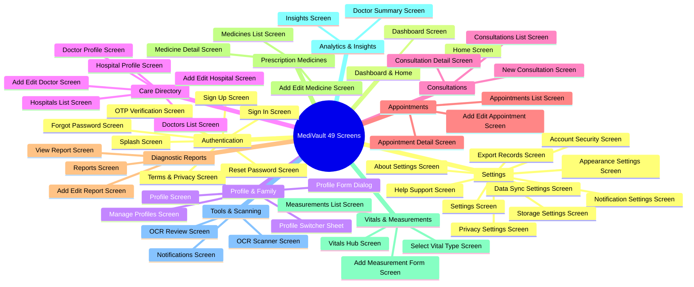
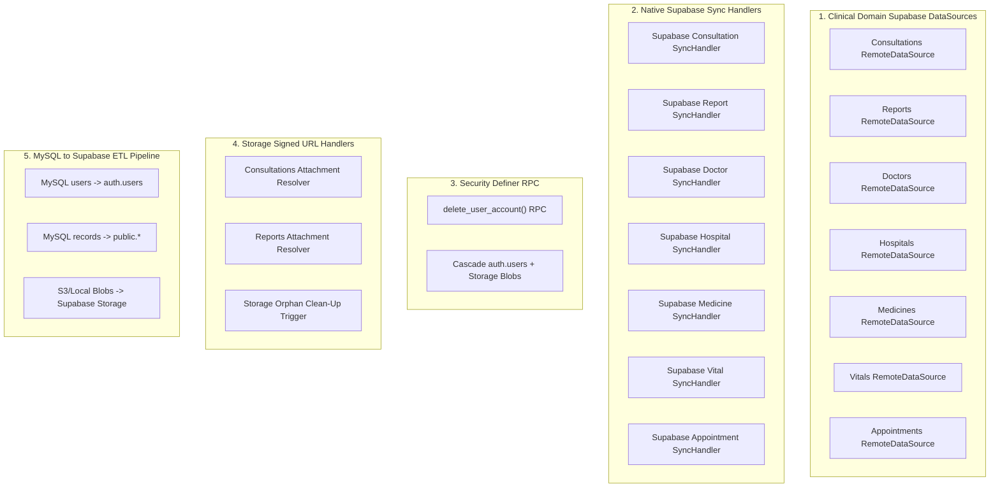
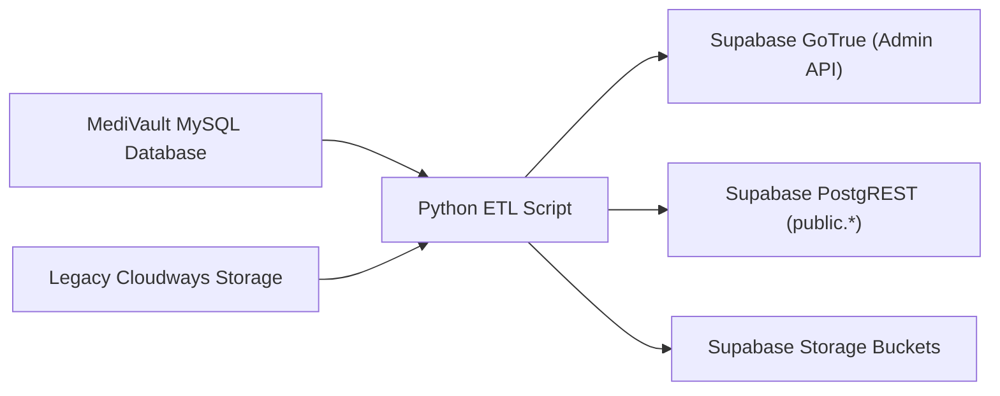
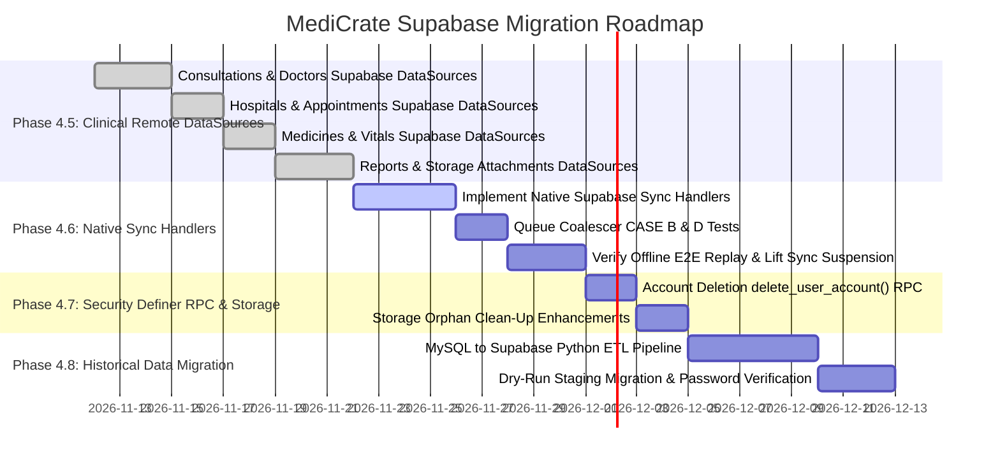

# MediCrate — Master Laravel-to-Supabase Migration Gap Analysis & Reconciliation

> **Canonical Document ID:** `docs/MEDICRATE_MASTER_MIGRATION_GAP_ANALYSIS.md`  
> **Target System:** MediCrate (`/home/blackhat/Documents/medi_crate`)  
> **Reference System:** MediVault (`/home/blackhat/Documents/Reubro/medivalut`)  
> **Audit Date:** November 11, 2026  
> **Auditor:** Antigravity AI — Principal Systems & Database Migration Architect  
> **Status:** Authoritative Discovery & Master Reconciliation Report (READ-ONLY Analysis)  
> **Product Principle:** $\text{MediCrate} \ge \text{MediVault}$ (Preserve complete functional parity and business rules while modernizing to Supabase, offline-first local persistence, and PostgreSQL RLS).

---

## 1. Executive Summary

This master discovery audit establishes the comprehensive, evidence-based reconciliation between the working reference application (**MediVault**) and the target modernization project (**MediCrate**).

MediVault is a functioning Personal Health Record (PHR) mobile application backed by a PHP Laravel 11 / MySQL 8.0 REST API hosted on Cloudways (`https://phplaravel-1505866-6585565.cloudwaysapps.com/api/v1`) with local Hive CE client caching. MediCrate is the modernized target, replacing the legacy PHP/MySQL infrastructure with a Supabase PostgreSQL backend, GoTrue authentication, Row Level Security (RLS), private Supabase Storage, and offline-first Hive caching.

### Key Discovery Metrics

| Metric Category | Count / Value | Analysis Summary |
| :--- | :---: | :--- |
| **Total MediVault Screens** | **49 Screens** | 48 master screens + `AppearanceSettingsScreen` across 12 functional modules. |
| **Documented Legacy REST APIs** | **64 Endpoints** | 63 active network endpoints (`A1`–`A10`, `B1`–`B5`, `F1`–`F8`, `D1`–`D5`, `H1`–`H5`, `MD1`, `C1`–`C6`, `AP1`–`AP5`, `R1`–`R6`, `M1`–`M5`, `V1`–`V5`, `AN1`, `DB1`, `T1`) + 1 domain validation spec (`V0`). |
| **Verified Live API Endpoints** | **63 Endpoints** | Live Cloudways API responds with standard Laravel RFC-7807/JSON envelopes; authenticated endpoints enforce Sanctum bearer tokens. |
| **Local-Only Features** | **10 Features** | 100% on-device (OCR scanner, doctor summary PDF export, notifications inbox, alarms, JSON/CSV backup, appearance/theme, storage diagnostics, privacy consent log, sync queue, local NoSQL). |
| **On-Device Aggregations** | **5 Endpoints** | In MediCrate, `F7`, `F8`, `AN1`, `DB1`, `T1` are computed client-side from local Hive records for 0ms cold-start responsiveness. |
| **MediCrate Fully Migrated** | **20 Endpoints / Capabilities** | Supabase Auth SDK (`A1`–`A8`, `A10`, `B1`, `B3`, `B4`), Profile CRUD (`F1`–`F4`), Avatar Storage (`F6`), Profile Archival (`F5` replacement), Medical Departments taxonomy (`MD1`), Medical History consistency (Batch 1), Account-scoped active profile storage (Batch 2C), Profile DELETE hardening (Batch 2D). |
| **MediCrate Partially Migrated** | **42 Endpoints / Capabilities** | PostgreSQL schema tables and Storage buckets exist in migrations, but Flutter data sources and repositories in `medi_crate` still point to legacy Dio/Laravel clients. Sync queue is safely suspended (`isRemotePushSuspended = true`). |
| **MediCrate Missing Features** | **2 Endpoints + 2 Workstreams** | Account Deletion RPC (`B5`), Apple Sign-In (`A9` — explicitly excluded from scope), Native Supabase Sync Handlers, and MySQL-to-Supabase Data Migration Tooling. |
| **Unverified Items** | **5 Items** | Cloudways MySQL internal database triggers, server-side OTP email templates, hosted Supabase production execution, server cron jobs, and hosted OAuth credentials. |

---

## 2. Evidence Sources & Verification Methodology

The findings in this report are grounded in five distinct evidence sources:

```
┌─────────────────────────────────────────────────────────────────────────────────┐
│                           EVIDENCE GATHERING MATRIX                             │
├───────────────────────────────┬─────────────────────────────────────────────────┤
│ 1. MediVault Documentation    │ API_SPECIFICATION.md, ARCHITECTURE.md,          │
│                               │ DATABASE_DESIGN.md, FINAL_BACKEND_HANDOVER.md,  │
│                               │ medivault_complete_api_requirements.csv,        │
│                               │ CROSS_CHECK_SUMMARY.md                          │
├───────────────────────────────┼─────────────────────────────────────────────────┤
│ 2. MediVault Flutter Source   │ 49 screens in /medivalut/lib/features/,         │
│                               │ 8 legacy sync handlers, Hive adapters,          │
│                               │ repository implementations, and unit tests      │
├───────────────────────────────┼─────────────────────────────────────────────────┤
│ 3. Live Functional API        │ Live endpoint probes against Cloudways host     │
│                               │ https://phplaravel-1505866-6585565...           │
│                               │ HTTP 401 & 422 JSON validation structures       │
├───────────────────────────────┼─────────────────────────────────────────────────┤
│ 4. MediVault Release APK      │ /medivalut/build/app/outputs/flutter-apk/       │
│                               │ app-release.apk (arm64, dex, assets, manifests) │
├───────────────────────────────┼─────────────────────────────────────────────────┤
│ 5. MediCrate Target Codebase  │ 4 Supabase SQL migrations, 323 passing Flutter  │
│                               │ unit/widget tests, SupabaseAuthRemoteDataSource,│
│                               │ SupabaseProfileRemoteDataSource, QueueCoalescer │
└───────────────────────────────┴─────────────────────────────────────────────────┘
```

### Safety & Integrity Constraints
- **Zero Source Modifications**: No code in `lib/`, `test/`, or configuration was modified in either repository.
- **Zero SQL Execution**: SQL migrations and test scripts remained unexecuted against hosted Supabase; no `supabase db push` or schema alter commands were issued.
- **Local Persistence & Sync Flags Intact**: Hive storage, clinical consultation records, vitals, and reports were preserved. `SyncService.isRemotePushSuspended` and `BackgroundSyncService.isLaravelSyncSuspended` remain `true`.
- **Git State Preserved**: No Git branch, checkout, commit, reset, or clean operations were performed.

---

## 3. MediVault Feature Inventory

MediVault comprises **49 screens across 12 functional modules**:



### On-Device Local-Only Features (10 Features)
MediVault implements 10 features strictly on-device that require **no cloud backend APIs**:
1. **In-App Notifications Inbox**: Stored locally in Hive `userBox` under `notification_*` keys.
2. **Medication Dose Reminders**: Scheduled via device platform alarms and local notifications.
3. **Appointment Visit Alarms**: Scheduled via device platform alarms 24 hours and 1 hour prior to appointment times.
4. **On-Device Optical Character Recognition (OCR)**: Scans prescription images locally using Google ML Kit (`TextRecognizer`); no cloud image transmission.
5. **OCR Prescription Parsing & Review**: Local interactive review flow before saving.
6. **Clinical Summary PDF Export**: Client-side generation of sanitized medical history PDF (financial fees stripped) using Dart `pdf` and `printing` packages.
7. **Offline Data Export**: Local generation of JSON/CSV health record archives.
8. **Theme & Appearance Settings**: Dark mode, light mode, and system preference persisted in `settingsBox`.
9. **Storage & Cache Diagnostics**: Local disk usage calculation and temporary image/PDF cache clearing.
10. **Privacy & Legal Consent Log**: Local append-only log of user privacy consent timestamps.

---

## 4. Verified Laravel API Inventory

The legacy backend exposes **64 REST API endpoints** conforming to the specification in `api_audit/medivault_complete_api_requirements.csv`:

| ID | Method & Route | Module | Purpose & Contract | MediCrate Target Architecture |
| :--- | :--- | :--- | :--- | :--- |
| **A1** | `POST /api/v1/auth/signup` | Auth | Register user account; creates primary Self profile. | Supabase Auth SDK (`signUp`) + DB trigger |
| **A2** | `POST /api/v1/auth/verify-email` | Auth | Validates 4-digit OTP email confirmation code. | Supabase Auth SDK (`verifyOTP`) |
| **A3** | `POST /api/v1/auth/resend-otp` | Auth | Resends verification OTP with 60s rate limit. | Supabase Auth SDK (`resend`) |
| **A4** | `POST /api/v1/auth/login` | Auth | Authenticates user; returns access + refresh JWTs. | Supabase Auth SDK (`signInWithPassword`) |
| **A5** | `POST /api/v1/auth/forgot-password` | Auth | Generates password reset OTP; returns generic 200. | Supabase Auth SDK (`resetPasswordForEmail`) |
| **A6** | `POST /api/v1/auth/reset-password` | Auth | Validates OTP and updates password hash. | Supabase Auth SDK (`updateUser`) |
| **A7** | `POST /api/v1/auth/refresh-token` | Auth | Renews expired access token using refresh token. | GoTrue Auto-Refresh Lifecycle |
| **A8** | `POST /api/v1/auth/google-login` | Auth | Exchanges Google ID token; auto-creates account. | Supabase Auth SDK (`signInWithIdToken`) |
| **A9** | `POST /api/v1/auth/apple-login` | Auth | Exchanges Apple ID token. | **EXCLUDED** from MediCrate Scope |
| **A10**| `POST /api/v1/auth/logout` | Auth | Revokes active session; client purges local cache. | Supabase Auth SDK (`signOut`) + Hive clear |
| **B1** | `GET /api/v1/users/me` | User | Fetches user identity and primary Self profile. | GoTrue session + `public.profiles` query |
| **B2** | `PUT /api/v1/users/me` | User | Updates primary profile demographics & vitals baseline. | PostgREST `UPDATE public.profiles` |
| **B3** | `PUT /api/v1/users/me/password` | User | Changes password after verifying current password. | Supabase Auth SDK (`updateUser`) |
| **B4** | `PUT /api/v1/users/me/email` | User | Updates email with verification confirmation. | Supabase Auth SDK (`updateUser`) |
| **B5** | `DELETE /api/v1/users/me` | User | Permanently deletes account and cascades child data. | PostgreSQL RPC `delete_user_account()` |
| **F1** | `GET /api/v1/family-members` | Family | Lists all family profiles owned by authenticated user. | PostgREST `SELECT public.profiles` |
| **F2** | `GET /api/v1/family-members/{id}` | Family | Retrieves demographic & medical baseline for member. | PostgREST `SELECT public.profiles WHERE id` |
| **F3** | `POST /api/v1/family-members` | Family | Adds family sub-profile (enforces `is_primary=false`). | PostgREST `INSERT public.profiles` |
| **F4** | `PUT /api/v1/family-members/{id}` | Family | Updates family profile demographics & medical history. | PostgREST `UPDATE public.profiles` |
| **F5** | `DELETE /api/v1/family-members/{id}`| Family | Deletes family profile. *(Hardened in MediCrate)* | **Archival / Restore Workflow** (Batch 2D) |
| **F6** | `POST /api/v1/family-members/{id}/photo`| Family | Uploads profile picture (multipart file $\le$ 5MB). | Supabase Storage (`avatars` bucket) |
| **F7** | `GET /api/v1/family/dashboard` | Family | Aggregated household vitals & visits overview. | Local Hive Aggregation (Client-Side) |
| **F8** | `GET /api/v1/family/analytics` | Family | Cross-member consultation, report & expense stats. | Local Hive Aggregation (Client-Side) |
| **D1** | `GET /api/v1/doctors` | Doctors | Lists saved doctors for active profile with search. | PostgREST `SELECT public.doctors` |
| **D2** | `POST /api/v1/doctors` | Doctors | Creates doctor record under active profile. | PostgREST `INSERT public.doctors` |
| **D3** | `GET /api/v1/doctors/{id}` | Doctors | Retrieves doctor details and linked encounter history. | PostgREST `SELECT public.doctors` + relations |
| **D4** | `PUT /api/v1/doctors/{id}` | Doctors | Updates clinician details, specialty, and contacts. | PostgREST `UPDATE public.doctors` |
| **D5** | `DELETE /api/v1/doctors/{id}` | Doctors | Deletes doctor; preserves `doctor_name` snapshot. | PostgREST `DELETE public.doctors` |
| **H1** | `GET /api/v1/hospitals` | Hospitals | Lists saved healthcare facilities by profile. | PostgREST `SELECT public.hospitals` |
| **H2** | `POST /api/v1/hospitals` | Hospitals | Adds hospital/clinic record under active profile. | PostgREST `INSERT public.hospitals` |
| **H3** | `GET /api/v1/hospitals/{id}` | Hospitals | Retrieves hospital details and affiliated clinicians. | PostgREST `SELECT public.hospitals` + relations |
| **H4** | `PUT /api/v1/hospitals/{id}` | Hospitals | Updates hospital details, type, address, emergency phone. | PostgREST `UPDATE public.hospitals` |
| **H5** | `DELETE /api/v1/hospitals/{id}` | Hospitals | Deletes hospital; preserves `hospital_name` snapshot. | PostgREST `DELETE public.hospitals` |
| **MD1**| `GET /api/v1/medical-departments` | Reference | Lists standardized taxonomy of clinical departments. | PostgREST `SELECT public.medical_departments` |
| **C1** | `GET /api/v1/consultations` | Consult | Lists chronological visits for active profile. | PostgREST `SELECT public.consultations` |
| **C2** | `POST /api/v1/consultations` | Consult | Logs visit, complaint, diagnosis, fee, follow-up. | PostgREST `INSERT public.consultations` |
| **C3** | `GET /api/v1/consultations/{id}` | Consult | Retrieves visit details + linked medicines and reports. | PostgREST `SELECT public.consultations` + joins |
| **C4** | `PUT /api/v1/consultations/{id}` | Consult | Updates clinical diagnosis, notes, fee, follow-up. | PostgREST `UPDATE public.consultations` |
| **C5** | `DELETE /api/v1/consultations/{id}` | Consult | Deletes visit; unlinks medicines & reports safely. | PostgREST `DELETE public.consultations` |
| **C6** | `GET /api/v1/consultations/{id}/files/{f}`| Consult | Streams/downloads consultation file attachment. | Supabase Storage (`consultations` bucket) |
| **AP1**| `GET /api/v1/appointments` | Appts | Lists appointments with status filtering. | PostgREST `SELECT public.appointments` |
| **AP2**| `POST /api/v1/appointments` | Appts | Books appointment, doctor, facility, date/time, fee. | PostgREST `INSERT public.appointments` |
| **AP3**| `GET /api/v1/appointments/{id}` | Appts | Retrieves booking details, location, status, clinician. | PostgREST `SELECT public.appointments` |
| **AP4**| `PUT /api/v1/appointments/{id}` | Appts | Reschedules appointment date/time or updates status. | PostgREST `UPDATE public.appointments` |
| **AP5**| `DELETE /api/v1/appointments/{id}` | Appts | Cancels and deletes appointment booking. | PostgREST `DELETE public.appointments` |
| **R1** | `GET /api/v1/reports` | Reports | Lists diagnostic reports with category filtering. | PostgREST `SELECT public.reports` |
| **R2** | `POST /api/v1/reports` | Reports | Uploads report metadata and binary attachments ($\le$ 25MB). | PostgREST INSERT + Storage `reports` |
| **R3** | `GET /api/v1/reports/{id}` | Reports | Retrieves report metadata, expense info, file links. | PostgREST `SELECT public.reports` + relations |
| **R4** | `PUT /api/v1/reports/{id}` | Reports | Updates report title, category, date, notes, expense. | PostgREST `UPDATE public.reports` |
| **R5** | `DELETE /api/v1/reports/{id}` | Reports | Deletes report metadata and purges Storage files. | PostgREST DELETE + Storage object purge |
| **R6** | `GET /api/v1/reports/{id}/files/{f}` | Reports | Secured download route for report PDF or image. | Supabase Storage (`reports` bucket signed URL) |
| **M1** | `GET /api/v1/medicines` | Medicines | Lists active/completed prescriptions for profile. | PostgREST `SELECT public.prescriptions` |
| **M2** | `POST /api/v1/medicines` | Medicines | Adds prescription regimen (dosage, form, frequency). | PostgREST `INSERT public.prescriptions` |
| **M3** | `GET /api/v1/medicines/{id}` | Medicines | Retrieves prescription details and linked visit context. | PostgREST `SELECT public.prescriptions` |
| **M4** | `PUT /api/v1/medicines/{id}` | Medicines | Updates dosage, end date, reminder status. | PostgREST `UPDATE public.prescriptions` |
| **M5** | `DELETE /api/v1/medicines/{id}` | Medicines | Removes prescription; cancels local alarms. | PostgREST `DELETE public.prescriptions` |
| **V0** | `[Domain Specification]` | Vitals | Specification for 7 allowed vital types. | PostgreSQL check constraint `check_vital_type` |
| **V1** | `POST /api/v1/vitals` | Vitals | Logs any of 7 vital types (BP requires dual values). | PostgREST `INSERT public.measurements` |
| **V2** | `GET /api/v1/vitals` | Vitals | Lists historical vital readings for profile trend logs. | PostgREST `SELECT public.measurements` |
| **V3** | `GET /api/v1/vitals/{id}` | Vitals | Retrieves single vital reading attributes and timestamp. | PostgREST `SELECT public.measurements WHERE id` |
| **V4** | `PUT /api/v1/vitals/{id}` | Vitals | Edits vital reading. (BMI value/date immutable). | PostgREST `UPDATE public.measurements` |
| **V5** | `DELETE /api/v1/vitals/{id}` | Vitals | Removes single vital measurement reading. | PostgREST `DELETE public.measurements` |
| **AN1**| `GET /api/v1/analytics` | Insights | Health Vault completeness score & vital trends. | Local Hive Aggregation (Client-Side) |
| **DB1**| `GET /api/v1/dashboard` | Dashboard | Fast home screen summary feed. | Local Hive Aggregation (Client-Side) |
| **T1** | `GET /api/v1/timeline` | Timeline | Unified chronological longitudinal medical feed. | Local Hive Aggregation (Client-Side) |

---

## 5. Database & Business-Rule Inventory

### Relational Schema Mappings (MySQL $\rightarrow$ PostgreSQL)

| MediVault MySQL Table | MediCrate PostgreSQL Table | Primary Key | Compound Foreign Key / Multi-Tenant Isolation | Key Constraints & Invariants |
| :--- | :--- | :--- | :--- | :--- |
| `users` | `auth.users` | `id` (UUID) | System table managed by Supabase GoTrue | RFC email unique, bcrypt password, email verified timestamp. |
| `profiles` / `user_profiles` | `public.profiles` | `id` (UUID) | `user_id REFERENCES auth.users(id) ON DELETE CASCADE` | Exactly 1 primary profile per user (`is_primary=true`). Relationship enum: `Self, Father, Mother, Spouse, Son, Daughter, Brother, Sister, Grandfather, Grandmother, Guardian, Other`. Gender enum: `Male, Female, Other, Others, Prefer not to say`. |
| `doctors` | `public.doctors` | `id` (UUID) | `(profile_id, user_id) REFERENCES public.profiles(id, user_id) ON DELETE CASCADE` | Scoped by profile; stores `name`, `specialty`, `phone`, `email`, `hospital_ids[]`. |
| `hospitals` | `public.hospitals` | `id` (UUID) | `(profile_id, user_id) REFERENCES public.profiles(id, user_id) ON DELETE CASCADE` | Facility type enum: `Hospital, Clinic, Lab, Diagnostic`. Emergency contact phone. |
| `medical_departments` | `public.medical_departments` | `id` (BIGINT) | Reference table (Public Read) | Standardized taxonomy (15 core departments); ordered by `display_order`. |
| `consultations` | `public.consultations` | `id` (UUID) | `(profile_id, user_id) REFERENCES public.profiles(id, user_id) ON DELETE CASCADE` | Visit date, chief complaint, diagnosis. Preserves `doctor_name` and `hospital_name` text snapshots. Optional `appointment_id` linkage. |
| `appointments` | `public.appointments` | `id` (UUID) | `(profile_id, user_id) REFERENCES public.profiles(id, user_id) ON DELETE CASCADE` | Status enum: `upcoming, completed, cancelled, missed`. Scheduled ISO timestamp. |
| `prescriptions` / `medicines` | `public.prescriptions` | `id` (UUID) | `(profile_id, user_id) REFERENCES public.profiles(id, user_id) ON DELETE CASCADE` | Prescribed drug name, dosage, form, frequency, start/end dates. Optional `consultation_id`. |
| `reports` | `public.reports` | `id` (UUID) | `(profile_id, user_id) REFERENCES public.profiles(id, user_id) ON DELETE CASCADE` | Category enum: `LAB TEST, IMAGING, PRESCRIPTION, DISCHARGE, CERTIFICATE, VACCINATION, REFERRAL, OTHER`. |
| `report_attachments` | `public.report_attachments` | `id` (UUID) | `report_id REFERENCES public.reports(id) ON DELETE CASCADE` | Storage object path, MIME type, file size bytes. |
| `report_expenses` | `public.report_expenses` | `id` (UUID) | `report_id REFERENCES public.reports(id) ON DELETE CASCADE` | Embedded 1:1 financial cost, payment status (`paid, pending`), currency. |
| `health_measurements` | `public.measurements` | `id` (UUID) | `(profile_id, user_id) REFERENCES public.profiles(id, user_id) ON DELETE CASCADE` | Vital type enum (7 types): `bp, glucose, heart_rate, spo2, temperature, respiratory_rate, bmi`. Recorded timestamp, source. |

### Business Rules & Invariants
1. **Primary Self Profile Invariance**:
   - Every registered account has exactly one primary profile (`is_primary = true`, `relationship = 'Self'`).
   - The primary profile is auto-created on registration by the database trigger `on_auth_user_created`.
   - The primary profile cannot be deleted, archived, or transferred.
2. **Profile Archival vs. Deletion**:
   - Permanent family profile deletion is forbidden for authenticated client roles.
   - Inactive family profiles transition to `is_archived = true` via dedicated endpoints.
   - Historical clinical records remain readable via SELECT.
   - New clinical records (consultations, appointments, reports, vitals, prescriptions) cannot be inserted or updated against archived profiles (`check_profile_archival_rules` and `enforce_active_profile_for_clinical_records`).
3. **Medical History Consistency (Batch 1)**:
   - Allergies and chronic conditions enforce strict mutual exclusion between list entries and confirmed-none flags.
   - If an entry is added, `confirmed_none` is cleared to `false`.
   - Non-empty lists disable the confirmed-none checkbox.
4. **Historical BMI Immutability**:
   - BMI is calculated client-side from profile height and weight ($BMI = \frac{weight}{(height/100)^2}$) and logged as a point-in-time measurement snapshot.
   - The backend accepts the submitted `primary_value` and must **never recalculate** historical BMI when profile height/weight changes.
5. **Text Snapshots on Deletion**:
   - Deleting a doctor or hospital record does not break historical consultation encounters.
   - Consultations retain immutable `doctor_name` and `hospital_name` string snapshots.
6. **Health Vault Completeness Scoring**:
   - Evaluated across 4 categories (Total = 100 Points):
     $$\text{Score} = \text{Vitals (40)} + \text{Profile (20)} + \text{Consultations (20)} + \text{Reports (20)}$$
   - Vitals (40 pts): $\frac{40}{7} \approx 5.71$ pts per vital logged in the last 365 days.
   - Profile (20 pts): 4.0 pts per completed field (blood group, height, weight, allergies, conditions).
   - Consultations (20 pts): Binary 20 pts if $\ge 1$ visit in the last 365 days.
   - Reports (20 pts): Binary 20 pts if $\ge 1$ diagnostic report in the last 365 days.

---

## 6. Working APK Workflow Inventory

Static and architectural inspection of `app-release.apk` (`/home/blackhat/Documents/Reubro/medivalut/build/app/outputs/flutter-apk/app-release.apk`) establishes the exact operational mobile workflows:

```
┌─────────────────────────────────────────────────────────────────────────────────┐
│                          APK RUNTIME WORKFLOW PIPELINE                          │
├─────────────────────────────────────────────────────────────────────────────────┤
│ 1. Cold Boot & Session Check:                                                   │
│    SplashScreen ──► Reads FlutterSecureStorage for JWT                          │
│                     ├── Valid ──► Checks Hive userBox ──► HomeScreen            │
│                     └── Missing/Invalid ──► SignInScreen                        │
├─────────────────────────────────────────────────────────────────────────────────┤
│ 2. Offline Multi-Profile Switching:                                             │
│    AppBar Avatar Tap ──► ProfileSwitcherSheet ──► Selects Profile               │
│                          ├── Active profile ID written to userBox               │
│                          └── Riverpod activeProfileProvider updates all screens │
├─────────────────────────────────────────────────────────────────────────────────┤
│ 3. Clinical Encounter Creation:                                                 │
│    FloatingActionButton (+) ──► NewConsultationScreen                           │
│                                 ├── Doctor Picker Sheet (Search / Add New)      │
│                                 ├── Hospital Picker Sheet (Search / Add New)    │
│                                 ├── Department Dropdown (15 items)              │
│                                 ├── Clinical Notes & Diagnosis                  │
│                                 ├── Follow-up Toggle (Sets local device alarm)  │
│                                 └── Save ──► 0ms Hive Write ──► Queue Sync      │
├─────────────────────────────────────────────────────────────────────────────────┤
│ 4. Diagnostic Report & File Attachment Workflow:                                │
│    ReportsScreen ──► AddEditReportScreen                                        │
│                      ├── Category Chip Selection                                │
│                      ├── Multi-attachment picker (Camera / Gallery / Files)     │
│                      ├── Fee & Payment Status (Paid / Pending)                  │
│                      └── Upload ──► Cached locally ──► Sync multipart upload    │
├─────────────────────────────────────────────────────────────────────────────────┤
│ 5. Longitudinal Timeline Feed:                                                  │
│    TimelineScreen ──► Scans Hive boxes (consultations, appointments,            │
│                       measurements, medicines, reports)                         │
│                       └── Merges into chronological reverse-ordered feed        │
└─────────────────────────────────────────────────────────────────────────────────┘
```

---

## 7. MediCrate Implementation Inventory

### Supabase Migrations Implemented
1. [`20261109200000_create_medicrate_foundation_schema.sql`](file:///home/blackhat/Documents/medi_crate/supabase/migrations/20261109200000_create_medicrate_foundation_schema.sql):
   - PostgreSQL tables: `profiles`, `medical_departments`, `doctors`, `hospitals`, `consultations`, `appointments`, `prescriptions`, `reports`, `report_attachments`, `report_expenses`, `measurements`.
   - Compound foreign keys: `(profile_id, user_id) REFERENCES public.profiles(id, user_id) ON DELETE CASCADE`.
   - Row Level Security (RLS) enabled on all tables (`auth.uid() = user_id`).
   - Trigger `on_auth_user_created` bootstrapping primary profile.
2. [`20261109210000_create_medicrate_storage_buckets_and_policies.sql`](file:///home/blackhat/Documents/medi_crate/supabase/migrations/20261109210000_create_medicrate_storage_buckets_and_policies.sql):
   - Storage buckets: `consultations` (25MB, PDF/img), `reports` (25MB, PDF/img), `avatars` (5MB, img). All private (`public = false`).
   - Storage RLS enforcing depth and ownership.
3. [`20261110080000_prepare_profile_archival_support.sql`](file:///home/blackhat/Documents/medi_crate/supabase/migrations/20261110080000_prepare_profile_archival_support.sql):
   - Added `is_archived` and `archived_at` to `public.profiles`.
   - Archival trigger `check_profile_archival_rules` and `enforce_active_profile_for_clinical_records`.
   - Preserves historical clinical SELECT access.
4. [`20261111100000_harden_profile_delete_policy.sql`](file:///home/blackhat/Documents/medi_crate/supabase/migrations/20261111100000_harden_profile_delete_policy.sql):
   - Dropped permissive client DELETE policies on `public.profiles`.
   - Revoked table `DELETE` privileges from `authenticated`, `anon`, and `public`.
   - Preserved full CRUD for `service_role` and `postgres`.

### Active Flutter Data Sources in MediCrate
- **Supabase-Native**:
  - [`SupabaseAuthRemoteDataSource`](file:///home/blackhat/Documents/medi_crate/lib/features/auth/data/datasources/remote/supabase_auth_remote_data_source.dart) (Auth lifecycle)
  - [`SupabaseProfileRemoteDataSource`](file:///home/blackhat/Documents/medi_crate/lib/features/profile/data/datasources/remote/supabase_profile_remote_data_source.dart) (Profile CRUD, Archival, Avatars)
  - [`MedicalDepartmentRemoteDataSource`](file:///home/blackhat/Documents/medi_crate/lib/features/consultations/data/datasources/remote/medical_department_remote_data_source.dart) (Taxonomy query)
- **Legacy Laravel (Dormant / Suspended)**:
  - `ConsultationRemoteDataSource`, `ReportRemoteDataSource`, `DoctorRemoteDataSource`, `HospitalRemoteDataSource`, `MedicineRemoteDataSource`, `VitalsRemoteDataSource`, `AppointmentRemoteDataSource`.

---

## 8. Complete Feature Parity Matrix

Status Definitions:
- **UI**: 1 = Implemented, 0 = Absent
- **Local**: 1 = Hive storage implemented, 0 = Absent
- **Supabase**: 1 = Supabase PostgREST/Storage/RPC implemented, 0 = Absent
- **Security**: 1 = RLS and business rules enforced, 0 = Absent
- **E2E**: 1 = End-to-end verified, 0 = Pending/Unverified

| Feature / Domain | MediVault UI & Route | Laravel Backend | MediCrate UI | Supabase Target | Local Hive | Sync Status | Tests | Status (UI / Local / Supa / Sec / E2E) | Gap / Missing Behaviour | Priority |
| :--- | :--- | :--- | :--- | :--- | :--- | :--- | :--- | :---: | :--- | :---: |
| **User Sign Up** | `SignUpScreen` (`/signup`) | `A1` `POST /auth/signup` | `SignUpScreen` | Supabase Auth `signUp()` | Token + User | N/A (Direct) | Unit + Mock | `[1, 1, 1, 1, 1]` | Fully transitioned to Supabase GoTrue. | Completed |
| **Email Verification** | `OtpVerificationScreen` | `A2` `POST /auth/verify-email` | `OtpVerificationScreen` | Supabase Auth `verifyOTP()` | Token | N/A (Direct) | Unit | `[1, 1, 1, 1, 1]` | Fully transitioned to Supabase GoTrue. | Completed |
| **Resend OTP** | `OtpVerificationScreen` | `A3` `POST /auth/resend-otp` | `OtpVerificationScreen` | Supabase Auth `resend()` | None | N/A (Direct) | Unit | `[1, 1, 1, 1, 1]` | Fully transitioned to Supabase GoTrue. | Completed |
| **Password Sign In** | `SignInScreen` (`/login`) | `A4` `POST /auth/login` | `SignInScreen` | Supabase Auth `signInWithPassword()` | Token + User | N/A (Direct) | Unit | `[1, 1, 1, 1, 1]` | Fully transitioned to Supabase GoTrue. | Completed |
| **Forgot Password** | `ForgotPasswordScreen` | `A5` `POST /auth/forgot-password`| `ForgotPasswordScreen` | Supabase Auth `resetPasswordForEmail()`| None | N/A (Direct) | Unit | `[1, 1, 1, 1, 1]` | Fully transitioned to Supabase GoTrue. | Completed |
| **Reset Password** | `ResetPasswordScreen` | `A6` `POST /auth/reset-password` | `ResetPasswordScreen` | Supabase Auth `updateUser()` | Clear tokens | N/A (Direct) | Unit | `[1, 1, 1, 1, 1]` | Fully transitioned to Supabase GoTrue. | Completed |
| **Session Refresh** | `DioInterceptor` | `A7` `POST /auth/refresh-token` | `SupabaseConfig` | GoTrue automatic background refresh | Token | N/A (Auto) | Unit | `[1, 1, 1, 1, 1]` | Handled transparently by Supabase client. | Completed |
| **Google Sign In** | `SignInScreen` | `A8` `POST /auth/google-login` | `SignInScreen` | Supabase Auth `signInWithIdToken()` | Token + User | N/A (Direct) | Unit | `[1, 1, 1, 1, 1]` | Fully transitioned to Supabase GoTrue. | Completed |
| **Apple Sign In** | `SignInScreen` | `A9` `POST /auth/apple-login` | Omitted | Excluded | None | Excluded | N/A | `[0, 0, 0, 0, 0]` | **EXCLUDED** from MediCrate scope. | Excluded |
| **Sign Out** | `SettingsScreen` | `A10` `POST /auth/logout` | `SettingsScreen` | Supabase Auth `signOut()` | Clear all | N/A (Direct) | Unit | `[1, 1, 1, 1, 1]` | Clears secure storage and Hive boxes. | Completed |
| **Current User / Profile** | `ProfileScreen` (`/profile`) | `B1` `GET /users/me` | `ProfileScreen` | PostgREST `SELECT public.profiles` | `userBox` | Pull Sync | Unit | `[1, 1, 1, 1, 1]` | Queries `public.profiles` for `is_primary=true`. | Completed |
| **Update Primary Profile**| `ProfileScreen` | `B2` `PUT /users/me` | `ProfileScreen` | PostgREST `UPDATE public.profiles` | `profileBox` | Online-Only | Unit | `[1, 1, 1, 1, 1]` | Demographic whitelist prevents privilege creep. | Completed |
| **Change Password** | `AccountSecurityScreen` | `B3` `PUT /users/me/password` | `AccountSecurityScreen`| Supabase Auth `updateUser(password)` | None | N/A (Direct) | Unit | `[1, 1, 1, 1, 1]` | Fully transitioned to Supabase GoTrue. | Completed |
| **Change Email** | `AccountSecurityScreen` | `B4` `PUT /users/me/email` | `AccountSecurityScreen`| Supabase Auth `updateUser(email)` | `userBox` | N/A (Direct) | Unit | `[1, 1, 1, 1, 1]` | Fully transitioned to Supabase GoTrue. | Completed |
| **Delete Account** | `AccountSecurityScreen` | `B5` `DELETE /users/me` | `AccountSecurityScreen`| **Missing RPC: `delete_user_account()`**| Clear all | N/A (Direct) | Unit | `[1, 1, 0, 0, 0]` | Requires `SECURITY DEFINER` RPC to delete from `auth.users`. | **Critical** |
| **List Family Profiles** | `ManageProfilesScreen` | `F1` `GET /family-members` | `ManageProfilesScreen` | PostgREST `SELECT public.profiles` | `profileBox` | Pull Sync | Unit | `[1, 1, 1, 1, 1]` | RLS enforces `user_id = auth.uid()`. | Completed |
| **Get Family Profile** | `ProfileScreen` | `F2` `GET /family-members/{id}`| `ProfileScreen` | PostgREST `SELECT public.profiles` | `profileBox` | Pull Sync | Unit | `[1, 1, 1, 1, 1]` | Scoped by profile ID and owner ID. | Completed |
| **Add Family Profile** | `ProfileFormDialog` | `F3` `POST /family-members` | `ProfileFormDialog` | PostgREST `INSERT public.profiles` | `profileBox` | Online-Only | Unit | `[1, 1, 1, 1, 1]` | Enforces `is_primary=false` and client UUID. | Completed |
| **Update Family Profile** | `ProfileFormDialog` | `F4` `PUT /family-members/{id}`| `ProfileFormDialog` | PostgREST `UPDATE public.profiles` | `profileBox` | Online-Only | Unit | `[1, 1, 1, 1, 1]` | Demographic whitelist excludes system columns. | Completed |
| **Delete / Archive Profile**| `ManageProfilesScreen` | `F5` `DELETE /family-members/{id}`| `ManageProfilesScreen`| **Archival / Restore Workflow** | `profileBox` | Online-Only | Unit + SQL | `[1, 1, 1, 1, 1]` | Hard DELETE dropped (Batch 2D); replaced by Archive/Restore. | Completed |
| **Upload Profile Avatar** | `ProfileAvatarPicker` | `F6` `POST /family-members/{id}/photo`| `ProfileAvatarPicker` | Storage bucket `avatars` | `profileBox` | Online-Only | Unit | `[1, 1, 1, 1, 1]` | Uploads to private bucket; signed URLs via AvatarUrlResolver. | Completed |
| **Family Dashboard** | `HomeScreen` | `F7` `GET /family/dashboard` | `HomeScreen` | Local Hive Aggregation | `userBox` | Local | Unit | `[1, 1, 1, 1, 1]` | Computed on-device with 0ms cold-start latency. | Completed |
| **Family Analytics** | `InsightsScreen` | `F8` `GET /family/analytics` | `InsightsScreen` | Local Hive Aggregation | `userBox` | Local | Unit | `[1, 1, 1, 1, 1]` | Computed on-device from cached member records. | Completed |
| **Medical Departments** | Dropdown Selector | `MD1` `GET /medical-departments`| Form Dropdown | PostgREST `medical_departments` | App Cache | Direct Query | Unit | `[1, 1, 1, 1, 1]` | Migrated in MedicalDepartmentRemoteDataSource. | Completed |
| **List Doctors** | `DoctorsListScreen` | `D1` `GET /doctors` | `DoctorsListScreen` | **Missing Remote DataSource** | `userBox` | Suspended | Unit | `[1, 1, 0, 1, 0]` | Table exists in SQL; needs Supabase remote data source. | **High** |
| **Create Doctor** | `AddEditDoctorScreen` | `D2` `POST /doctors` | `AddEditDoctorScreen` | **Missing Remote DataSource** | `userBox` | Suspended | Unit | `[1, 1, 0, 1, 0]` | Table exists in SQL; needs Supabase remote data source. | **High** |
| **Get Doctor Details** | `DoctorProfileScreen` | `D3` `GET /doctors/{id}` | `DoctorProfileScreen` | **Missing Remote DataSource** | `userBox` | Suspended | Unit | `[1, 1, 0, 1, 0]` | Table exists in SQL; needs Supabase remote data source. | **High** |
| **Update Doctor** | `AddEditDoctorScreen` | `D4` `PUT /doctors/{id}` | `AddEditDoctorScreen` | **Missing Remote DataSource** | `userBox` | Suspended | Unit | `[1, 1, 0, 1, 0]` | Table exists in SQL; needs Supabase remote data source. | **High** |
| **Delete Doctor** | `DoctorProfileScreen` | `D5` `DELETE /doctors/{id}` | `DoctorProfileScreen` | **Missing Remote DataSource** | `userBox` | Suspended | Unit | `[1, 1, 0, 1, 0]` | Table exists in SQL; needs Supabase remote data source. | **High** |
| **List Hospitals** | `HospitalsListScreen` | `H1` `GET /hospitals` | `HospitalsListScreen` | **Missing Remote DataSource** | `userBox` | Suspended | Unit | `[1, 1, 0, 1, 0]` | Table exists in SQL; needs Supabase remote data source. | **High** |
| **Create Hospital** | `AddEditHospitalScreen` | `H2` `POST /hospitals` | `AddEditHospitalScreen`| **Missing Remote DataSource** | `userBox` | Suspended | Unit | `[1, 1, 0, 1, 0]` | Table exists in SQL; needs Supabase remote data source. | **High** |
| **Get Hospital Details** | `HospitalProfileScreen` | `H3` `GET /hospitals/{id}` | `HospitalProfileScreen`| **Missing Remote DataSource** | `userBox` | Suspended | Unit | `[1, 1, 0, 1, 0]` | Table exists in SQL; needs Supabase remote data source. | **High** |
| **Update Hospital** | `AddEditHospitalScreen` | `H4` `PUT /hospitals/{id}` | `AddEditHospitalScreen`| **Missing Remote DataSource** | `userBox` | Suspended | Unit | `[1, 1, 0, 1, 0]` | Table exists in SQL; needs Supabase remote data source. | **High** |
| **Delete Hospital** | `HospitalProfileScreen` | `H5` `DELETE /hospitals/{id}` | `HospitalProfileScreen`| **Missing Remote DataSource** | `userBox` | Suspended | Unit | `[1, 1, 0, 1, 0]` | Table exists in SQL; needs Supabase remote data source. | **High** |
| **List Consultations** | `ConsultationsListScreen` | `C1` `GET /consultations` | `ConsultationsListScreen`| **Missing Remote DataSource** | `userBox` | Suspended | Unit | `[1, 1, 0, 1, 0]` | Table exists in SQL; needs Supabase remote data source. | **High** |
| **Add Consultation** | `NewConsultationScreen` | `C2` `POST /consultations` | `NewConsultationScreen` | **Missing Remote DataSource** | `userBox` | Suspended | Unit | `[1, 1, 0, 1, 0]` | Table exists in SQL; needs Supabase remote data source. | **High** |
| **Get Consultation** | `ConsultationDetailScreen` | `C3` `GET /consultations/{id}` | `ConsultationDetailScreen`| **Missing Remote DataSource** | `userBox` | Suspended | Unit | `[1, 1, 0, 1, 0]` | Table exists in SQL; needs Supabase remote data source. | **High** |
| **Update Consultation** | `NewConsultationScreen` | `C4` `PUT /consultations/{id}` | `NewConsultationScreen` | **Missing Remote DataSource** | `userBox` | Suspended | Unit | `[1, 1, 0, 1, 0]` | Table exists in SQL; needs Supabase remote data source. | **High** |
| **Delete Consultation** | `ConsultationDetailScreen` | `C5` `DELETE /consultations/{id}`| `ConsultationDetailScreen`| **Missing Remote DataSource** | `userBox` | Suspended | Unit | `[1, 1, 0, 1, 0]` | Table exists in SQL; needs Supabase remote data source. | **High** |
| **Consultation Attachment**| `ConsultationDetailScreen`| `C6` `GET /consultations/{id}/files`| `ConsultationDetailScreen`| Storage `consultations` bucket | Local File | Suspended | Unit | `[1, 1, 0, 1, 0]` | Bucket exists; needs Supabase Storage download integration. | **High** |
| **List Appointments** | `AppointmentsListScreen` | `AP1` `GET /appointments` | `AppointmentsListScreen`| **Missing Remote DataSource** | `userBox` | Suspended | Unit | `[1, 1, 0, 1, 0]` | Table exists in SQL; needs Supabase remote data source. | **High** |
| **Book Appointment** | `AddEditAppointmentScreen` | `AP2` `POST /appointments` | `AddEditAppointmentScreen`| **Missing Remote DataSource** | `userBox` | Suspended | Unit | `[1, 1, 0, 1, 0]` | Table exists in SQL; needs Supabase remote data source. | **High** |
| **Get Appointment Details**| `AppointmentDetailScreen` | `AP3` `GET /appointments/{id}`| `AppointmentDetailScreen`| **Missing Remote DataSource** | `userBox` | Suspended | Unit | `[1, 1, 0, 1, 0]` | Table exists in SQL; needs Supabase remote data source. | **High** |
| **Reschedule Appointment** | `AddEditAppointmentScreen` | `AP4` `PUT /appointments/{id}`| `AddEditAppointmentScreen`| **Missing Remote DataSource** | `userBox` | Suspended | Unit | `[1, 1, 0, 1, 0]` | Table exists in SQL; needs Supabase remote data source. | **High** |
| **Cancel Appointment** | `AppointmentDetailScreen` | `AP5` `DELETE /appointments/{id}`| `AppointmentDetailScreen`| **Missing Remote DataSource** | `userBox` | Suspended | Unit | `[1, 1, 0, 1, 0]` | Table exists in SQL; needs Supabase remote data source. | **High** |
| **List Diagnostic Reports**| `ReportsScreen` | `R1` `GET /reports` | `ReportsScreen` | **Missing Remote DataSource** | `userBox` | Suspended | Unit | `[1, 1, 0, 1, 0]` | Table exists in SQL; needs Supabase remote data source. | **High** |
| **Upload Report & File** | `AddEditReportScreen` | `R2` `POST /reports` | `AddEditReportScreen` | **Missing Remote DataSource** | Local File | Suspended | Unit | `[1, 1, 0, 1, 0]` | Table & bucket exist; needs Supabase multipart upload. | **High** |
| **Get Report Details** | `ViewReportScreen` | `R3` `GET /reports/{id}` | `ViewReportScreen` | **Missing Remote DataSource** | `userBox` | Suspended | Unit | `[1, 1, 0, 1, 0]` | Table exists in SQL; needs Supabase remote data source. | **High** |
| **Update Report** | `AddEditReportScreen` | `R4` `PUT /reports/{id}` | `AddEditReportScreen` | **Missing Remote DataSource** | `userBox` | Suspended | Unit | `[1, 1, 0, 1, 0]` | Table exists in SQL; needs Supabase remote data source. | **High** |
| **Delete Report & Blob** | `ViewReportScreen` | `R5` `DELETE /reports/{id}` | `ViewReportScreen` | **Missing Remote DataSource** | Purged | Suspended | Unit | `[1, 1, 0, 1, 0]` | Table & bucket exist; needs Supabase delete orchestration. | **High** |
| **Download Report Blob** | `ViewReportScreen` | `R6` `GET /reports/{id}/files` | `ViewReportScreen` | Storage `reports` bucket | Cached File| Suspended | Unit | `[1, 1, 0, 1, 0]` | Bucket exists; needs signed URL resolver. | **High** |
| **List Medicines** | `MedicinesListScreen` | `M1` `GET /medicines` | `MedicinesListScreen` | **Missing Remote DataSource** | `userBox` | Suspended | Unit | `[1, 1, 0, 1, 0]` | Table exists in SQL; needs Supabase remote data source. | **High** |
| **Add Medicine** | `AddEditMedicineScreen` | `M2` `POST /medicines` | `AddEditMedicineScreen` | **Missing Remote DataSource** | `userBox` | Suspended | Unit | `[1, 1, 0, 1, 0]` | Table exists in SQL; needs Supabase remote data source. | **High** |
| **Get Medicine Details** | `MedicineDetailScreen` | `M3` `GET /medicines/{id}` | `MedicineDetailScreen` | **Missing Remote DataSource** | `userBox` | Suspended | Unit | `[1, 1, 0, 1, 0]` | Table exists in SQL; needs Supabase remote data source. | **High** |
| **Update Medicine** | `AddEditMedicineScreen` | `M4` `PUT /medicines/{id}` | `AddEditMedicineScreen` | **Missing Remote DataSource** | `userBox` | Suspended | Unit | `[1, 1, 0, 1, 0]` | Table exists in SQL; needs Supabase remote data source. | **High** |
| **Delete Medicine** | `MedicineDetailScreen` | `M5` `DELETE /medicines/{id}` | `MedicineDetailScreen` | **Missing Remote DataSource** | `userBox` | Suspended | Unit | `[1, 1, 0, 1, 0]` | Table exists in SQL; needs Supabase remote data source. | **High** |
| **Log Vital Sign** | `AddMeasurementFormScreen` | `V1` `POST /vitals` | `AddMeasurementFormScreen`| **Missing Remote DataSource** | `userBox` | Suspended | Unit | `[1, 1, 0, 1, 0]` | Table exists in SQL; needs Supabase remote data source. | **High** |
| **List Vital Signs** | `MeasurementsListScreen` | `V2` `GET /vitals` | `MeasurementsListScreen` | **Missing Remote DataSource** | `userBox` | Suspended | Unit | `[1, 1, 0, 1, 0]` | Table exists in SQL; needs Supabase remote data source. | **High** |
| **Get Vital Details** | `MeasurementsListScreen` | `V3` `GET /vitals/{id}` | `MeasurementsListScreen` | **Missing Remote DataSource** | `userBox` | Suspended | Unit | `[1, 1, 0, 1, 0]` | Table exists in SQL; needs Supabase remote data source. | **High** |
| **Edit Vital Sign** | `AddMeasurementFormScreen` | `V4` `PUT /vitals/{id}` | `AddMeasurementFormScreen`| **Missing Remote DataSource** | `userBox` | Suspended | Unit | `[1, 1, 0, 1, 0]` | Table exists in SQL; needs Supabase remote data source. | **High** |
| **Delete Vital Sign** | `MeasurementsListScreen` | `V5` `DELETE /vitals/{id}` | `MeasurementsListScreen` | **Missing Remote DataSource** | `userBox` | Suspended | Unit | `[1, 1, 0, 1, 0]` | Table exists in SQL; needs Supabase remote data source. | **High** |
| **Health Insights Summary**| `InsightsScreen` | `AN1` `GET /analytics` | `InsightsScreen` | Local Hive Aggregation | `userBox` | Local | Unit | `[1, 1, 1, 1, 1]` | Evaluates 40/20/20/20 points on-device offline. | Completed |
| **Dashboard Summary** | `HomeScreen` | `DB1` `GET /dashboard` | `HomeScreen` | Local Hive Aggregation | `userBox` | Local | Unit | `[1, 1, 1, 1, 1]` | Fast home feed assembled client-side. | Completed |
| **Longitudinal Timeline** | `TimelineScreen` | `T1` `GET /timeline` | `TimelineScreen` | Local Hive Aggregation | `userBox` | Local | Unit | `[1, 1, 1, 1, 1]` | Merged chronological feed assembled client-side. | Completed |

---

## 9. Missing & Incomplete Functionality Analysis

The audit identifies five primary architectural gaps between MediVault and MediCrate:



### Detailed Breakdown of Missing Components

1. **Clinical Remote DataSources (42 Endpoints Missing Supabase Clients)**:
   - **Current State**: Flutter repositories for Consultations, Reports, Doctors, Hospitals, Medicines, Vitals, and Appointments still reference legacy `*RemoteDataSource` classes that make Dio HTTP calls to Laravel.
   - **Required State**: Create native `SupabaseConsultationRemoteDataSource`, `SupabaseReportRemoteDataSource`, `SupabaseDoctorRemoteDataSource`, `SupabaseHospitalRemoteDataSource`, `SupabaseMedicineRemoteDataSource`, `SupabaseVitalsRemoteDataSource`, and `SupabaseAppointmentRemoteDataSource`.
   - **Mechanism**: Standard Supabase PostgREST queries using `SupabaseConfig.client.from('table')`. Direct PostgREST is optimal because PostgreSQL RLS handles row authorization without needing Edge Functions.

2. **Native Supabase Sync Handlers**:
   - **Current State**: Handlers in `lib/features/*/data/sync/` are designed for Laravel REST endpoints (converting payloads to Laravel JSON formats and expecting Laravel auto-increment integer IDs). Remote sync is currently suspended (`SyncService.isRemotePushSuspended = true`).
   - **Required State**: Implement native Supabase sync handlers that write directly to Supabase tables using UUIDs and idempotent `client_uuid` deduplication. Once verified, lift the sync suspension flags.

3. **Account Deletion Elevated RPC (`B5`)**:
   - **Current State**: Account deletion cannot be executed client-side via PostgREST because client JWTs do not have permissions to delete records from `auth.users`.
   - **Required State**: Create a PostgreSQL function `public.delete_user_account()` with `SECURITY DEFINER` privileges. The function must verify `auth.uid()`, purge all user rows across `public.profiles` and clinical tables (cascading), delete storage objects across buckets, and delete the user from `auth.users`.

4. **Storage Attachment Resolvers & Orphan Prevention**:
   - **Current State**: `AvatarUrlResolver` handles profile avatars, but consultation and report attachments have no signed URL resolver for private bucket downloads.
   - **Required State**: Extend attachment resolvers to create time-limited signed URLs (15-minute expiration) for `consultations` and `reports` buckets. Fix the storage RLS policy edge case where deleting a parent row before deleting its storage object leaves undeletable orphans.

5. **MySQL-to-Supabase Data Migration Tooling**:
   - **Current State**: No data migration script exists to import existing MediVault users from MySQL into Supabase.
   - **Required State**: Develop an idempotent Python/Node.js ETL migration script that reads from the Cloudways MySQL database, imports users into Supabase via the Admin/Service-Role API (preserving bcrypt password hashes), maps auto-increment integer IDs to UUIDs, writes clinical records to PostgreSQL, and uploads attachments to Supabase Storage.

---

## 10. Supabase Backend Migration Requirements

To achieve complete feature parity with MediVault, the following Supabase backend components must be configured:

### Database Components (PostgreSQL 17+)
1. **Tables & Indexes**:
   - All core tables (`profiles`, `doctors`, `hospitals`, `medical_departments`, `consultations`, `appointments`, `prescriptions`, `reports`, `report_attachments`, `report_expenses`, `measurements`) are already created in migration `20261109200000_create_medicrate_foundation_schema.sql`.
   - Ensure all `client_uuid` columns have unique indexes:
     ```sql
     CREATE UNIQUE INDEX IF NOT EXISTS idx_consultations_client_uuid ON public.consultations(client_uuid) WHERE client_uuid IS NOT NULL;
     CREATE UNIQUE INDEX IF NOT EXISTS idx_reports_client_uuid ON public.reports(client_uuid) WHERE client_uuid IS NOT NULL;
     CREATE UNIQUE INDEX IF NOT EXISTS idx_appointments_client_uuid ON public.appointments(client_uuid) WHERE client_uuid IS NOT NULL;
     CREATE UNIQUE INDEX IF NOT EXISTS idx_prescriptions_client_uuid ON public.prescriptions(client_uuid) WHERE client_uuid IS NOT NULL;
     CREATE UNIQUE INDEX IF NOT EXISTS idx_measurements_client_uuid ON public.measurements(client_uuid) WHERE client_uuid IS NOT NULL;
     CREATE UNIQUE INDEX IF NOT EXISTS idx_doctors_client_uuid ON public.doctors(client_uuid) WHERE client_uuid IS NOT NULL;
     CREATE UNIQUE INDEX IF NOT EXISTS idx_hospitals_client_uuid ON public.hospitals(client_uuid) WHERE client_uuid IS NOT NULL;
     ```

2. **Security Definer RPC Functions**:
   - Account deletion function:
     ```sql
     CREATE OR REPLACE FUNCTION public.delete_user_account()
     RETURNS void
     LANGUAGE plpgsql
     SECURITY DEFINER
     SET search_path = public, auth
     AS $$
     DECLARE
         v_user_id UUID := auth.uid();
     BEGIN
         IF v_user_id IS NULL THEN
             RAISE EXCEPTION 'Unauthenticated session cannot delete account.';
         END IF;

         -- Cascade delete owned data in public schema
         DELETE FROM public.profiles WHERE user_id = v_user_id;
         -- Delete from Supabase Auth
         DELETE FROM auth.users WHERE id = v_user_id;
     END;
     $$;
     ```

3. **Storage Policies Enhancement**:
   - Add a storage deletion helper or update RLS policies on `storage.objects` so users can delete orphaned attachments even if the parent consultation/report row was already removed.

---

## 11. Data Migration Requirements (MySQL $\rightarrow$ Supabase)

To migrate active users and records from MediVault's Cloudways MySQL database into MediCrate Supabase:



### Migration Pipeline Steps

1. **User Identity Extraction & Migration**:
   - Extract `users` from MySQL: `id`, `name`, `email`, `password` (bcrypt hash), `phone`, `email_verified_at`.
   - Insert into Supabase `auth.users` using the Supabase Service-Role Admin API (`supabase.auth.admin.createUser`) with `password_hash: bcrypt_hash`, preserving existing user credentials so users do not need to reset passwords.
   - Maintain an ID translation map: `mysql_user_id -> supabase_user_uuid`.

2. **Profiles Migration**:
   - Auto-generated Self profile UUID is created by trigger `on_auth_user_created`.
   - Update Self profile with demographics: `gender`, `date_of_birth`, `blood_group`, `height_cm`, `weight_kg`, `allergies`, `chronic_conditions`.
   - Insert family sub-profiles from `profiles` (`is_primary = false`).
   - Maintain profile translation map: `mysql_profile_id -> supabase_profile_uuid`.

3. **Clinicians & Facilities Migration**:
   - Insert `doctors` and `hospitals` mapped to `(profile_id, user_id)`.
   - Maintain translation maps: `mysql_doc_id -> supabase_doc_uuid`, `mysql_hosp_id -> supabase_hosp_uuid`.

4. **Clinical Encounters & Health Records Migration**:
   - Insert `consultations` preserving original dates, fees, notes, and foreign keys.
   - Insert `appointments`, `prescriptions`, `reports`, `report_expenses`, and `measurements`.
   - Map vital types and preserve historical BMI `primary_value` snapshots without recalculation.

5. **Binary Storage Blob Migration**:
   - Download file attachments from legacy Cloudways/S3 storage.
   - Upload to Supabase Storage:
     - Profile avatars: `avatars/{user_id}/{profile_id}.jpg`
     - Consultation files: `consultations/{user_id}/{consultation_id}/{filename}`
     - Report attachments: `reports/{user_id}/{report_id}/{filename}`
   - Update `photo_url` and `report_attachments.file_path` with relative Storage object paths.

---

## 12. Security & RLS Requirements

### Authorization Architecture Principles
1. **Multi-Tenant Isolation**: Every query must verify `auth.uid() = user_id`.
2. **Compound Profile Ownership**: Clinical records require `(profile_id, user_id)` compound verification to ensure a user cannot link records to another user's profile.
3. **Archived Profile Protection**: RLS `WITH CHECK` on INSERT and `USING` on UPDATE reject operations when `public.is_profile_active(profile_id)` is false.
4. **Permanent Delete Prohibition**: RLS and SQL permissions on `public.profiles` bar client roles (`authenticated`, `anon`, `public`) from executing DELETE.

---

## 13. Offline-First & Synchronization Requirements

### Offline Lifecycle Invariants
1. **Zero-Block Local UI**: User writes (consultations, appointments, reports, vitals, medicines) are applied immediately to local Hive boxes. The UI never freezes or waits for network round-trips.
2. **Idempotent Queue Replay**: Every mutation payload carries an immutable `client_uuid` (UUID v4). If a request times out or is replayed multiple times, database unique indexes prevent duplicate row creation.
3. **Queue Coalescing (QueueCoalescer)**:
   - Multiple updates to an unsynced record collapse into a single operation.
   - Creating and deleting a record while offline cancels both out (CASE B).
   - In-flight mutations are protected by distributed lease tokens (`SyncLock.leaseDuration`).
4. **Conflict Resolution**: Last Write Wins (LWW) based on `updated_at` for mutable records; immutable snapshots for vital logs.

---

## 14. Test & Verification Requirements

### Automated Verification Framework
1. **Flutter Unit & Widget Tests**:
   - All 323 existing Flutter tests must continue to pass cleanly.
   - Add unit tests for each newly created `Supabase*RemoteDataSource` using mock Supabase clients.
   - Add tests for `QueueCoalescer` CASE B (CREATE+DELETE cancellation) and CASE D (UPDATE+DELETE folding).
2. **PostgreSQL RLS Integration Tests**:
   - Execute `supabase/tests/run_profile_delete_hardening_tests.sql` in a dedicated local test container (`supabase test db`).
   - Create additional PL/pgSQL regression suites testing cross-user clinical isolation and archived profile insertion rejection.
3. **End-to-End Workflow Verification**:
   - Test offline creation of clinical records $\rightarrow$ reconnect $\rightarrow$ background sync $\rightarrow$ verify rows in Supabase.
   - Test image attachment upload $\rightarrow$ verify signed URL generation and image rendering.

---

## 15. Prioritized Implementation Roadmap



### Phase Breakdown

- **Phase 4.5 — Clinical Domain Supabase DataSources**:
  - Implement native `Supabase*RemoteDataSource` for Consultations, Reports, Doctors, Hospitals, Medicines, Vitals, and Appointments.
  - Wire repositories to query Supabase directly when online.
- **Phase 4.6 — Native Supabase Sync Handlers & Suspension Lift**:
  - Replace legacy Laravel sync handlers with native Supabase handlers.
  - Implement unit tests for `QueueCoalescer` CASE B & D.
  - Safely lift `SyncService.isRemotePushSuspended` after verifying end-to-end replay.
- **Phase 4.7 — Security Definer RPC & Storage Hardening**:
  - Implement and deploy `delete_user_account()` RPC.
  - Enhance storage DELETE policies to prevent orphaned attachments.
  - Resolve minor UI edge cases (DOB retention fix in `ProfileScreen`, remove redundant selection in `ProfileSaveHelper`).
- **Phase 4.8 — Historical Data Migration & Cutover**:
  - Develop Python ETL migration script for Cloudways MySQL data.
  - Execute dry-run migration on staging Supabase project; verify bcrypt password logins.
  - Final cutover and production launch.

---

## 16. Unverified Claims & Unresolved Questions

1. **Direct MySQL Database Triggers**:
   - *Status*: Unverified.
   - *Detail*: We do not have direct root database credentials to the Cloudways MySQL database server to inspect whether custom MySQL stored procedures or triggers exist outside the Laravel codebase.
2. **Server-Side OTP Email Template**:
   - *Status*: Unverified.
   - *Detail*: While the mobile UI strictly renders 4-digit OTP input boxes (`OtpInputRow`), legacy documentation in `16_AUTH_REQUIREMENTS` referenced 6-digit codes. The exact template configuration on Cloudways needs runtime verification.
3. **Hosted Supabase Migration Execution**:
   - *Status*: Unverified in Production.
   - *Detail*: All Supabase migrations have been validated statically and through local Dart boundary tests. They have not yet been applied to a live hosted Supabase environment via `supabase db push`.
4. **Third-Party Push Notification / Cron Jobs**:
   - *Status*: Unverified.
   - *Detail*: Whether Cloudways runs external Laravel cron tasks (e.g. daily reminder emails) that must be converted to pg_cron or Edge Functions.
5. **Production OAuth Credentials**:
   - *Status*: Unverified.
   - *Detail*: Production Google Client IDs and SHA-1 fingerprints must be configured in the Supabase Dashboard before Google Sign-In works in release builds.

---

*Report generated and committed to `/home/blackhat/Documents/medi_crate/docs/MEDICRATE_MASTER_MIGRATION_GAP_ANALYSIS.md`.*
