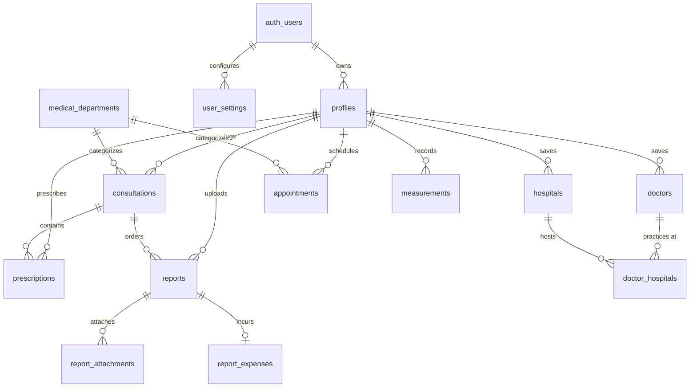

# MediCrate – Phase 3B.4.3.0: Supabase Database Schema, Security & Storage Requirements

> **Document Status:** Specification & Planning Only (Read-Only)  
> **Target Release:** Phase 4 (Supabase Backend Migration)  
> **Source Evidence:** `DATABASE_DESIGN.md`, `API_SPECIFICATION.md`, `medivault_backend_api_requirements_CROSSCHECKED.xlsx`  
> **Strict Safety Notice:** This document establishes engineering requirements only. **No SQL migrations, tables, functions, or storage buckets will be executed during Phase 3B.4.3.0.**  

---

## 1. Executive Architecture Summary

This specification defines the complete, production-grade PostgreSQL database schema, Row Level Security (RLS) policies, storage bucket configurations, and offline synchronization protocols required to migrate MediVault's clinical data layer to **Supabase**.

### Core Architectural Invariants

1. **Supabase Auth as Identity Authority:** The root user identity is governed exclusively by `auth.users.id` (UUID v4). Legacy MySQL auto-incrementing integer IDs (`12`) are completely retired.
2. **Two-Tier Multi-Profile Hierarchy:** All clinical records belong to managed family health profiles (`profiles.id` UUID), owned by the authenticated account (`profiles.user_id = auth.uid()`).
3. **Idempotent Background Synchronization:** All mutating clinical tables enforce an indexed `client_uuid UUID UNIQUE` to guarantee that offline mutation replays never create duplicate database rows.
4. **Historical Medical Immutability:**
   - **BMI Snapshot:** Accept client-calculated BMI as an immutable historical record; server recalculation triggers are strictly forbidden.
   - **Clinician & Facility Text Snapshots:** Consultations and appointments store text copies of `doctor_name` and `hospital_name` to prevent broken clinical history if a provider is edited or deleted.
5. **Private Multi-Tenant Storage:** Medical document attachments and avatar photos are stored in private Supabase Storage buckets, secured via RLS policies and streamed via short-lived signed URLs.
6. **Direct PostgREST vs. Edge Functions:** 95% of application operations map directly to PostgREST CRUD table queries. No Edge Functions are required for standard CRUD. An optional RPC function may be provided for high-performance dashboard aggregations.

---

## 2. PostgreSQL Relational Entity Architecture



---

## 3. Entity-by-Entity Schema Specifications

### 1. `public.profiles` (Managed Family Profiles)
- **Purpose:** Stores the primary patient profile and managed family member sub-profiles.
- **Legacy Table:** `profiles` / `user_profiles`
- **Ownership:** Scoped to `user_id REFERENCES auth.users(id) ON DELETE CASCADE`.

| Column | PostgreSQL Data Type | Nullable | Default | Constraints & Description |
| :--- | :--- | :---: | :--- | :--- |
| `id` | `UUID` | NO | `gen_random_uuid()` | Primary Key |
| `user_id` | `UUID` | NO | `auth.uid()` | FK to `auth.users(id)` ON DELETE CASCADE |
| `client_uuid` | `UUID` | YES | NULL | Unique client idempotency key |
| `full_name` | `TEXT` | NO | None | Legal patient name (min 2 chars) |
| `relationship` | `TEXT` | NO | `'Self'` | Check: `IN ('Self', 'Father', 'Mother', 'Spouse', 'Son', 'Daughter', 'Brother', 'Sister', 'Grandfather', 'Grandmother', 'Guardian', 'Other')` |
| `relationship_other`| `TEXT` | YES | NULL | Explanatory text if relationship is 'Other' |
| `gender` | `TEXT` | YES | NULL | Check: `IN ('Male', 'Female', 'Others')` |
| `date_of_birth`| `DATE` | YES | NULL | Patient birth date |
| `blood_group` | `TEXT` | YES | NULL | Check: `IN ('A+', 'A-', 'B+', 'B-', 'AB+', 'AB-', 'O+', 'O-')` |
| `height_cm` | `NUMERIC(5,2)` | YES | NULL | Height in centimeters (10.0 – 300.0) |
| `weight_kg` | `NUMERIC(5,2)` | YES | NULL | Weight in kilograms (1.0 – 500.0) |
| `allergies` | `TEXT[]` | NO | `'{}'` | Array of diagnosed allergies |
| `allergies_confirmed_none` | `BOOLEAN` | NO | `FALSE` | Patient confirmed zero known allergies |
| `chronic_conditions` | `TEXT[]` | NO | `'{}'` | Array of chronic medical conditions |
| `chronic_conditions_confirmed_none`| `BOOLEAN`| NO | `FALSE` | Patient confirmed zero chronic conditions |
| `photo_url` | `TEXT` | YES | NULL | Storage path in `profile_photos` bucket |
| `is_primary` | `BOOLEAN` | NO | `FALSE` | Flag: `TRUE` for root Self profile, `FALSE` for sub-profiles |
| `notes` | `TEXT` | YES | NULL | General clinical notes |
| `created_at` | `TIMESTAMPTZ` | NO | `NOW()` | Record creation timestamp |
| `updated_at` | `TIMESTAMPTZ` | NO | `NOW()` | Record update timestamp |

- **Indexes:**
  - `CREATE INDEX idx_profiles_user_id ON public.profiles(user_id);`
  - `CREATE UNIQUE INDEX idx_profiles_user_primary ON public.profiles(user_id) WHERE is_primary = TRUE;`
  - `CREATE UNIQUE INDEX idx_profiles_client_uuid ON public.profiles(user_id, client_uuid) WHERE client_uuid IS NOT NULL;`

---

### 2. `public.medical_departments` (Reference Data)
- **Purpose:** Standard medical department directory (replaces `MD1 /medical-departments`).
- **Access:** Public read-only to authenticated users (`SELECT` allowed; mutations restricted).

| Column | PostgreSQL Data Type | Nullable | Default | Constraints & Description |
| :--- | :--- | :---: | :--- | :--- |
| `id` | `SMALLSERIAL` | NO | Auto | Primary Key (Integer ID) |
| `name` | `TEXT` | NO | None | Unique department title (e.g. `'CARDIOLOGY'`) |
| `description`| `TEXT` | YES | NULL | Clinical specialty scope |
| `is_active` | `BOOLEAN` | NO | `TRUE` | Active display status |

- **Required Initial Seed Data:**
  ```sql
  INSERT INTO public.medical_departments (name) VALUES
    ('GENERAL MEDICINE'),
    ('CARDIOLOGY'),
    ('PEDIATRICS'),
    ('ORTHOPEDICS'),
    ('DERMATOLOGY'),
    ('NEUROLOGY'),
    ('GYNECOLOGY & OBSTETRICS'),
    ('ENT (EAR, NOSE, THROAT)'),
    ('OPHTHALMOLOGY'),
    ('DENTISTRY'),
    ('PSYCHIATRY'),
    ('ONCOLOGY'),
    ('UROLOGY'),
    ('PULMONOLOGY'),
    ('ENDOCRINOLOGY'),
    ('GASTROENTEROLOGY'),
    ('OTHERS');
  ```

---

### 3. `public.hospitals` (Facilities & Clinics)
- **Purpose:** Personal directory of hospitals, clinics, and diagnostic labs.
- **Legacy Table:** `hospitals` (`H1–H5`)

| Column | PostgreSQL Data Type | Nullable | Default | Constraints & Description |
| :--- | :--- | :---: | :--- | :--- |
| `id` | `UUID` | NO | `gen_random_uuid()` | Primary Key |
| `user_id` | `UUID` | NO | `auth.uid()` | FK to `auth.users(id)` ON DELETE CASCADE |
| `profile_id` | `UUID` | NO | None | FK to `public.profiles(id)` ON DELETE CASCADE |
| `client_uuid` | `UUID` | YES | NULL | Unique idempotency key |
| `name` | `TEXT` | NO | None | Facility name (min 2 chars) |
| `type` | `TEXT` | NO | `'Hospital'` | Check: `IN ('Hospital', 'Clinic', 'Lab', 'Diagnostic Center')` |
| `address` | `TEXT` | YES | NULL | Physical address / city |
| `phone` | `TEXT` | YES | NULL | Contact phone number |
| `email` | `TEXT` | YES | NULL | Contact email address |
| `notes` | `TEXT` | YES | NULL | General facility notes |
| `created_at` | `TIMESTAMPTZ` | NO | `NOW()` | Creation timestamp |
| `updated_at` | `TIMESTAMPTZ` | NO | `NOW()` | Update timestamp |

- **Indexes:**
  - `CREATE INDEX idx_hospitals_profile ON public.hospitals(profile_id);`
  - `CREATE UNIQUE INDEX idx_hospitals_client_uuid ON public.hospitals(user_id, client_uuid) WHERE client_uuid IS NOT NULL;`

---

### 4. `public.doctors` (Clinicians & Specialists)
- **Purpose:** Personal directory of medical practitioners.
- **Legacy Table:** `doctors` (`D1–D5`)

| Column | PostgreSQL Data Type | Nullable | Default | Constraints & Description |
| :--- | :--- | :---: | :--- | :--- |
| `id` | `UUID` | NO | `gen_random_uuid()` | Primary Key |
| `user_id` | `UUID` | NO | `auth.uid()` | FK to `auth.users(id)` ON DELETE CASCADE |
| `profile_id` | `UUID` | NO | None | FK to `public.profiles(id)` ON DELETE CASCADE |
| `client_uuid` | `UUID` | YES | NULL | Unique idempotency key |
| `name` | `TEXT` | NO | None | Doctor full name (e.g. `'Dr. Aris Thorne'`) |
| `specialty` | `TEXT` | NO | None | Medical specialty (e.g. `'Cardiology'`) |
| `phone` | `TEXT` | YES | NULL | Doctor contact number |
| `email` | `TEXT` | YES | NULL | Doctor email address |
| `notes` | `TEXT` | YES | NULL | General consultation notes |
| `created_at` | `TIMESTAMPTZ` | NO | `NOW()` | Creation timestamp |
| `updated_at` | `TIMESTAMPTZ` | NO | `NOW()` | Update timestamp |

- **Indexes:**
  - `CREATE INDEX idx_doctors_profile ON public.doctors(profile_id);`
  - `CREATE UNIQUE INDEX idx_doctors_client_uuid ON public.doctors(user_id, client_uuid) WHERE client_uuid IS NOT NULL;`

---

### 5. `public.doctor_hospitals` (Doctor Affiliations)
- **Purpose:** Implements the M:N relationship between clinicians and practicing hospitals (replaces legacy `doctors.hospital_ids[]`).

| Column | PostgreSQL Data Type | Nullable | Default | Constraints & Description |
| :--- | :--- | :---: | :--- | :--- |
| `doctor_id` | `UUID` | NO | None | FK to `public.doctors(id)` ON DELETE CASCADE |
| `hospital_id`| `UUID` | NO | None | FK to `public.hospitals(id)` ON DELETE CASCADE |
| `user_id` | `UUID` | NO | `auth.uid()` | FK to `auth.users(id)` ON DELETE CASCADE |

- **Primary Key:** `PRIMARY KEY (doctor_id, hospital_id)`

---

### 6. `public.consultations` (Clinical Encounters)
- **Purpose:** Doctor visits, clinical diagnoses, and encounter notes.
- **Legacy Table:** `consultations` (`C1–C5`)

| Column | PostgreSQL Data Type | Nullable | Default | Constraints & Description |
| :--- | :--- | :---: | :--- | :--- |
| `id` | `UUID` | NO | `gen_random_uuid()` | Primary Key |
| `user_id` | `UUID` | NO | `auth.uid()` | FK to `auth.users(id)` ON DELETE CASCADE |
| `profile_id` | `UUID` | NO | None | FK to `public.profiles(id)` ON DELETE CASCADE |
| `doctor_id` | `UUID` | YES | NULL | FK to `public.doctors(id)` ON DELETE SET NULL |
| `doctor_name`| `TEXT` | NO | None | **Immutable Snapshot:** Doctor name at visit time |
| `hospital_id`| `UUID` | YES | NULL | FK to `public.hospitals(id)` ON DELETE SET NULL |
| `hospital_name`|`TEXT` | YES | NULL | **Immutable Snapshot:** Hospital name at visit time |
| `appointment_id`|`UUID`| YES | NULL | Optional FK to `public.appointments(id)` ON DELETE SET NULL |
| `department` | `TEXT` | YES | NULL | Medical specialty snapshot |
| `consultation_date`|`TIMESTAMPTZ`| NO | None | Date and time of visit |
| `diagnosis` | `TEXT` | NO | None | Primary medical diagnosis |
| `clinical_notes`|`TEXT` | YES | NULL | Detailed doctor visit notes |
| `fee` | `NUMERIC(10,2)`| YES | NULL | Consultation fee / payment amount |
| `fee_currency`| `TEXT` | NO | `'INR'` | Currency code |
| `is_follow_up_required`|`BOOLEAN`| NO| `FALSE` | Follow-up required flag |
| `follow_up_date`|`DATE` | YES | NULL | Scheduled follow-up date |
| `follow_up_time`|`TEXT` | YES | NULL | Scheduled follow-up time string |
| `follow_up_status`|`TEXT`| NO | `'pending'` | Check: `IN ('pending', 'completed')` |
| `follow_up_notes`|`TEXT`| YES | NULL | Additional follow-up instructions |
| `client_uuid` | `UUID` | YES | NULL | Unique idempotency key |
| `created_at` | `TIMESTAMPTZ` | NO | `NOW()` | Creation timestamp |
| `updated_at` | `TIMESTAMPTZ` | NO | `NOW()` | Update timestamp |

- **Indexes:**
  - `CREATE INDEX idx_consultations_profile_date ON public.consultations(profile_id, consultation_date DESC);`
  - `CREATE UNIQUE INDEX idx_consultations_client_uuid ON public.consultations(user_id, client_uuid) WHERE client_uuid IS NOT NULL;`

---

### 7. `public.appointments` (Scheduled Visits)
- **Purpose:** Upcoming, completed, and cancelled clinical bookings.
- **Legacy Table:** `appointments` (`AP1–AP5`)

| Column | PostgreSQL Data Type | Nullable | Default | Constraints & Description |
| :--- | :--- | :---: | :--- | :--- |
| `id` | `UUID` | NO | `gen_random_uuid()` | Primary Key |
| `user_id` | `UUID` | NO | `auth.uid()` | FK to `auth.users(id)` ON DELETE CASCADE |
| `profile_id` | `UUID` | NO | None | FK to `public.profiles(id)` ON DELETE CASCADE |
| `doctor_id` | `UUID` | YES | NULL | FK to `public.doctors(id)` ON DELETE SET NULL |
| `doctor_name`| `TEXT` | NO | None | **Immutable Snapshot:** Doctor name |
| `hospital_id`| `UUID` | YES | NULL | FK to `public.hospitals(id)` ON DELETE SET NULL |
| `hospital_name`|`TEXT` | YES | NULL | **Immutable Snapshot:** Facility name |
| `department_id`|`INT` | YES | NULL | FK to `public.medical_departments(id)` ON DELETE SET NULL |
| `department` | `TEXT` | YES | NULL | Department name snapshot |
| `appointment_date`|`TIMESTAMPTZ`| NO | None | Scheduled visit date & time |
| `status` | `TEXT` | NO | `'upcoming'`| Check: `IN ('upcoming', 'completed', 'cancelled', 'missed')` |
| `reason` | `TEXT` | YES | NULL | Chief complaint / visit purpose |
| `notes` | `TEXT` | YES | NULL | Instructions (e.g. 'Fasting required') |
| `expected_fee`|`NUMERIC(10,2)`| YES | NULL | Expected visit fee |
| `client_uuid` | `UUID` | YES | NULL | Unique idempotency key |
| `created_at` | `TIMESTAMPTZ` | NO | `NOW()` | Creation timestamp |
| `updated_at` | `TIMESTAMPTZ` | NO | `NOW()` | Update timestamp |

- **Indexes:**
  - `CREATE INDEX idx_appointments_profile_status ON public.appointments(profile_id, status, appointment_date DESC);`
  - `CREATE UNIQUE INDEX idx_appointments_client_uuid ON public.appointments(user_id, client_uuid) WHERE client_uuid IS NOT NULL;`

---

### 8. `public.prescriptions` (Prescription Medicines)
- **Purpose:** Medication schedules, dosage instructions, and active regimens.
- **Legacy Table:** `medicines` / `prescriptions` (`M1–M5`)

| Column | PostgreSQL Data Type | Nullable | Default | Constraints & Description |
| :--- | :--- | :---: | :--- | :--- |
| `id` | `UUID` | NO | `gen_random_uuid()` | Primary Key |
| `user_id` | `UUID` | NO | `auth.uid()` | FK to `auth.users(id)` ON DELETE CASCADE |
| `profile_id` | `UUID` | NO | None | FK to `public.profiles(id)` ON DELETE CASCADE |
| `consultation_id`|`UUID` | YES | NULL | FK to `public.consultations(id)` ON DELETE SET NULL |
| `consultation_title`|`TEXT`| YES | NULL | **Immutable Snapshot:** Diagnosis/Title of encounter |
| `medicine_name`| `TEXT` | NO | None | Commercial/generic drug name |
| `form` | `TEXT` | YES | NULL | Check: `IN ('Tablet', 'Capsule', 'Syrup', 'Inhaler', 'Injection', 'Cream', 'Drops', 'Other')` |
| `dosage` | `TEXT` | YES | NULL | e.g. `'500 mg'`, `'10 ml'` |
| `frequency` | `TEXT` | YES | NULL | Check: `IN ('Once daily', 'Twice daily', 'Three times daily', 'As needed', 'Other')` |
| `start_date` | `DATE` | NO | None | Regimen commencement date |
| `end_date` | `DATE` | YES | NULL | Nullable: ongoing chronic medications have no end date |
| `is_active` | `BOOLEAN` | NO | `TRUE` | Active prescription status flag |
| `instructions`| `TEXT` | YES | NULL | Intake guidelines (e.g. `'After food'`) |
| `client_uuid` | `UUID` | YES | NULL | Unique idempotency key |
| `created_at` | `TIMESTAMPTZ` | NO | `NOW()` | Creation timestamp |
| `updated_at` | `TIMESTAMPTZ` | NO | `NOW()` | Update timestamp |

- **Indexes:**
  - `CREATE INDEX idx_prescriptions_profile_active ON public.prescriptions(profile_id, is_active);`
  - `CREATE UNIQUE INDEX idx_prescriptions_client_uuid ON public.prescriptions(user_id, client_uuid) WHERE client_uuid IS NOT NULL;`

---

### 9. `public.reports` (Diagnostic Reports)
- **Purpose:** Lab tests, imaging scans, discharge summaries, and medical certificates.
- **Legacy Table:** `reports` (`R1–R5`)

| Column | PostgreSQL Data Type | Nullable | Default | Constraints & Description |
| :--- | :--- | :---: | :--- | :--- |
| `id` | `UUID` | NO | `gen_random_uuid()` | Primary Key |
| `user_id` | `UUID` | NO | `auth.uid()` | FK to `auth.users(id)` ON DELETE CASCADE |
| `profile_id` | `UUID` | NO | None | FK to `public.profiles(id)` ON DELETE CASCADE |
| `consultation_id`|`UUID` | YES | NULL | FK to `public.consultations(id)` ON DELETE SET NULL |
| `consultation_title`|`TEXT`| YES | NULL | **Immutable Snapshot:** Encounter title |
| `title` | `TEXT` | NO | None | Document title (e.g. `'Complete Blood Count'`) |
| `category` | `TEXT` | NO | None | Check: `IN ('LAB TEST', 'IMAGING', 'PRESCRIPTION', 'DISCHARGE', 'CERTIFICATE', 'VACCINATION', 'REFERRAL', 'OTHER')` |
| `report_date` | `DATE` | NO | None | Diagnostic test date |
| `doctor_name` | `TEXT` | YES | NULL | Snapshot ordering clinician |
| `hospital_name`| `TEXT` | YES | NULL | Snapshot diagnostic facility |
| `notes` | `TEXT` | YES | NULL | Patient observation notes |
| `client_uuid` | `UUID` | YES | NULL | Unique idempotency key |
| `created_at` | `TIMESTAMPTZ` | NO | `NOW()` | Creation timestamp |
| `updated_at` | `TIMESTAMPTZ` | NO | `NOW()` | Update timestamp |

- **Indexes:**
  - `CREATE INDEX idx_reports_profile_category ON public.reports(profile_id, category, report_date DESC);`
  - `CREATE UNIQUE INDEX idx_reports_client_uuid ON public.reports(user_id, client_uuid) WHERE client_uuid IS NOT NULL;`

---

### 10. `public.report_attachments` (File Attachments)
- **Purpose:** Stores file metadata linked to physical files in the `report_attachments` Supabase Storage bucket.
- **Legacy Table:** `report_attachments` (`R2`, `R6`)

| Column | PostgreSQL Data Type | Nullable | Default | Constraints & Description |
| :--- | :--- | :---: | :--- | :--- |
| `id` | `UUID` | NO | `gen_random_uuid()` | Primary Key |
| `report_id` | `UUID` | NO | None | FK to `public.reports(id)` ON DELETE CASCADE |
| `user_id` | `UUID` | NO | `auth.uid()` | FK to `auth.users(id)` ON DELETE CASCADE |
| `storage_path`| `TEXT` | NO | None | Path in bucket: `{user_id}/{report_id}/{file_id}.pdf` |
| `file_name` | `TEXT` | NO | None | Original upload filename |
| `file_size` | `INTEGER` | NO | None | Size in bytes (max 26,214,400 = 25MB) |
| `mime_type` | `TEXT` | NO | None | `application/pdf`, `image/png`, `image/jpeg` |
| `created_at` | `TIMESTAMPTZ` | NO | `NOW()` | Creation timestamp |

- **Indexes:**
  - `CREATE INDEX idx_report_attachments_report_id ON public.report_attachments(report_id);`

---

### 11. `public.report_expenses` (Embedded Diagnostic Costs)
- **Purpose:** Embedded medical expense record linked 1:1 to a diagnostic report.
- **Legacy Table:** `report_expenses` (`R2`)

| Column | PostgreSQL Data Type | Nullable | Default | Constraints & Description |
| :--- | :--- | :---: | :--- | :--- |
| `report_id` | `UUID` | NO | None | Primary Key & FK to `public.reports(id)` ON DELETE CASCADE |
| `user_id` | `UUID` | NO | `auth.uid()` | FK to `auth.users(id)` ON DELETE CASCADE |
| `amount` | `NUMERIC(10,2)`| NO | None | Test cost amount |
| `currency` | `TEXT` | NO | `'INR'` | Currency code |
| `status` | `TEXT` | NO | `'paid'` | Check: `IN ('paid', 'pending')` |
| `created_at` | `TIMESTAMPTZ` | NO | `NOW()` | Creation timestamp |

---

### 12. `public.measurements` (Polymorphic Vitals Engine)
- **Purpose:** Unified vital logs (BP, Glucose, Heart Rate, SpO₂, Temperature, Respiratory Rate, BMI).
- **Legacy Table:** `vitals` / `health_measurements` (`V1–V5`)

| Column | PostgreSQL Data Type | Nullable | Default | Constraints & Description |
| :--- | :--- | :---: | :--- | :--- |
| `id` | `UUID` | NO | `gen_random_uuid()` | Primary Key |
| `user_id` | `UUID` | NO | `auth.uid()` | FK to `auth.users(id)` ON DELETE CASCADE |
| `profile_id` | `UUID` | NO | None | FK to `public.profiles(id)` ON DELETE CASCADE |
| `type` | `TEXT` | NO | None | Check: `IN ('bp', 'glucose', 'heart_rate', 'spo2', 'temperature', 'respiratory_rate', 'bmi')` |
| `primary_value`|`NUMERIC(8,2)` | NO | None | Main value (or Systolic for BP) |
| `secondary_value`|`NUMERIC(8,2)`| YES | NULL | Secondary value (Diastolic for BP; NULL for others) |
| `unit` | `TEXT` | NO | None | `mmHg`, `mg/dL`, `bpm`, `%`, `°C`, `br/min`, `kg/m²` |
| `context` | `TEXT` | YES | NULL | Check: `IN ('fasting', 'random')` (for glucose only) |
| `source` | `TEXT` | NO | `'Manual'` | `'Manual'`, `'Device'`, `'Calculated'` |
| `recorded_at` | `TIMESTAMPTZ` | NO | None | **Client Authoritative:** Exact historical timestamp |
| `notes` | `TEXT` | YES | NULL | Patient observation notes |
| `client_uuid` | `UUID` | YES | NULL | Unique idempotency key |
| `created_at` | `TIMESTAMPTZ` | NO | `NOW()` | Creation timestamp |
| `updated_at` | `TIMESTAMPTZ` | NO | `NOW()` | Update timestamp |

- **Critical Invariant Rule:** For `type = 'bmi'`, `primary_value` is calculated by Flutter from profile height and weight and committed as an immutable snapshot. **No PostgreSQL trigger may recalculate this historical value.**
- **Indexes:**
  - `CREATE INDEX idx_measurements_profile_type_date ON public.measurements(profile_id, type, recorded_at DESC);`
  - `CREATE UNIQUE INDEX idx_measurements_client_uuid ON public.measurements(user_id, client_uuid) WHERE client_uuid IS NOT NULL;`

---

## 4. Row Level Security (RLS) Policy Specifications

Every clinical table MUST enable RLS to enforce multi-tenant account isolation:

```sql
-- 1. Enable RLS on all tables
ALTER TABLE public.profiles ENABLE ROW LEVEL SECURITY;
ALTER TABLE public.hospitals ENABLE ROW LEVEL SECURITY;
ALTER TABLE public.doctors ENABLE ROW LEVEL SECURITY;
ALTER TABLE public.doctor_hospitals ENABLE ROW LEVEL SECURITY;
ALTER TABLE public.consultations ENABLE ROW LEVEL SECURITY;
ALTER TABLE public.appointments ENABLE ROW LEVEL SECURITY;
ALTER TABLE public.prescriptions ENABLE ROW LEVEL SECURITY;
ALTER TABLE public.reports ENABLE ROW LEVEL SECURITY;
ALTER TABLE public.report_attachments ENABLE ROW LEVEL SECURITY;
ALTER TABLE public.report_expenses ENABLE ROW LEVEL SECURITY;
ALTER TABLE public.measurements ENABLE ROW LEVEL SECURITY;
ALTER TABLE public.medical_departments ENABLE ROW LEVEL SECURITY;

-- 2. Standard Ownership Policies (Applied to all user-owned tables)
-- Example for public.profiles:
CREATE POLICY "Users can manage their own profiles"
  ON public.profiles
  FOR ALL
  TO authenticated
  USING (auth.uid() = user_id)
  WITH CHECK (auth.uid() = user_id);

-- 3. Reference Table Policy for medical_departments:
CREATE POLICY "Authenticated users can read medical departments"
  ON public.medical_departments
  FOR SELECT
  TO authenticated
  USING (is_active = TRUE);
```

---

## 5. Supabase Storage Buckets Configuration

Three dedicated private storage buckets are required:

1. **`report_attachments`**:
   - Access: Private (No public URLs)
   - Max file size: 25 MB (`26214400` bytes)
   - Allowed MIME types: `application/pdf`, `image/png`, `image/jpeg`
   - Path convention: `{user_id}/{report_id}/{file_id}.{ext}`
   - RLS Policy:
     ```sql
     CREATE POLICY "Users manage their own report files"
       ON storage.objects
       FOR ALL
       TO authenticated
       USING (bucket_id = 'report_attachments' AND (storage.foldername(name))[1] = auth.uid()::text)
       WITH CHECK (bucket_id = 'report_attachments' AND (storage.foldername(name))[1] = auth.uid()::text);
     ```
2. **`profile_photos`**:
   - Access: Private
   - Max file size: 5 MB
   - Allowed MIME types: `image/png`, `image/jpeg`, `image/webp`
   - Path convention: `{user_id}/{profile_id}.jpg`
3. **`consultation_attachments`**:
   - Access: Private
   - Max file size: 25 MB
   - Path convention: `{user_id}/{consultation_id}/{file_id}.{ext}`

---

## 6. Offline-First Sync Architecture (Phase 4 Protocol)

When synchronization is enabled in Phase 4:

1. **Local-First Write:** Mobile UI continues writing immediately to local Hive CE storage (0ms UI latency).
2. **Idempotent Queue Draining:** The Flutter `SyncService` drains `syncQueueBox` by executing standard PostgREST `upsert` queries attaching `client_uuid`:
   ```dart
   await supabase.from('measurements').upsert(
     vital.toSupabaseJson(),
     onConflict: 'user_id, client_uuid',
   );
   ```
3. **Key Reconciliation:** Upon receiving the inserted row, Flutter replaces the local temporary UUID key with the confirmed Supabase `id` (UUID) and removes the item from `syncQueueBox`.
4. **Resiliency:** If offline, mutations remain queued in Hive and replay seamlessly on network reconnect.

---

## 7. Direct PostgREST vs. Edge Functions Evaluation

- **Direct PostgREST Sufficiency:** All 64 REST endpoints can be replaced by direct Supabase PostgREST table queries with RLS.
- **Edge Functions Verdict:** **Zero Edge Functions are strictly required.**
  - Standard CRUD is completely handled by PostgREST.
  - Multi-part uploads are handled directly via the Supabase Storage SDK.
  - Health Vault Score calculation and dashboard feeds are performed instantaneously on-device in Hive NoSQL, avoiding network latency entirely.
- **Optional Postgres RPC Functions:** A single PostgreSQL function `get_dashboard_summary(p_profile_id UUID)` may optionally be provisioned for cross-device web portal synchronization in future phases.
