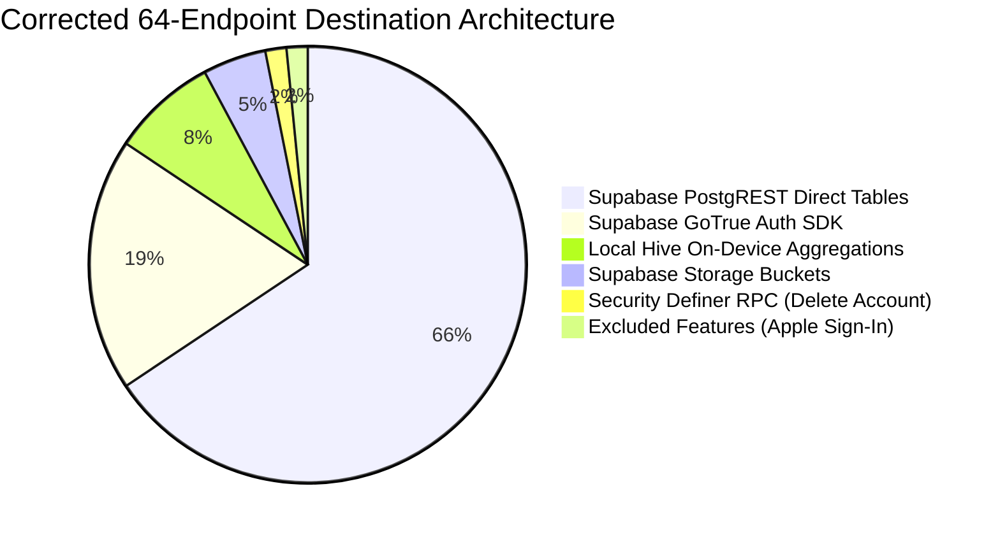

# MediCrate – Phase 3B.4.3.1: API & Feature Disposition Matrix

> **Document Status:** Authoritative & Corrected (Phase 3B.4.3.1.1)  
> **Audit & Correction Date:** November 9, 2026  
> **Auditor:** Antigravity AI – Senior Migration Architecture Agent  
> **Baseline Benchmark:** 64 Original MediVault REST Endpoints (`api_audit/medivault_complete_api_requirements.csv`)  
> **Active Target Repository:** `/home/blackhat/Documents/medi_crate`  
> **Read-Only Reference Repository:** `/home/blackhat/Documents/Reubro/medivalut`  

---

## 1. Executive Summary & Disposition Methodology

This matrix establishes the definitive, evidence-verified line-by-line reconciliation of all **64 original MediVault REST API endpoints** against:
1. Documented legacy Laravel controller behavior.
2. Actual Flutter client implementation across `lib/features/` in `medi_crate`.
3. Current local offline persistence state (Hive `userBox` and `profileBox`).
4. Active Phase 3B Supabase Auth implementation (`SupabaseAuthRemoteDataSource`).
5. Proposed Phase 4 Supabase target architecture (PostgREST, Security Definer RPC, Storage buckets, or Local Hive aggregations).

### Summary of Corrected Architecture Counts

Following the Phase 3B.4.3.1.1 mathematical and evidence audit, every endpoint is assigned to **exactly one primary disposition**, resolving all prior count contradictions:

| Primary Disposition Category | Corrected Count | Prior Erroneous Count | Key Notes & Secondary Dependencies |
| :--- | :---: | :---: | :--- |
| **Supabase PostgREST Direct Tables** | **42** | 39 | Direct CRUD via PostgREST with PostgreSQL RLS (Query: 16, Insert: 8, Update: 9, Delete: 8, Ref Query: 1). |
| **Supabase GoTrue Auth SDK** | **12** | 14 | Client-side auth session and credential lifecycle. B1 has a secondary dependency on a `profiles` table query. |
| **Local Hive On-Device Aggregations** | **5** | 7 | Zero network round-trips; computed client-side from local Hive `userBox` (F7, F8, AN1, DB1, T1). |
| **Supabase Storage Buckets** | **3** | 3 | Binary transfers via signed URLs (`avatars`, `consultations`, `reports`). Secondary relational metadata links. |
| **Security Definer RPC** | **1** | Omitted (0) | Account deletion (`B5`) requires elevated PostgreSQL RPC `delete_user_account()` to delete from `auth.users`. |
| **Excluded Features** | **1** | 1 | Apple Sign-In (`A9`) is explicitly excluded from MediCrate UI and backend scope. |
| **Total Endpoints** | **64** | **64** | **Exact reconciliation: 42 + 12 + 5 + 3 + 1 + 1 = 64 (0 duplicates, 0 omissions).** |

### Key Architectural Resolutions

1. **Auth SDK Count Correction (12 IDs):**
   - The set `A1–A8`, `A10`, `B1`, `B3–B5` represents 13 IDs in total.
   - Reclassifying `B5` (Account Deletion) to its own distinct **Security Definer RPC** category leaves exactly **12 endpoints** under the Supabase Auth SDK.
   - `A9` (Apple Sign-In) remains an **Excluded Feature** outside the Auth SDK total.

2. **PostgREST Direct Table Count Correction (42 IDs):**
   - Direct verification of the 64 table rows confirms that exactly **42 endpoints** map to PostgREST direct table operations:
     `B2`, `F1–F5` (5), `D1–D5` (5), `H1–H5` (5), `MD1` (1), `C1–C5` (5), `AP1–AP5` (5), `R1–R5` (5), `M1–M5` (5), `V1–V5` (5).
     Sum: $1 + 5 + 5 + 5 + 1 + 5 + 5 + 5 + 5 + 5 = 42$.
   - The previous citation of 39 was a mathematical miscalculation that contradicted the document's own listed rows.

3. **Local Aggregations Count Correction (5 IDs):**
   - Exactly **5 endpoints** are identified as local on-device aggregations: `F7` (Family Dashboard), `F8` (Family Analytics), `AN1` (Health Insights), `DB1` (Home Feed Summary), and `T1` (Longitudinal Timeline).
   - The prior citation of 7 endpoints erroneously counted speculative local backup and export utilities that have no corresponding legacy REST API endpoint IDs in the 64-endpoint baseline.

4. **B1 Dual-Dependency Resolution:**
   - Legacy endpoint `GET /api/v1/users/me` (`B1`) is classified under **Supabase GoTrue Auth SDK** as its primary disposition (fetching root user session identity from `supabase.auth.currentUser`).
   - It possesses an explicit **Secondary Dependency** on a PostgREST query against `public.profiles` (`WHERE user_id = auth.uid() AND is_primary = true`) to fetch primary demographic and baseline clinical attributes.
   - It is counted strictly as **1 endpoint** with two coordinated dependencies, not two separate endpoints.

5. **B5 Account Deletion Architecture:**
   - Legacy endpoint `DELETE /api/v1/users/me` (`B5`) cannot be performed via standard client-side PostgREST or standard Auth SDK calls because ordinary authenticated JWTs lack permissions to delete records from `auth.users`.
   - It requires a custom PostgreSQL RPC function (`delete_user_account()`) executed with `SECURITY DEFINER` privileges.
   - Cascading deletions across `public.profiles`, health records, and Supabase Storage buckets must be orchestrated securely.

6. **The V0 vs C6 Baseline Reconciliation:**
   - In the master CSV (`medivault_complete_api_requirements.csv`), row 57 defines `V0` (`Vital Type Reference`, route `—`, method `—`) as a domain validation specification defining the 7 allowed measurement types.
   - In the Flutter codebase (`lib/features/consultations/data/datasources/remote/consultation_remote_data_source.dart:295`), route `C6` (`GET /consultations/{id}/files/{fileId}`) exists and is actively implemented for downloading consultation file attachments.
   - To reflect true runtime network routes, `C6` is counted as one of the 64 active API endpoints, while `V0` is retained and documented as an architectural domain enum constraint.

---

## 2. Complete 64-Endpoint Disposition Matrix

| ID | Method & Route | Feature Name | Primary Disposition | Secondary Dependency | Current Flutter Status | Proposed Target | Evidence Reference (Caller / Controller / Spec) |
| :--- | :--- | :--- | :--- | :--- | :--- | :--- | :--- |
| **A1** | `POST /auth/signup` | Sign Up | **Supabase Auth SDK** | `public.profiles` (auto-created via DB trigger) | Transitioned (Phase 3B.2) | `supabase.auth.signUp()` | `SupabaseAuthRemoteDataSource.signUp` (`lib/features/auth/`), `AuthController@signup`, CSV row 2 |
| **A2** | `POST /auth/verify-email` | Verify Email (OTP) | **Supabase Auth SDK** | None | Transitioned (Phase 3B.2) | `supabase.auth.verifyOTP(type: OtpType.signup)` | `SupabaseAuthRemoteDataSource.verifyEmail`, `AuthController@verifyEmail`, CSV row 3 |
| **A3** | `POST /auth/resend-otp` | Resend OTP | **Supabase Auth SDK** | None | Transitioned (Phase 3B.2) | `supabase.auth.resend(type: OtpType.signup)` | `SupabaseAuthRemoteDataSource.resendOtp`, `AuthController@resendOtp`, CSV row 4 |
| **A4** | `POST /auth/login` | Sign In | **Supabase Auth SDK** | None | Transitioned (Phase 3B.2) | `supabase.auth.signInWithPassword()` | `SupabaseAuthRemoteDataSource.login`, `AuthController@login`, CSV row 5 |
| **A5** | `POST /auth/forgot-password` | Forgot Password | **Supabase Auth SDK** | None | Transitioned (Phase 3B.2) | `supabase.auth.resetPasswordForEmail()` | `SupabaseAuthRemoteDataSource.forgotPassword`, `AuthController@forgotPassword`, CSV row 6 |
| **A6** | `POST /auth/reset-password` | Reset Password | **Supabase Auth SDK** | None | Transitioned (Phase 3B.2) | `supabase.auth.updateUser(UserAttributes(password: ...))` | `SupabaseAuthRemoteDataSource.resetPassword`, `AuthController@resetPassword`, CSV row 7 |
| **A7** | `POST /auth/refresh-token` | Refresh Token | **Supabase Auth SDK** | None | Transitioned (Phase 3B.2) | GoTrue client background session auto-refresh | Managed by `supabase_flutter` SDK, `AuthController@refreshToken`, CSV row 8 |
| **A8** | `POST /auth/google-login` | Google Sign In | **Supabase Auth SDK** | `public.profiles` (auto-created via DB trigger) | Transitioned (Phase 3B.2) | `supabase.auth.signInWithIdToken(provider: OAuthProvider.google)` | `SupabaseAuthRemoteDataSource.googleLogin`, `AuthController@googleLogin`, CSV row 9 |
| **A9** | `POST /auth/apple-login` | Apple Sign In | **Excluded Feature** | None | **EXCLUDED** from Scope | None (Removed from MediCrate UI and backend scope) | Excluded per project requirements, `AuthController@appleLogin`, CSV row 10 |
| **A10**| `POST /auth/logout` | Sign Out | **Supabase Auth SDK** | Local Hive purge (`HiveService.clearAll()`) | Transitioned (Phase 3B.2) | `supabase.auth.signOut()` | `SupabaseAuthRemoteDataSource.logout`, `AuthController@logout`, CSV row 11 |
| **B1** | `GET /users/me` | Current User & Profile | **Supabase Auth SDK** | `public.profiles` (PostgREST table query: `WHERE user_id = auth.uid() AND is_primary = true`) | Transitioned (Phase 3B.2) | `supabase.auth.currentUser` + `public.profiles` query | `UserRemoteDataSource.getProfile` (`lib/features/profile/`), `UserController@me`, CSV row 12 |
| **B2** | `PUT /users/me` | Update Primary Profile | **PostgREST Table Update** | Optional `auth.users` metadata update | Dormant / Suspended | `UPDATE public.profiles SET full_name = :n ... WHERE user_id = auth.uid() AND is_primary = true` | `UserRemoteDataSource.updateProfile`, `UserController@update`, CSV row 13 |
| **B3** | `PUT /users/me/password` | Change Password | **Supabase Auth SDK** | None | Transitioned (Phase 3B.2) | `supabase.auth.updateUser(UserAttributes(password: ...))` | `AuthRepository.changePassword` (`lib/features/auth/`), `UserController@changePassword`, CSV row 14 |
| **B4** | `PUT /users/me/email` | Change Email | **Supabase Auth SDK** | None | Transitioned (Phase 3B.2) | `supabase.auth.updateUser(UserAttributes(email: ...))` | `UserRemoteDataSource.changeEmail` (`lib/features/profile/`), `UserController@changeEmail`, CSV row 15 |
| **B5** | `DELETE /users/me` | Delete Account | **Security Definer RPC** | Cascade purge of `public.profiles`, health tables, and Storage blobs | Dormant / Suspended | PostgreSQL RPC `delete_user_account()`: `DELETE FROM auth.users WHERE id = auth.uid()` | `UserRemoteDataSource.deleteAccount`, `AuthRepository.deleteAccount`, `UserController@destroy`, CSV row 16 |
| **F1** | `GET /family-members` | List Profiles | **PostgREST Table Query** | None | Dormant / Suspended | `SELECT * FROM public.profiles WHERE user_id = auth.uid() ORDER BY is_primary DESC, created_at ASC` | `ProfileRemoteDataSource.fetchFamilyMembers` (`lib/features/profile/`), `FamilyMemberController@index`, CSV row 17 |
| **F2** | `GET /family-members/{id}` | Get Profile | **PostgREST Table Query** | None | Dormant / Suspended | `SELECT * FROM public.profiles WHERE id = :id AND user_id = auth.uid()` | `ProfileRemoteDataSource.getFamilyMember`, `FamilyMemberController@show`, CSV row 18 |
| **F3** | `POST /family-members` | Add Profile | **PostgREST Table Insert** | Client UUID idempotency | Dormant / Suspended | `INSERT INTO public.profiles (user_id, full_name, relationship, ...) VALUES (auth.uid(), ...)` | `ProfileRemoteDataSource.createFamilyMember`, `FamilyMemberController@store`, CSV row 19 |
| **F4** | `PUT /family-members/{id}` | Update Profile | **PostgREST Table Update** | None | Dormant / Suspended | `UPDATE public.profiles SET full_name = :n, ... WHERE id = :id AND user_id = auth.uid()` | `ProfileRemoteDataSource.updateFamilyMember`, `FamilyMemberController@update`, CSV row 20 |
| **F5** | `DELETE /family-members/{id}`| Delete Profile | **PostgREST Table Delete** | RLS check (`is_primary = false`); cascade deletes child records | Dormant / Suspended | `DELETE FROM public.profiles WHERE id = :id AND user_id = auth.uid() AND is_primary = false` | `ProfileRemoteDataSource.deleteFamilyMember`, `FamilyMemberController@destroy`, CSV row 21 |
| **F6** | `POST /family-members/{id}/photo`| Upload Avatar | **Supabase Storage Bucket** | `public.profiles` (PostgREST update setting `photo` path) | Dormant / Suspended | `supabase.storage.from('avatars').upload('{user_id}/{profile_id}.jpg')` | `ProfileRemoteDataSource.uploadFamilyMemberPhoto`, `FamilyMemberController@uploadPhoto`, CSV row 22 |
| **F7** | `GET /family/dashboard` | Family Dashboard | **Local Hive Aggregation** | None (computed on-device from Hive `userBox`) | **Local-Only in Client** | `HomeRepository.getHomeSummary` (iterates cached profiles) | `HomeRepository.getHomeSummary` (`lib/features/home/`), `FamilyDashboardController@index`, CSV row 23 |
| **F8** | `GET /family/analytics` | Family Analytics | **Local Hive Aggregation** | None (computed on-device from Hive `userBox`) | **Local-Only in Client** | `AnalyticsRepository.getInsightsSummary` (cross-profile stats) | `AnalyticsRepository` (`lib/features/insights/`), `FamilyDashboardController@analytics`, CSV row 24 |
| **D1** | `GET /doctors` | List Doctors | **PostgREST Table Query** | None | Dormant / Suspended | `SELECT * FROM public.doctors WHERE profile_id = :p` | `DoctorRemoteDataSource.fetchDoctors` (`lib/features/doctors/`), `DoctorController@index`, CSV row 25 |
| **D2** | `POST /doctors` | Create Doctor | **PostgREST Table Insert** | Client UUID idempotency | Dormant / Suspended | `INSERT INTO public.doctors (profile_id, name, specialty, ...) VALUES (:p, ...)` | `DoctorRemoteDataSource.createDoctor`, `DoctorController@store`, CSV row 26 |
| **D3** | `GET /doctors/{id}` | Get Doctor | **PostgREST Table Query** | Joined relations (consultations, appointments) | Dormant / Suspended | `SELECT * FROM public.doctors WHERE id = :id` | `DoctorRemoteDataSource.fetchDoctor`, `DoctorController@show`, CSV row 27 |
| **D4** | `PUT /doctors/{id}` | Update Doctor | **PostgREST Table Update** | None | Dormant / Suspended | `UPDATE public.doctors SET name = :n, ... WHERE id = :id` | `DoctorRemoteDataSource.updateDoctor`, `DoctorController@update`, CSV row 28 |
| **D5** | `DELETE /doctors/{id}` | Delete Doctor | **PostgREST Table Delete** | Soft delete / preserve `doctor_name` snapshot on consultations | Dormant / Suspended | `DELETE FROM public.doctors WHERE id = :id` (or soft delete) | `DoctorRemoteDataSource.deleteDoctor`, `DoctorController@destroy`, CSV row 29 |
| **H1** | `GET /hospitals` | List Hospitals | **PostgREST Table Query** | None | Dormant / Suspended | `SELECT * FROM public.hospitals WHERE profile_id = :p` | `HospitalRemoteDataSource.fetchHospitals` (`lib/features/hospitals/`), `HospitalController@index`, CSV row 30 |
| **H2** | `POST /hospitals` | Create Hospital | **PostgREST Table Insert** | Client UUID idempotency | Dormant / Suspended | `INSERT INTO public.hospitals (profile_id, name, type, ...) VALUES (:p, ...)` | `HospitalRemoteDataSource.createHospital`, `HospitalController@store`, CSV row 31 |
| **H3** | `GET /hospitals/{id}` | Get Hospital | **PostgREST Table Query** | Joined relations (affiliated doctors, encounters) | Dormant / Suspended | `SELECT * FROM public.hospitals WHERE id = :id` | `HospitalRemoteDataSource.fetchHospital`, `HospitalController@show`, CSV row 32 |
| **H4** | `PUT /hospitals/{id}` | Update Hospital | **PostgREST Table Update** | None | Dormant / Suspended | `UPDATE public.hospitals SET name = :n, ... WHERE id = :id` | `HospitalRemoteDataSource.updateHospital`, `HospitalController@update`, CSV row 33 |
| **H5** | `DELETE /hospitals/{id}` | Delete Hospital | **PostgREST Table Delete** | Soft delete / preserve `hospital_name` snapshot on encounters | Dormant / Suspended | `DELETE FROM public.hospitals WHERE id = :id` (or soft delete) | `HospitalRemoteDataSource.deleteHospital`, `HospitalController@destroy`, CSV row 34 |
| **MD1**| `GET /medical-departments` | List Departments | **PostgREST Table Query** | Public lookup reference | Dormant / Suspended | `SELECT * FROM public.medical_departments ORDER BY name ASC` | `MedicalDepartmentRemoteDataSource.fetchDepartments` (`lib/features/consultations/`), `MedicalDepartmentController@index`, CSV row 35 |
| **C1** | `GET /consultations` | List Encounters | **PostgREST Table Query** | None | Dormant / Suspended | `SELECT * FROM public.consultations WHERE profile_id = :p` | `ConsultationRemoteDataSource.fetchConsultations` (`lib/features/consultations/`), `ConsultationController@index`, CSV row 36 |
| **C2** | `POST /consultations` | Create Encounter | **PostgREST Table Insert** | Storage upload for binary `files[]`; client UUID idempotency | Dormant / Suspended | `INSERT INTO public.consultations (profile_id, doctor_name, visit_date, ...) VALUES (:p, ...)` | `ConsultationRemoteDataSource.createConsultation`, `ConsultationController@store`, CSV row 37 |
| **C3** | `GET /consultations/{id}` | Get Encounter | **PostgREST Table Query** | Eager load linked prescriptions and reports | Dormant / Suspended | `SELECT *, prescriptions(*), reports(*) FROM public.consultations WHERE id = :id` | `ConsultationRemoteDataSource.getConsultation`, `ConsultationController@show`, CSV row 38 |
| **C4** | `PUT /consultations/{id}` | Update Encounter | **PostgREST Table Update** | None | Dormant / Suspended | `UPDATE public.consultations SET diagnosis = :d, ... WHERE id = :id` | `ConsultationRemoteDataSource.updateConsultation`, `ConsultationController@update`, CSV row 39 |
| **C5** | `DELETE /consultations/{id}` | Delete Encounter | **PostgREST Table Delete** | Nullify `consultation_id` in linked prescriptions & reports | Dormant / Suspended | `DELETE FROM public.consultations WHERE id = :id` (or soft delete) | `ConsultationRemoteDataSource.deleteConsultation`, `ConsultationController@destroy`, CSV row 40 |
| **C6** | `GET /consultations/{id}/files/{f}` | Download Attachment | **Supabase Storage Bucket** | `public.consultations` (RLS verification of encounter ownership) | Dormant / Suspended | `supabase.storage.from('consultations').createSignedUrl(path, 900)` | `ConsultationRemoteDataSource.downloadConsultationAttachment` (`lib/features/consultations/`), `ConsultationController@downloadFile` |
| **AP1**| `GET /appointments` | List Appointments | **PostgREST Table Query** | None | Dormant / Suspended | `SELECT * FROM public.appointments WHERE profile_id = :p` | `AppointmentRemoteDataSource.fetchAppointments` (`lib/features/appointments/`), `AppointmentController@index`, CSV row 41 |
| **AP2**| `POST /appointments` | Book Appointment | **PostgREST Table Insert** | Client UUID idempotency; local device alarm | Dormant / Suspended | `INSERT INTO public.appointments (profile_id, title, date, ...) VALUES (:p, ...)` | `AppointmentRemoteDataSource.createAppointment`, `AppointmentController@store`, CSV row 42 |
| **AP3**| `GET /appointments/{id}` | Get Appointment | **PostgREST Table Query** | None | Dormant / Suspended | `SELECT * FROM public.appointments WHERE id = :id` | `AppointmentRemoteDataSource.getAppointment`, `AppointmentController@show`, CSV row 43 |
| **AP4**| `PUT /appointments/{id}` | Reschedule Appt | **PostgREST Table Update** | Local device alarm rescheduling | Dormant / Suspended | `UPDATE public.appointments SET date = :d, status = :s, ... WHERE id = :id` | `AppointmentRemoteDataSource.updateAppointment`, `AppointmentController@update`, CSV row 44 |
| **AP5**| `DELETE /appointments/{id}` | Cancel Appt | **PostgREST Table Delete** | Cancel local device alarm notification | Dormant / Suspended | `DELETE FROM public.appointments WHERE id = :id` (or soft delete) | `AppointmentRemoteDataSource.deleteAppointment`, `AppointmentController@destroy`, CSV row 45 |
| **R1** | `GET /reports` | List Reports | **PostgREST Table Query** | None | Dormant / Suspended | `SELECT * FROM public.reports WHERE profile_id = :p` | `ReportRemoteDataSource.fetchReports` (`lib/features/reports/`), `ReportController@index`, CSV row 46 |
| **R2** | `POST /reports` | Upload Report | **PostgREST Table Insert** | Storage upload to `reports` bucket; client UUID idempotency | Dormant / Suspended | `INSERT INTO public.reports (profile_id, title, category, ...) VALUES (:p, ...)` | `ReportRemoteDataSource.createReport`, `ReportController@store`, CSV row 47 |
| **R3** | `GET /reports/{id}` | Get Report Details | **PostgREST Table Query** | Joined expense and attachment records | Dormant / Suspended | `SELECT * FROM public.reports WHERE id = :id` | `ReportRemoteDataSource.getReport`, `ReportController@show`, CSV row 48 |
| **R4** | `PUT /reports/{id}` | Update Report | **PostgREST Table Update** | None | Dormant / Suspended | `UPDATE public.reports SET title = :t, category = :c, ... WHERE id = :id` | `ReportRemoteDataSource.updateReport`, `ReportController@update`, CSV row 49 |
| **R5** | `DELETE /reports/{id}` | Delete Report | **PostgREST Table Delete** | Purge associated binary blobs from `reports` Storage bucket | Dormant / Suspended | `DELETE FROM public.reports WHERE id = :id` (or soft delete) | `ReportRemoteDataSource.deleteReport`, `ReportController@destroy`, CSV row 50 |
| **R6** | `GET /reports/{id}/files/{f}` | Download Report File | **Supabase Storage Bucket** | `public.reports` (RLS verification of report ownership) | Dormant / Suspended | `supabase.storage.from('reports').createSignedUrl(path, 900)` | `ReportRemoteDataSource.downloadReportAttachment` (`lib/features/reports/`), `ReportController@downloadFile`, CSV row 51 |
| **M1** | `GET /medicines` | List Medicines | **PostgREST Table Query** | None | Dormant / Suspended | `SELECT * FROM public.prescriptions WHERE profile_id = :p` | `MedicineRemoteDataSource.fetchMedicines` (`lib/features/medicines/`), `MedicineController@index`, CSV row 52 |
| **M2** | `POST /medicines` | Add Medicine | **PostgREST Table Insert** | Client UUID idempotency; local device reminder alarm | Dormant / Suspended | `INSERT INTO public.prescriptions (profile_id, medicine_name, dosage, ...) VALUES (:p, ...)` | `MedicineRemoteDataSource.createMedicine`, `MedicineController@store`, CSV row 53 |
| **M3** | `GET /medicines/{id}` | Get Medicine Details | **PostgREST Table Query** | Joined prescribing consultation | Dormant / Suspended | `SELECT * FROM public.prescriptions WHERE id = :id` | `MedicineRemoteDataSource.getMedicine`, `MedicineController@show`, CSV row 54 |
| **M4** | `PUT /medicines/{id}` | Update Medicine | **PostgREST Table Update** | Local device alarm adjustment | Dormant / Suspended | `UPDATE public.prescriptions SET dosage = :d, end_date = :e, ... WHERE id = :id` | `MedicineRemoteDataSource.updateMedicine`, `MedicineController@update`, CSV row 55 |
| **M5** | `DELETE /medicines/{id}` | Delete Medicine | **PostgREST Table Delete** | Cancel local device reminder alarm notification | Dormant / Suspended | `DELETE FROM public.prescriptions WHERE id = :id` (or soft delete) | `MedicineRemoteDataSource.deleteMedicine`, `MedicineController@destroy`, CSV row 56 |
| **V1** | `POST /vitals` | Log Vital Sign | **PostgREST Table Insert** | V0 domain validation check; client UUID idempotency | Dormant / Suspended | `INSERT INTO public.measurements (profile_id, type, primary_value, ...) VALUES (:p, ...)` | `MeasurementRemoteDataSource.createMeasurement` (`lib/features/vitals/`), `VitalController@store`, CSV row 58 |
| **V2** | `GET /vitals` | List Vital Signs | **PostgREST Table Query** | None | Dormant / Suspended | `SELECT * FROM public.measurements WHERE profile_id = :p` | `MeasurementRemoteDataSource.fetchMeasurements`, `VitalController@index`, CSV row 59 |
| **V3** | `GET /vitals/{id}` | Get Vital Details | **PostgREST Table Query** | None | Dormant / Suspended | `SELECT * FROM public.measurements WHERE id = :id` | `MeasurementRemoteDataSource.getMeasurement`, `VitalController@show`, CSV row 60 |
| **V4** | `PUT /vitals/{id}` | Edit Vital Sign | **PostgREST Table Update** | Enforce immutability of BMI `primary_value` and `recorded_at` | Dormant / Suspended | `UPDATE public.measurements SET primary_value = :v, ... WHERE id = :id` | `MeasurementRemoteDataSource.updateMeasurement`, `VitalController@update`, CSV row 61 |
| **V5** | `DELETE /vitals/{id}` | Delete Vital Sign | **PostgREST Table Delete** | None | Dormant / Suspended | `DELETE FROM public.measurements WHERE id = :id` (or soft delete) | `MeasurementRemoteDataSource.deleteMeasurement`, `VitalController@destroy`, CSV row 62 |
| **AN1**| `GET /analytics` | Health Insights Summary | **Local Hive Aggregation** | None (computed on-device from Hive `userBox`) | **Local-Only in Client** | `AnalyticsRepository.getInsightsSummary` (completeness score & trends) | `AnalyticsRepository.getInsightsSummary` (`lib/features/insights/`), `AnalyticsController@index`, CSV row 63 |
| **DB1**| `GET /dashboard` | Home Feed Feed | **Local Hive Aggregation** | None (computed on-device from Hive `userBox`) | **Local-Only in Client** | `HomeRepository.getHomeSummary` (latest vitals, upcoming visits, active meds) | `HomeRepository.getHomeSummary` (`lib/features/home/`), `DashboardController@index`, CSV row 64 |
| **T1** | `GET /timeline` | Longitudinal Timeline | **Local Hive Aggregation** | None (computed on-device from Hive repositories) | **Local-Only in Client** | `TimelineRepository.getTimelineFeed` (cross-domain chronological feed) | `TimelineRepository.getTimelineFeed` (`lib/features/timeline/`), `TimelineController@index`, CSV row 65 |

### Complementary Specification: V0 (Vital Type Whitelist)

In addition to the 64 network API endpoints above, the MediVault baseline specification includes **V0**:
- **Specification ID:** `V0` (`medivault_complete_api_requirements.csv`, row 57)
- **Role:** Domain Validation Specification (No HTTP network route; method `—`, route `—`).
- **Allowed Whitelist Values:** `bp`, `glucose`, `heart_rate`, `spo2`, `temperature`, `respiratory_rate`, `bmi`.
- **Implementation Mechanism:** Enforced in client-side Dart domain models (`MeasurementType` enum) and to be enforced in Phase 4 via PostgreSQL table check constraint:
  ```sql
  CONSTRAINT check_vital_type CHECK (type IN ('bp', 'glucose', 'heart_rate', 'spo2', 'temperature', 'respiratory_rate', 'bmi'))
  ```

---

## 3. Destination Pattern Distribution



### Destination Category Breakdown

1. **PostgREST Direct Tables (42 Endpoints):**
   - Comprises standard clinical and demographic CRUD operations across core medical domains:
     - Primary Profile (`B2`)
     - Family Profiles (`F1–F5`: 5 endpoints)
     - Clinicians & Doctors (`D1–D5`: 5 endpoints)
     - Facilities & Hospitals (`H1–H5`: 5 endpoints)
     - Reference Taxonomy (`MD1`: 1 endpoint)
     - Clinical Encounters (`C1–C5`: 5 endpoints)
     - Appointments (`AP1–AP5`: 5 endpoints)
     - Diagnostic Reports (`R1–R5`: 5 endpoints)
     - Prescriptions & Medicines (`M1–M5`: 5 endpoints)
     - Vitals & Measurements (`V1–V5`: 5 endpoints)
   - Every operation is secured through PostgreSQL Row Level Security (RLS) policies enforcing multi-tenant isolation via `(profile_id, user_id)` compound checks.

2. **Supabase GoTrue Auth SDK (12 Endpoints):**
   - User identity lifecycle, authentication, credential validation, and session management:
     - Account registration (`A1`)
     - Email verification OTP (`A2`)
     - Resend verification OTP (`A3`)
     - Password authentication (`A4`)
     - Forgot password OTP dispatch (`A5`)
     - Password reset execution (`A6`)
     - Background session token rotation (`A7`)
     - Google OAuth ID token exchange (`A8`)
     - Session termination & logout (`A10`)
     - Root user session resolution (`B1`)
     - In-app password update (`B3`)
     - In-app email update (`B4`)

3. **Local Hive On-Device Aggregations (5 Endpoints):**
   - Endpoints `F7` (Family Dashboard), `F8` (Family Analytics), `AN1` (Health Insights), `DB1` (Home Feed Summary), and `T1` (Longitudinal Timeline).
   - In MediCrate, these features are computed client-side with zero latency by scanning and aggregating records already cached in Hive `userBox`.
   - Eliminating server-side round-trips for dashboard aggregations guarantees instantaneous app boot and seamless offline usability.

4. **Supabase Storage Buckets (3 Endpoints):**
   - Manages binary file transfers via signed URLs across three dedicated buckets:
     - Profile avatars: `avatars` bucket (`F6`)
     - Consultation notes and visit attachments: `consultations` bucket (`C6`)
     - Diagnostic lab and radiology documents: `reports` bucket (`R6`)
   - File downloads utilize short-lived time-limited signed URLs (recommended TTL: 15 minutes / 900 seconds) generated after verifying record ownership.

5. **Security Definer RPC (1 Endpoint):**
   - Endpoint `B5` (Account Deletion) is isolated as a dedicated RPC operation (`delete_user_account()`).
   - Because standard authenticated JWTs cannot delete records from `auth.users`, this operation requires administrative elevation via PostgreSQL `SECURITY DEFINER`.

6. **Excluded Features (1 Endpoint):**
   - Endpoint `A9` (Apple Sign-In) is explicitly excluded from MediCrate scope and removed from client UI workflows.

---

## 4. Deep Dive: B1 Dual-Dependency Architecture

### Analysis of Legacy Route `GET /api/v1/users/me`

In legacy MediVault, `GET /api/v1/users/me` returned a monolithic JSON response combining:
1. Root user account settings (email, user ID, created timestamp).
2. Primary profile baseline medical data (full name, phone, date of birth, blood group, allergies, chronic conditions).

```json
{
  "user": {
    "id": 1,
    "email": "alex@example.com",
    "name": "Alex Mercer"
  },
  "primary_profile": {
    "id": 101,
    "full_name": "Alex Mercer",
    "relationship": "Self",
    "is_primary": true,
    "gender": "Male",
    "date_of_birth": "1990-05-15",
    "blood_group": "O+"
  }
}
```

### Proposed Supabase Target Implementation

Under Supabase architecture, user identity and clinical profiles reside in separate PostgreSQL schemas (`auth` vs `public`):

```mermaid
flowchart TD
    Client["MediCrate Client (UserRemoteDataSource.getProfile)"]
    GoTrue["1. Supabase Auth SDK (supabase.auth.currentUser)"]
    PostgREST["2. PostgREST Table Query (public.profiles)"]
    Combined["3. Assemble Composite UserModel + Primary Profile"]

    Client -->|Step 1: Get Auth User| GoTrue
    GoTrue -->|Returns auth.users ID & email| Client
    Client -->|Step 2: Query Primary Profile| PostgREST
    PostgREST -->|WHERE user_id = auth.uid() AND is_primary = true| Client
    Client -->|Synthesize| Combined
```

1. **Primary Disposition:** `Supabase GoTrue Auth SDK` handles session validation and root user identity.
2. **Secondary Dependency:** A direct PostgREST query against `public.profiles` loads the primary profile details.
3. **Classification Rule:** `B1` is accounted for as **one endpoint** with two coordinated dependencies, ensuring clean mathematical reconciliation.

---

## 5. Deep Dive: B5 Account Deletion Architecture & Unresolved Security Decisions

### Technical Reality of Account Deletion in Supabase

In Supabase, client-side JWTs possess the PostgreSQL role `authenticated`. The `authenticated` role is intentionally denied permission to execute `DELETE FROM auth.users WHERE id = auth.uid()`. Consequently:
1. Client-side SDK calls cannot directly delete the calling user's account from `auth.users`.
2. Calling standard PostgREST `DELETE` against `public.profiles` would only remove clinical profiles, leaving orphaned credentials in `auth.users`.

### Proposed Security Definer RPC

To enable authenticated self-deletion, Phase 4 must provision a dedicated PostgreSQL RPC function:

```sql
CREATE OR REPLACE FUNCTION public.delete_user_account()
RETURNS void
LANGUAGE plpgsql
SECURITY DEFINER
SET search_path = public, auth
AS $$
DECLARE
    v_user_id uuid := auth.uid();
BEGIN
    -- 1. Ensure caller is authenticated
    IF v_user_id IS NULL THEN
        RAISE EXCEPTION 'Not authenticated' USING ERRCODE = '42501';
    END IF;

    -- 2. Delete root user from auth.users (cascades to public.profiles via FK)
    DELETE FROM auth.users WHERE id = v_user_id;
END;
$$;
```

### Unresolved Architectural & Security Decisions for Phase 4

Before Phase 4 implementation begins, the following three architectural decisions must be formally resolved:

1. **Immediate Hard Delete vs. 30-Day Soft Delete Grace Period:**
   - *Legacy MediVault Behavior:* Legacy documentation recommended a 30-day grace period where accounts were flagged with a `deleted_at` timestamp.
   - *Supabase Hard Delete:* Calling `DELETE FROM auth.users` immediately purges user credentials and triggers irreversible cascading deletion across all relational tables.
   - *Decision Needed:* Should MediCrate implement immediate hard deletion, or introduce a soft-delete status (`account_status = 'pending_deletion'`) with a pg_cron scheduled task to purge after 30 days?

2. **Client-Side Re-Authentication Requirement:**
   - *Security Risk:* Executing account deletion without confirming credentials creates severe risk if an unlocked device is compromised.
   - *Legacy Behavior:* Required passing `{ "password": "..." }` in the HTTP DELETE request body.
   - *Supabase Mechanism:* Supabase RPC calls do not verify passwords. The client application must explicitly execute `supabase.auth.signInWithPassword()` immediately prior to invoking the `delete_user_account()` RPC.
   - *Decision Needed:* Mandate explicit re-authentication workflow in the UI dialog before RPC trigger.

3. **Storage Bucket Blob Purge Orchestration:**
   - *Orphaned Binary Blobs:* Deleting database rows via foreign key cascades does NOT automatically delete binary objects stored in Supabase Storage (`storage.objects`).
   - *Decision Needed:* Should storage cleanup be handled via:
     - Option A: PostgreSQL database trigger invoking an Edge Function to delete storage blobs.
     - Option B: Client-side storage deletion prior to calling the deletion RPC.
     - Option C: Background asynchronous cleanup worker.

4. **Clinical Record Legal Hold & Retention:**
   - *Compliance Consideration:* In healthcare domains, certain jurisdictions require clinical documentation (prescriptions, diagnostic encounters) to be retained for audit or legal purposes.
   - *Decision Needed:* Confirm whether patient account deletion warrants complete data erasure (GDPR "Right to be Forgotten") or anonymization of clinical records.

---

*API Disposition Matrix Finalized: November 9, 2026*  
*Author: Antigravity AI – Senior Migration Architecture Agent*  
