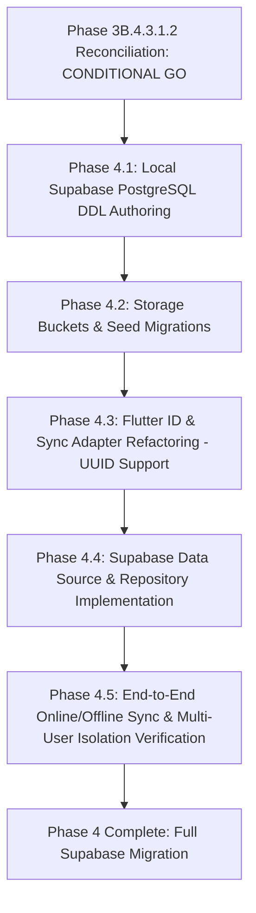

# MediCrate – Phase 3B.4.3.1: Phase 4 Readiness Assessment & Go/No-Go Decision

> **Document Status:** Authoritative & Reconciled (Phase 3B.4.3.1.2)  
> **Audit & Reconciliation Date:** November 9, 2026  
> **Auditor:** Antigravity AI – Senior Migration Architecture Agent  
> **Authoritative Baseline Matrix:** [`docs/active/MEDICRATE_PHASE3B_4_3_1_API_AND_FEATURE_DISPOSITION_MATRIX.md`](file:///home/blackhat/Documents/medi_crate/docs/active/MEDICRATE_PHASE3B_4_3_1_API_AND_FEATURE_DISPOSITION_MATRIX.md)  
> **Governance Report Reference:** [`docs/governance/MEDICRATE_PHASE3B_4_3_1_1_API_DISPOSITION_CORRECTION_REPORT.md`](file:///home/blackhat/Documents/medi_crate/docs/governance/MEDICRATE_PHASE3B_4_3_1_1_API_DISPOSITION_CORRECTION_REPORT.md)  
> **Active Target Repository:** `/home/blackhat/Documents/medi_crate`  
> **Read-Only Reference Repository:** `/home/blackhat/Documents/Reubro/medivalut`  

---

## 1. Overall Phase 4 Readiness Decision

### Final Verdict: **CONDITIONAL GO**

```
┌────────────────────────────────────────────────────────────────────────┐
│                      PHASE 4 GATEWAY DECISION                          │
│                                                                        │
│                      [ CONDITIONAL GO ]                                │
│                                                                        │
│   Phase 4.1 (Supabase PostgreSQL DDL Authoring) is AUTHORIZED          │
│   TO PROCEED locally, subject to strict boundary restrictions:         │
│   1. Local offline DDL script authoring ONLY.                          │
│   2. Remote database execution (supabase db push) is NOT authorized.   │
│   3. Edge Function deployment is NOT authorized.                       │
│   4. Hosted database configuration must NOT be modified.               │
│   5. Runtime synchronization push MUST remain suspended                │
│      (SyncService.isRemotePushSuspended = true).                       │
│   6. UUID string support in IdUtils and SyncService remains            │
│      a mandatory prerequisite prior to enabling live sync in P4.5.     │
└────────────────────────────────────────────────────────────────────────┘
```

### Executive Justification & Boundary Clarifications

1. **Architectural Clarity & Reconciled API Baseline:**
   All 13 relational tables, 64 original REST API endpoints, 23 selection sources, and 3 private storage buckets have been verified against actual Flutter client code and legacy Laravel contracts. The API disposition matrix has been mathematically reconciled to 6 distinct primary categories totaling exactly 64 endpoints (0 duplicates, 0 omissions).

2. **Tenant Isolation & RLS Design Clarification:**
   The composite tenant isolation architecture (`UNIQUE (id, user_id)` on `public.profiles` and compound foreign keys `(profile_id, user_id)` on clinical tables) is designed to prevent cross-tenant data corruption. However, Row Level Security (RLS) is currently at the **proposed policy design** stage. RLS policies are **not yet authored into SQL scripts, not deployed to any database, and not validated by multi-user isolation tests**. Complete elimination of cross-tenant leakage risks will only be verified post-deployment in Phase 4.5 via automated multi-user test suites.

3. **Runtime Blocker Isolated to Client Sync Adapter:**
   The mismatch between legacy integer IDs (`toServerIntId`, `< 1,000,000,000,000`) and Supabase UUID v4 strings is diagnosed and isolated. Because `isRemotePushSuspended = true` completely isolates the mobile client from remote network push, local PostgreSQL DDL authoring can safely proceed without risking data corruption. Live remote synchronization must remain suspended until the client sync adapter is updated to support UUID strings in Phase 4.3.

---

## 2. Workstream-by-Workstream Readiness Scorecard

### 1. Database Entity Inventory
- **Status:** **READY**
- **Evidence:** 13 primary relational tables finalized (`profiles`, `medical_departments`, `hospitals`, `doctors`, `doctor_hospitals`, `consultations`, `consultation_attachments`, `appointments`, `prescriptions`, `reports`, `report_attachments`, `report_expenses`, `measurements`). Candidate entities (`user_settings`, `sync_queues`, `consent_records`) cleanly classified as local-only.
- **Remaining Work:** None for planning. Author local DDL scripts in Phase 4.1.
- **Blocking Decisions:** None.
- **Acceptance Criteria:** Exactly 13 tables defined in PostgreSQL DDL with proper foreign keys, constraints, and indexes.

---

### 2. Schema Relationships & Integrity
- **Status:** **READY WITH CONDITIONS**
- **Evidence:** Foreign key cascades, multi-profile links, doctor-hospital M:N affiliations, and historical snapshot text fields (`doctor_name`, `hospital_name`, BMI value) reconciled.
- **Remaining Work:** Incorporate compound foreign keys `(profile_id, user_id)` on all clinical child tables to prevent cross-account profile injection.
- **Blocking Decisions:** Implementation of composite uniqueness `UNIQUE (id, user_id)` on `public.profiles`.
- **Acceptance Criteria:** Every clinical child table enforces a composite foreign key referencing `public.profiles(id, user_id) ON DELETE CASCADE`.

---

### 3. Multi-Profile Ownership
- **Status:** **READY**
- **Evidence:** Two-tier model (`auth.users` -> `public.profiles`) fully matches `lib/features/profile/` and `HiveProfileQueryHelper`. Primary profile (`Self`) and family member profiles cleanly separated.
- **Remaining Work:** Implement PostgreSQL trigger on `auth.users` to bootstrap primary profile row upon sign-up.
- **Blocking Decisions:** None.
- **Acceptance Criteria:** Automatic creation of primary profile row upon new user registration via GoTrue Auth.

---

### 4. Row Level Security (RLS) & Tenant Isolation
- **Status:** **READY WITH CONDITIONS (DESIGN STAGE)**
- **Maturity Level Distinction:**
  - *Reviewed Ownership Architecture:* **Complete.** Two-tier hierarchy (`auth.users` $\rightarrow$ `public.profiles` $\rightarrow$ clinical records) validated.
  - *Proposed RLS Policy Design:* **Complete.** Specification formulating `auth.uid() = user_id` checks across all 13 tables documented.
  - *Actual Authored SQL Policies:* **Not Started.** To be written in Phase 4.1 DDL files.
  - *Deployed Policies:* **Not Deployed.** No policies exist on any remote or hosted database.
  - *Multi-User Isolation Verification:* **Untested.** Multi-tenant isolation tests have not yet been executed.
- **Remaining Work:** Author PostgreSQL RLS policies in Phase 4.1 DDL scripts; build automated multi-user test suite asserting that User B cannot query, insert, update, or delete User A's records.
- **Blocking Decisions:** None for DDL drafting.
- **Acceptance Criteria:** `ALTER TABLE <t> ENABLE ROW LEVEL SECURITY;` on all 13 tables accompanied by passing multi-tenant integration tests. Cross-tenant leakage risks cannot be claimed as eliminated until deployment and testing succeed.

---

### 5. Reference Data & Enums
- **Status:** **READY**
- **Evidence:** All 23 selection sources reconciled. `medical_departments` confirmed as the canonical reference table. 16 hardcoded enum sets verified against Flutter widgets. Unified gender check constraint defined. V0 documented as a static domain validation specification whitelist (`bp`, `glucose`, `heart_rate`, `spo2`, `temperature`, `respiratory_rate`, `bmi`).
- **Remaining Work:** Author SQL seed migration for `public.medical_departments` containing the standard clinical specialties.
- **Blocking Decisions:** None.
- **Acceptance Criteria:** `medical_departments` seeded with verified specialties; enum check constraints applied.

---

### 6. Offline Synchronization Engine
- **Status:** **NOT READY FOR RUNTIME PUSH / READY FOR DDL PLANNING**
- **Evidence:** `lib/core/sync/sync_service.dart` and `lib/core/utils/id_utils.dart` contain hardcoded integer validation (`toServerIntId`, parsed `< 1,000,000,000,000`). Supabase generates UUID v4 strings, which causes current client sync logic to discard remote IDs.
- **Remaining Work:** Refactor `IdUtils` to support UUID string resolution (`toServerUuid`) and update `SyncService` queue drain logic in Phase 4.3.
- **Blocking Decisions:** Runtime sync push must remain suspended (`isRemotePushSuspended = true`) until Phase 4.3 refactoring is complete.
- **Acceptance Criteria:** Successful offline-to-online sync integration test asserting that client-generated UUIDs cleanly persist to Supabase and drain from `sync_queue_box`.

---

### 7. Storage & Attachment Architecture
- **Status:** **READY WITH CONDITIONS (PROPOSED POLICY)**
- **Three-Tier Consultation Attachment Architecture:**
  To resolve ambiguity regarding route `C6` and consultation file handling, the architecture explicitly distinguishes three functional layers:
  1. `public.consultations`: Parent clinical encounter record containing diagnosis, physician, fee, and clinical notes.
  2. `public.consultation_attachments`: Relational metadata table storing attachment ownership, file name, file size, mime type, and file path pointers, secured by compound foreign keys `(consultation_id, user_id)`.
  3. Private `consultations` Storage Bucket: Encrypted cloud object storage holding the physical binary files.
- **Storage Signed URL Lifetime Policy:**
  - *Proposed Default:* **900 seconds (15 minutes)**, harmonized with [`docs/active/MEDICRATE_PHASE3B_4_3_1_API_AND_FEATURE_DISPOSITION_MATRIX.md`](file:///home/blackhat/Documents/medi_crate/docs/active/MEDICRATE_PHASE3B_4_3_1_API_AND_FEATURE_DISPOSITION_MATRIX.md).
  - *Status:* Clearly designated as a **proposed policy**, not a deployed configuration.
  - *Justification:* 900 seconds provides an optimal balance between document viewing/streaming reliability for multi-page medical PDFs and session security, replacing the previous shorter URL lifetime proposal.
- **Remaining Work:** Author Supabase Storage bucket provisioning scripts and storage RLS policies in Phase 4.2.
- **Blocking Decisions:** None for DDL planning.
- **Acceptance Criteria:** Storage buckets provisioned as private; authenticated users can upload and stream attachments via proposed 900-second signed URLs.

---

### 8. API Replacement Mapping
- **Status:** **READY**
- **Evidence:** All 64 original REST endpoints reconciled against the corrected Phase 3B.4.3.1.1 baseline:
  - **Supabase PostgREST Direct Tables:** **42 endpoints** (Direct CRUD across clinical entities)
  - **Supabase GoTrue Auth SDK:** **12 endpoints** (User authentication and session lifecycle)
  - **Local Hive On-Device Aggregations:** **5 endpoints** (`F7`, `F8`, `AN1`, `DB1`, `T1`)
  - **Supabase Storage Buckets:** **3 endpoints** (`F6` avatars, `C6` consultations, `R6` reports)
  - **Security Definer RPC:** **1 endpoint** (`B5` account deletion)
  - **Excluded Features:** **1 endpoint** (`A9` Apple Sign-In)
  - **Total Reconciled Endpoints:** **64 endpoints** ($42 + 12 + 5 + 3 + 1 + 1 = 64$)
- **Remaining Work:** Implement Flutter Supabase client repositories in Phase 4.4 to replace dormant Dio callers.
- **Blocking Decisions:** None.
- **Acceptance Criteria:** Every active Flutter repository calls Supabase PostgREST / Storage instead of Dio REST callers.

---

### 9. Authentication & Account Lifecycle
- **Status:** **NOT READY FOR PRODUCTION DELETION / GATED ON ARCHITECTURAL DECISIONS**
- **Evidence:** Supabase GoTrue Auth is operational for core sign-in, token refresh, and password management (Phases 3B.2–3B.4). However, **Account Deletion (`B5`) is NOT fully ready** and must not be marked as decision-free.
- **Unresolved Architectural & Security Decisions (Gating Implementation):**
  1. *Immediate Hard Deletion vs. 30-Day Grace Period:* Whether calling `delete_user_account()` immediately executes hard deletion (`DELETE FROM auth.users`) or sets `account_status = 'pending_deletion'` with a pg_cron scheduled purge to accommodate user remorse.
  2. *Mandatory Re-Authentication Protocol:* Normal Supabase RPC calls do not verify passwords. An explicit client-side re-authentication workflow (`supabase.auth.signInWithPassword()`) must be mandated before the deletion RPC can be triggered.
  3. *Storage-Object Cleanup Strategy:* Deleting database rows via foreign key cascades does NOT automatically remove binary blobs from `storage.objects`. A reliable mechanism (database trigger calling an Edge Function or client-side storage purge) must be finalized.
  4. *Clinical-Record Retention & Legal Holds:* Compliance assessment is required to determine whether healthcare regulations mandate retaining anonymized encounter records rather than executing full GDPR erasure.
- **Production Guardrail:**
  The `delete_user_account()` RPC remains a planned architectural component. Its implementation into production migrations is **strictly gated** on formal resolution of the four decisions above and a comprehensive security review. The sample RPC script must **not** be copied into production migrations during Phase 4.1.
- **Blocking Decisions:** Formal architectural sign-off on the 4 account lifecycle decisions.
- **Acceptance Criteria:** Formal security review and signed specification resolving deletion grace period, re-authentication, blob purge, and clinical record retention.

---

### 10. Migration & Seed Strategy
- **Status:** **READY**
- **Evidence:** Clean baseline approach: fresh Supabase database instance with zero legacy dirty state. Reference data (`medical_departments`) extracted from `api_constants.dart` and `medical_department_remote_data_source.dart`.
- **Remaining Work:** Prepare local `seed.sql` script with standard clinical specialties.
- **Blocking Decisions:** None.
- **Acceptance Criteria:** Automated seed migration populates `medical_departments` on fresh database initialization.

---

### 11. Test Strategy
- **Status:** **READY WITH CONDITIONS**
- **Evidence:** Existing unit and widget test suites pass (`test/core/startup_configuration_test.dart`).
- **Remaining Work:** Create dedicated Supabase mock client test harness for repository unit testing without requiring hosted network calls.
- **Blocking Decisions:** None.
- **Acceptance Criteria:** All unit tests pass with zero regressions; mock Supabase repositories verify CRUD contracts.

---

### 12. Rollback & Recovery Strategy
- **Status:** **READY**
- **Evidence:** MediCrate's offline-first architecture decouples the UI from network availability. Setting `SyncService.isRemotePushSuspended = true` instantly halts remote operations, leaving the mobile client fully operational via local Hive storage.
- **Remaining Work:** Document formal rollback flags in `AppConfig`.
- **Blocking Decisions:** None.
- **Acceptance Criteria:** Toggling `isRemotePushSuspended` completely isolates the app without crashes or data loss.

---

## 3. Phase 4 Execution Roadmap

Following approval of this reconciled readiness assessment, Phase 4 will execute according to the approved sequential milestones:



### Milestone Scope & Boundaries

1. **Phase 4.1: Local Supabase PostgreSQL DDL Authoring:**
   - Author local, idempotent SQL migration scripts defining the 13 public tables, composite uniqueness `UNIQUE (id, user_id)` on `public.profiles`, composite foreign keys `(profile_id, user_id)` on child tables, indexes, and proposed RLS policies.
   - *Restrictions:* Local file creation ONLY. No execution of `supabase db push`, no remote migrations, and no sample RPC copying.
2. **Phase 4.2: Storage Buckets & Reference Seeding:**
   - Author configuration scripts for `avatars`, `reports`, and `consultations` private buckets with the proposed 900-second signed URL policy. Seed `public.medical_departments`. Account deletion RPC authoring remains gated on the 4 architectural decisions.
3. **Phase 4.3: Flutter ID & Sync Adapter Refactoring (Mandatory Blocker):**
   - Refactor `IdUtils` and `SyncService` to support UUID string resolution (`toServerUuid`). Eliminate the integer ID assumption (`< 1,000,000,000,000`).
4. **Phase 4.4: Supabase Data Source & Repository Implementation:**
   - Implement Supabase PostgREST data sources in `lib/features/**/data/datasources/remote/`, replacing dormant Dio HTTP callers.
5. **Phase 4.5: End-to-End Online/Offline Sync & Multi-User Isolation Verification:**
   - Unsuspend `SyncService.isRemotePushSuspended`. Verify bi-directional synchronization, offline mutation draining, file streaming, and execute automated multi-user test suites to prove zero cross-tenant leakage.

---

*Readiness Assessment Finalized: November 9, 2026*  
*Author: Antigravity AI – Senior Migration Architecture Agent*  
