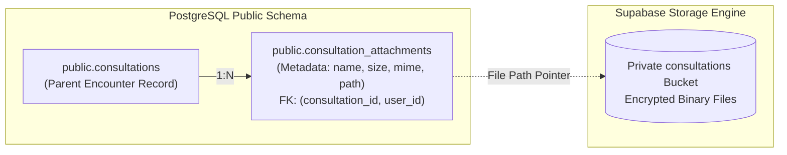

# MediCrate – Phase 3B.4.3.1.2: Phase 4 Readiness Reconciliation Report

> **Document Classification:** Governance & Architecture Audit Report  
> **Phase:** 3B.4.3.1.2 (Readiness Assessment Reconciliation)  
> **Reconciliation Date:** November 9, 2026  
> **Auditor:** Antigravity AI – Senior Migration Architecture Agent  
> **Target Active Document:** [`docs/active/MEDICRATE_PHASE3B_4_3_1_PHASE4_READINESS_ASSESSMENT.md`](file:///home/blackhat/Documents/medi_crate/docs/active/MEDICRATE_PHASE3B_4_3_1_PHASE4_READINESS_ASSESSMENT.md)  
> **Authoritative Baseline Matrix:** [`docs/active/MEDICRATE_PHASE3B_4_3_1_API_AND_FEATURE_DISPOSITION_MATRIX.md`](file:///home/blackhat/Documents/medi_crate/docs/active/MEDICRATE_PHASE3B_4_3_1_API_AND_FEATURE_DISPOSITION_MATRIX.md)  
> **Prior Governance Audit:** [`docs/governance/MEDICRATE_PHASE3B_4_3_1_1_API_DISPOSITION_CORRECTION_REPORT.md`](file:///home/blackhat/Documents/medi_crate/docs/governance/MEDICRATE_PHASE3B_4_3_1_1_API_DISPOSITION_CORRECTION_REPORT.md)  
> **Active Target Repository:** `/home/blackhat/Documents/medi_crate`  
> **Read-Only Reference Repository:** `/home/blackhat/Documents/Reubro/medivalut`  

---

## 1. Executive Summary & Audit Mandate

Following the formal count correction and evidence verification in Phase 3B.4.3.1.1, this governance workstream reconciled [`docs/active/MEDICRATE_PHASE3B_4_3_1_PHASE4_READINESS_ASSESSMENT.md`](file:///home/blackhat/Documents/medi_crate/docs/active/MEDICRATE_PHASE3B_4_3_1_PHASE4_READINESS_ASSESSMENT.md) against the authoritative API disposition matrix.

The previous readiness assessment contained multiple inconsistencies with the corrected baseline, including stale API endpoint counts (14 Auth, 39 PostgREST, 7 Local Hive), premature claims regarding Row Level Security (RLS) leakage elimination, an unverified "READY" status for Account Deletion (`B5`), an internal conflict over Storage signed URL expiration windows (60 seconds vs. 900 seconds), and an incomplete two-tier description of consultation attachments.

This report documents the exact discrepancies identified, the specific architectural corrections applied to the readiness assessment, and the reaffirmed gateway boundaries for Phase 4.

---

## 2. Issues Found & Exact Corrections Applied

| # | Issue Identified | Prior Text / Claim | Corrected Text / Architecture | Root Cause & Justification |
| :--- | :--- | :--- | :--- | :--- |
| **1** | **Stale API Endpoint Counts** | "14 Auth, 1 Excluded, 39 PostgREST, 3 Storage, 7 Local Hive" | **42 PostgREST, 12 Auth SDK, 5 Local Hive, 3 Storage, 1 RPC, 1 Excluded = 64** | Aligned with Phase 3B.4.3.1.1 authoritative matrix. Corrected arithmetic and category assignments. |
| **2** | **Account Deletion Readiness Overstatement** | Status: "READY"; "Author `delete_user_account()` RPC; Blocking Decisions: None." | Status: **NOT READY FOR PRODUCTION DELETION / GATED ON ARCHITECTURAL DECISIONS** | 4 critical security/lifecycle decisions remain unresolved. Production RPC authoring is strictly gated. Sample RPC must not be copied into DDL. |
| **3** | **Premature RLS Leakage Claims** | Claimed RLS policies "eliminate cross-tenant data leakage risks." | Explicitly distinguished 5 maturity stages: reviewed ownership (done), proposed policy design (done), authored SQL (pending), deployed policies (none), multi-user isolation tests (untested). | Leakage elimination is an architectural goal, not a proven fact prior to deployment and testing. |
| **4** | **Storage Signed URL TTL Discrepancy** | Section 2, Item 7 cited "60-second signed URLs." | Corrected to **900 seconds (15 minutes)**, clearly labeled as a **proposed policy**, not a deployed configuration. | 60 seconds is too aggressive for streaming large multi-page medical PDFs; 900 seconds harmonizes with the API matrix. |
| **5** | **Consultation Attachment Model Ambiguity** | Blurred relational metadata and binary storage. | Formally distinguished three layers: 1) `public.consultations`, 2) `public.consultation_attachments`, 3) private `consultations` bucket. | Essential to support multi-file attachments, file sizes, mime types, and RLS metadata linking. |
| **6** | **Phase 4 Gateway Restrictions** | Brief CONDITIONAL GO without explicit deployment guardrails. | Expanded gateway decision with strict negative constraints: local DDL only, NO `supabase db push`, NO Edge Functions, sync push remains suspended. | Prevents premature remote operations before client UUID refactoring in Phase 4.3. |

---

## 3. Before-and-After API Category Counts

The table below contrasts the stale API category counts previously referenced in the readiness assessment with the authoritative values established in the corrected matrix:

| Endpoint Disposition Category | Stale Readiness Assessment Count | Reconciled Authoritative Count | Discrepancy Analysis & Reconciliation |
| :--- | :---: | :---: | :--- |
| **Supabase PostgREST Direct Tables** | 39 | **42** | +3: Narrative undercounted the 42 listed PostgREST table rows ($1 + 5 + 5 + 5 + 1 + 5 + 5 + 5 + 5 + 5 = 42$). |
| **Supabase GoTrue Auth SDK** | 14 | **12** | -2: The set `A1–A8, A10, B1, B3–B5` has 13 IDs; reclassifying `B5` to RPC leaves exactly 12 client Auth SDK endpoints. |
| **Local Hive On-Device Aggregations** | 7 | **5** | -2: Only `F7, F8, AN1, DB1, T1` are baseline endpoints. Speculative export/backup counts were removed. |
| **Supabase Storage Buckets** | 3 | **3** | 0: Validated binary transfer routes (`F6` avatars, `C6` consultations, `R6` reports). |
| **Security Definer RPC** | 0 (Omitted) | **1** | +1: Restored `B5` (Account Deletion) as a distinct administrative RPC category. |
| **Excluded Features** | 1 | **1** | 0: Validated `A9` (Apple Sign-In) is excluded from MediCrate UI and backend scope. |
| **Total Reconciled Endpoints** | **64** | **64** | **Exact match: $42 + 12 + 5 + 3 + 1 + 1 = 64$ (0 duplicates, 0 omissions).** |

---

## 4. Account Deletion: Unresolved Decisions & Production Gating

Workstream 9 (Authentication & Account Lifecycle) has been formally downgraded from "READY" to **"NOT READY FOR PRODUCTION DELETION / GATED ON ARCHITECTURAL DECISIONS"**.

The implementation of `delete_user_account()` in production migrations is gated on resolving the following four architectural decisions:

1. **Immediate Hard Deletion vs. 30-Day Soft Deletion Grace Period:**
   - *Consideration:* Immediate execution of `DELETE FROM auth.users` cascades irreversibly across all relational tables. Legacy MediVault notes suggested a 30-day soft-delete grace period with a `deleted_at` timestamp.
   - *Status:* Unresolved. Requires product and business decision on whether user remorse recovery is supported via `account_status = 'pending_deletion'` and a scheduled pg_cron worker.
2. **Mandatory Client-Side Re-Authentication:**
   - *Consideration:* Standard PostgreSQL RPC invocations in Supabase execute based on the active JWT and do not prompt for password verification. In an unattended unlocked session, calling the RPC would delete the account without challenge.
   - *Status:* Unresolved. Requires establishing a mandatory UI workflow requiring `supabase.auth.signInWithPassword()` immediately prior to RPC execution.
3. **Storage Bucket Object Cleanup Strategy:**
   - *Consideration:* Relational foreign keys with `ON DELETE CASCADE` only purge rows from PostgreSQL tables (`public.profiles`, `public.reports`, etc.). They do NOT automatically delete physical files in `storage.objects`.
   - *Status:* Unresolved. Requires selecting either a PostgreSQL trigger calling an Edge Function, a background batch sweeper, or client-orchestrated bucket purges.
4. **Clinical Record Retention & Legal Holds:**
   - *Consideration:* In medical jurisdictions, medical encounter records and prescription histories are subject to statutory retention periods and cannot be summarily purged upon patient request.
   - *Status:* Unresolved. Compliance guidance is required on whether account deletion executes full data erasure (GDPR "Right to be Forgotten") or anonymizes clinical data while detaching identity.

**Mandatory Guardrail:**
The sample RPC script must **NOT** be copied into Phase 4.1 DDL migrations.

---

## 5. Row Level Security (RLS) Implementation & Testing Status

To ensure engineering rigor, the readiness assessment now strictly distinguishes between the five lifecycle stages of RLS implementation:

```
┌────────────────────────────────────────────────────────────────────────────────────────┐
│                                 RLS MATURITY PIPELINE                                  │
│                                                                                        │
│  [1. Reviewed Architecture] ──> [2. Proposed Policy Design] ──> [3. Authored SQL]     │
│             (DONE)                          (DONE)                  (PHASE 4.1 LOCAL)  │
│                                                                                        │
│                                           │                                            │
│                                           ▼                                            │
│                                [4. Deployed to Database] ──> [5. Multi-User Tests]     │
│                                    (PHASE 4.5 REMOTE)            (PHASE 4.5 REMOTE)    │
└────────────────────────────────────────────────────────────────────────────────────────┘
```

1. **Reviewed Ownership Architecture:** **COMPLETE.** The two-tier hierarchy (`auth.users(id)` $\rightarrow$ `public.profiles(id, user_id)` $\rightarrow$ clinical records) is validated against client models.
2. **Proposed Policy Design:** **COMPLETE.** Policies requiring `auth.uid() = user_id` across all 13 tables are specified.
3. **Actual Authored SQL Policies:** **PENDING PHASE 4.1.** DDL scripts containing `CREATE POLICY` statements will be written locally in Phase 4.1.
4. **Deployed Policies:** **NOT DEPLOYED.** Zero policies have been pushed to any remote or hosted database.
5. **Multi-User Isolation Verification:** **UNTESTED.** No automated multi-tenant penetration or leak tests have been run.

**Governance Directive:** Cross-tenant leakage risks cannot be claimed as eliminated until Stage 4 (deployment) and Stage 5 (passing automated isolation tests) are completed. The required schema constraints—composite uniqueness `UNIQUE (id, user_id)` on `public.profiles` and composite foreign keys `(profile_id, user_id)` on all child tables—remain mandatory DDL requirements.

---

## 6. Storage URL Lifetime Policy Harmonization

- **Discrepancy:** The API disposition matrix specified a 900-second (15-minute) signed URL expiration, while the readiness assessment previously cited a 60-second expiration.
- **Resolution:** The readiness assessment has been updated to adopt the **900-second (15 minutes)** standard as the documented default.
- **Classification:** Clearly designated as a **proposed policy**, not a deployed configuration.
- **Rationale:** Medical reports and consultation attachments frequently consist of multi-page diagnostic PDFs. A 60-second lifetime causes connection drops during slow-network file rendering, while 900 seconds provides adequate viewing time without compromising security.

---

## 7. Consultation Attachment Three-Tier Architecture

To eliminate ambiguity regarding route `C6` (`GET /consultations/{id}/files/{fileId}`) and consultation attachments, the readiness assessment now explicitly defines the three necessary architecture tiers:



1. **`public.consultations`:** Stores parent encounter clinical attributes (doctor, hospital, diagnosis, notes, fee).
2. **`public.consultation_attachments`:** Stores relational metadata (file name, file size, mime type, upload timestamp, and relative storage object path) with composite foreign keys `(consultation_id, user_id)` enforcing profile-scoped tenant isolation.
3. **Private `consultations` Storage Bucket:** Holds encrypted physical binary files accessed strictly through time-limited signed URLs generated via Storage RLS.

---

## 8. Final Phase 4 Gate Decision & Boundary Restrictions

The gateway verdict of **CONDITIONAL GO** is preserved, permitting the start of **Phase 4.1: Local Supabase PostgreSQL DDL Authoring**, under the following explicit constraints:

```
┌────────────────────────────────────────────────────────────────────────┐
│                     PHASE 4.1 BOUNDARY CONSTRAINTS                     │
│                                                                        │
│  [ALLOWED]                                                             │
│  ✔ Authoring local .sql DDL scripts for 13 tables.                     │
│  ✔ Authoring composite uniqueness and composite FK constraints.        │
│  ✔ Authoring local proposed RLS policy statements.                     │
│  ✔ Authoring reference seed data scripts (medical_departments).        │
│                                                                        │
│  [STRICTLY PROHIBITED]                                                 │
│  ✖ DO NOT execute 'supabase db push' or apply remote DDL.              │
│  ✖ DO NOT execute migrations against hosted database instances.        │
│  ✖ DO NOT deploy Edge Functions.                                       │
│  ✖ DO NOT modify hosted project configuration or secrets.              │
│  ✖ DO NOT un-suspend SyncService.isRemotePushSuspended.                │
│  ✖ DO NOT copy sample account-deletion RPC into migrations.            │
│  ✖ DO NOT modify application source code, tests, or .env.             │
└────────────────────────────────────────────────────────────────────────┘
```

The prerequisite for live remote database synchronization remains unchanged: **UUID string support in `IdUtils` and `SyncService` must be completed in Phase 4.3 prior to enabling runtime push in Phase 4.5.**

---

## 9. Verification & Integrity Checklist

| Verification Item | Status | Verification Evidence |
| :--- | :---: | :--- |
| **API Matrix & Readiness Counts Agree** | **PASS** | Both documents agree on all 6 categories: 42 PostgREST, 12 Auth, 5 Local Hive, 3 Storage, 1 RPC, 1 Excluded. |
| **64 Total Endpoint Sum** | **PASS** | Exact mathematical sum: $42 + 12 + 5 + 3 + 1 + 1 = 64$. |
| **Stale Count References Eliminated** | **PASS** | Grep confirms zero occurrences of "14 Auth", "39 PostgREST", or "7 Local Hive" across active documents. |
| **Account Deletion Gating Explicit** | **PASS** | Marked NOT READY FOR PRODUCTION DELETION; all 4 unresolved decisions documented; sample RPC copying barred. |
| **RLS Leakage Claims Corrected** | **PASS** | 5 maturity stages documented; leakage elimination framed as post-deployment target, not current status. |
| **Storage URL TTL Harmonized** | **PASS** | Consistent 900-second proposed policy across both active matrix and readiness assessment. |
| **Consultation 3-Tier Architecture Documented** | **PASS** | `public.consultations`, `public.consultation_attachments`, and private `consultations` bucket clearly separated. |
| **No Source Code or Test Modifications** | **PASS** | `git status` verifies zero changes to `lib/`, `test/`, `pubspec.yaml`, or `.env`. |
| **MediVault Reference Repo Untouched** | **PASS** | Read-only compliance preserved; zero changes to `/home/blackhat/Documents/Reubro/medivalut`. |

---

*Report Approved by: Antigravity AI – Senior Migration Architecture Agent*  
*Distribution: `docs/governance/`, `docs/active/`*  
