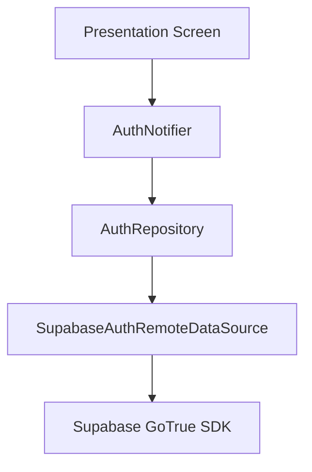

# MediCrate – Phase 3B.4.0: Authentication Runtime Readiness & Configuration Preflight Audit

**Target repository:** `/home/blackhat/Documents/medi_crate`  
**Reference repository:** `/home/blackhat/Documents/Reubro/medivalut` — STRICTLY READ-ONLY  
**Baseline commit:** `d25d6ada15530572965d21bf9e6cd06fac9aac11`  
**Audit Date:** 2026-11-09  
**Status:** COMPLETE (READ-ONLY AUDIT)

---

## Executive Summary

This preflight audit validates MediCrate's authentication implementation and Android runtime readiness prior to real-device testing. All code paths, environment variables, Gradle settings, security boundaries, and offline data protections were inspected in a strictly non-destructive manner.

- **Static Analysis & Tests:** 0 analyzer issues, 96/96 tests passing, debug APK builds cleanly in 5.8s.
- **Application Code Readiness:** `PASS`. Supabase GoTrue authentication, 6-digit OTP handling, real-time error clearance, and Hive clinical data isolation are fully implemented and verified.
- **External Configuration Pre-requisites:** `WARNING` / `NOT VERIFIED`. Real-device Google Sign-In requires adding the Android debug SHA-1 fingerprint to Google Cloud Console, and Supabase email templates must be verified to contain `{{ .Token }}`.

---

## 1. Git Baseline Verification

| Check | Expected | Actual | Finding |
|---|---|---|---|
| Active Branch | `master` | `master` | **PASS** |
| HEAD Commit Hash | `d25d6ada15530572965d21bf9e6cd06fac9aac11` | `d25d6ada15530572965d21bf9e6cd06fac9aac11` | **PASS** |
| Baseline Commit Match | Yes | Yes (`d25d6ad`) | **PASS** |
| Working Tree Status | Clean | Clean (`git status --short` returned 0 changes) | **PASS** |
| Reference Project (`medivalut`) | Untouched | Untouched | **PASS** |

---

## 2. Supabase Configuration Audit

### 2.1 Configuration Keys & Environment Loading

- **`.env` file status:** Present and ignored by Git. Checked via `git check-ignore -v .env` (`.gitignore:51:.env`).
- **Required keys verified:**
  - `SUPABASE_URL`: Non-empty (`https://wnaflcytkubqmrymbmcn.supabase.co`).
  - `SUPABASE_ANON_KEY`: Non-empty (79 chars, public anon JWT, masked).
  - `GOOGLE_WEB_CLIENT_ID`: Non-empty (`574482098020-...apps.googleusercontent.com`).
- **Startup sequence (`lib/main.dart`):**
  1. `WidgetsFlutterBinding.ensureInitialized()` is executed first.
  2. `await dotenv.load(fileName: '.env')` loads environment configuration.
  3. `Future.wait([SslSecurityContext.initialize(), HiveService.init(), GoogleAuthService.initialize(...)])` initializes prerequisite services concurrently.
  4. `await SupabaseConfig.initialize()` initializes Supabase singleton before `runApp`.
  5. If pre-runApp initializers fail, `_StartupErrorApp` displays an actionable recovery screen rather than crashing.
- **Error handling:** `SupabaseConfig.validateConfig` validates URL scheme (`http`/`https`) and authority. Throws typed `SupabaseConfigurationException` with clear diagnostics.
- **Service-role key audit:** Checked full workspace (`lib/`, `test/`). **Zero** service-role references exist in application code.

### 2.2 Session Persistence & Token Handling

- **Session authority:** Managed solely by the Supabase Flutter SDK (GoTrue internal secure storage).
- **Manual token duplication:** **None**. `AuthLocalDataSource` in Hive caches only `UserModel` profile attributes and boolean `isLoggedIn`. No duplicate Supabase tokens are persisted in `SharedPreferences` or `FlutterSecureStorage`.
- **Startup session restoration:**
  - `AuthNotifier.build()` initiates `_initialSessionFuture = Future.microtask(checkInitialSession)`.
  - `SplashScreen` awaits `authNotifier.initialSessionReady` (in parallel with minimum 900ms branding) before routing to `/dashboard` or `/login`.

**Finding:** **PASS**

---

## 3. Google OAuth Configuration Audit

### 3.1 Service Implementation (`lib/features/auth/data/services/google_auth_service.dart`)

- **Web Client ID usage:** Passed to `GoogleAuthService.initialize(serverClientId: googleClientId)` in `main.dart`.
- **Strict configuration:** Initialization requires a non-empty `serverClientId`. If empty or null, `GoogleAuthService` sets `_isInitialized = false` and returns clear diagnostic errors: `Google Sign-In is unconfigured: GOOGLE_WEB_CLIENT_ID environment variable is missing`.
- **Legacy fallback avoidance:** App does **not** fall back to any old MediVault OAuth client IDs.
- **Client Secret:** **Zero** Google client secrets are present in Flutter source code or assets.
- **Direct Supabase exchange:**
  - Flow: `GoogleSignIn.authenticate()` -> extracts `account.authentication.idToken` -> passes to `supabaseRemoteDataSource.signInWithGoogleIdToken(idToken)` -> invokes `_client.auth.signInWithIdToken(provider: OAuthProvider.google, idToken: idToken)`.
  - **Firebase & Laravel involvement:** Zero. No Firebase Auth or Laravel Sanctum endpoints are invoked.

### 3.2 External Cloud Configuration Requirements

For Google Sign-In to succeed on Android real devices, external cloud services must be aligned:

1. **Google Cloud Console (OAuth Client IDs):**
   - **Web Application Client:**
     - Client ID: `574482098020-f1cghf914972a95c477i9f1cmlak73fa.apps.googleusercontent.com`
     - Authorized Redirect URIs: `https://wnaflcytkubqmrymbmcn.supabase.co/auth/v1/callback`
   - **Android Client (CRITICAL for real device testing):**
     - Package name: `com.example.medi_crate`
     - Debug SHA-1 Certificate Fingerprint: `F6:01:AE:27:B3:71:46:2D:FD:D8:09:1A:96:42:15:BA:BE:16:CF:D1`
     - Debug SHA-256 Certificate Fingerprint: `A5:7D:34:39:B2:A8:81:34:05:68:D3:4F:D0:2E:4F:DA:F4:09:85:A3:78:8E:E8:66:AE:1E:0F:3B:4F:8B:84:39`
     > [!WARNING]
     > If this Android OAuth client is not registered under the same Google Cloud project that owns the Web Client ID, Google Sign-In on Android will throw `ApiException: 10` (`DEVELOPER_ERROR`) on real devices.
2. **Supabase Dashboard:**
   - Provider: **Google** enabled.
   - Client ID: `574482098020-f1cghf914972a95c477i9f1cmlak73fa.apps.googleusercontent.com`
   - Client Secret: Configured from Google Cloud Console.
   - Skip nonce check: Enabled for native mobile ID-token authentication.

**Finding:** Code is **PASS**; Cloud configuration status is **NOT VERIFIED** (requires external dashboard access).

---

## 4. Android Runtime Readiness

| Component | Setting / File | Status | Notes |
|---|---|---|---|
| Application ID | `com.example.medi_crate` | **PASS** | Set in `android/app/build.gradle.kts` |
| Compile SDK | `37` (Android 15+) | **PASS** | Configured in `android/app/build.gradle.kts` |
| Min SDK | `flutter.minSdkVersion` (>= 21) | **PASS** | Supports Android 5.0 through 15 |
| Target SDK | `flutter.targetSdkVersion` | **PASS** | Standard Flutter target |
| Java / JVM Target | Java 17 / JVM 17 | **PASS** | Core library desugaring enabled (`desugar_jdk_libs:2.1.5`) |
| Debug Signing Key | `~/.android/debug.keystore` | **PASS** | Valid through 2056, alias `androiddebugkey` |
| Debug INTERNET Permission | `android/app/src/debug/AndroidManifest.xml` | **PASS** | Granted for debug builds |
| Main INTERNET Permission | `android/app/src/main/AndroidManifest.xml` | **WARNING** | Missing `<uses-permission android:name="android.permission.INTERNET"/>` in main manifest. Debug builds merge the debug manifest so debug testing will succeed, but release builds require this tag in main manifest. |
| Network Security Config | Default TLS / Cleartext blocked | **PASS** | All communication to Supabase and Google occurs over HTTPS |
| Deep Linking Intent Filters | `android/app/src/main/AndroidManifest.xml` | **WARNING** | No custom scheme or App Links filters. In-app 6-digit OTP entry and native Google Sign-In do not require deep links. However, clicking email verification links outside the app will not open the app directly. |
| Debug APK Build | `build/app/outputs/flutter-apk/app-debug.apk` | **PASS** | Builds cleanly in 5.8s |

---

## 5. Authentication Flow Traceability

Every authentication flow was traced across the entire stack:

### Detailed Flow Matrix

| Flow | Entry Screen | AuthNotifier Method | AuthRepository Method | Remote DataSource Method | Supabase SDK Operation | Success Result & Navigation | Failure Result & Handling |
|---|---|---|---|---|---|---|---|
| **A. Email Sign-Up** | `SignUpScreen` | `signUp(...)` | `signUp(...)` | `signUp(...)` | `_auth.signUp(...)` | If confirmation required: returns `pendingVerification`, navigates to `/otp-verification` (`type: 'signup'`). If autoconfirmed: `isSuccess`. | Catches `sb.AuthException`, sets `signupError`, stays on screen showing error container. |
| **B. Email Verification OTP** | `OtpVerificationScreen` | `verifyEmail(...)` | `verifyEmail(...)` | `verifyEmail(...)` | `_auth.verifyOTP(type: OtpType.signup)` | Saves `UserModel` to Hive `userBox`, sets `isAuthenticated: true`, navigates to `/dashboard`. | Sets `otpError` ("Invalid verification code" or "Expired"), displays inline error on OTP boxes. |
| **C. Email/Password Login** | `SignInScreen` | `signIn(...)` | `signIn(...)` | `login(...)` | `_auth.signInWithPassword(...)` | If confirmed: sets `isAuthenticated: true`, saves user to Hive, navigates to `/dashboard`. If unconfirmed: returns `pendingVerification`, auto-resends OTP, routes to `/otp-verification`. | Sets `loginError` ("Invalid email or password"), displays error container above form. |
| **D. Google Sign-In** | `SignInScreen` / `SignUpScreen` | `signInWithGoogle()` | `googleLogin(idToken)` | `signInWithGoogleIdToken(idToken)` | `_auth.signInWithIdToken(provider: google)` | Sets `isAuthenticated: true`, saves user to Hive, navigates to `/dashboard`. | If user cancels dialog: sets `isLoading: false` (no error). If token retrieval fails: surfaces error banner. |
| **E. Password Recovery Request** | `ForgotPasswordScreen` | `forgotPassword(email)` | `forgotPassword(email)` | `forgotPassword(email)` | `_auth.resetPasswordForEmail(...)` | Sets `pendingEmail`, navigates to `/otp-verification` (`type: 'reset_password'`). | Sets `forgotPasswordError`, displays inline banner. |
| **F. Recovery OTP Verification** | `OtpVerificationScreen` | Screen intercepts `type == 'reset_password'` | Passed as parameter to next screen | N/A (deferred to reset step) | N/A | Passes entered 6-digit code as `token` parameter to `/reset-password`. | Length check requires all 6 digits before enabling submission. |
| **G. Password Update** | `ResetPasswordScreen` | `resetPassword(...)` | `resetPassword(...)` | `resetPassword(...)` | 1. `_auth.verifyOTP(type: OtpType.recovery)` 2. `_auth.updateUser(...)` 3. `_auth.signOut()` | Clears legacy tokens, shows success snackbar, navigates to `/login`. | Sets `resetPasswordError` (e.g. invalid code or weak password), displays error banner. |
| **H. Session Restoration** | `SplashScreen` | `checkInitialSession()` | `checkSession()` | `_client.auth.currentSession` | Checks `session.isExpired`. If expired, calls `_client.auth.refreshSession()`. | If valid session: hydrates `UserModel`, updates `authState`, routes to `/dashboard`. | If no session: sets `isAuthenticated: false`, routes to `/login`. |
| **I. Sign-Out** | `Settings` / `Profile` | `signOut()` | `signOut()` | `signOut()` | `_auth.signOut()` | Clears legacy tokens, clears Hive user cache, sets `isAuthenticated: false`, triggers GoRouter redirect to `/login`. | Swallows network errors defensively; always clears local session cache. |

### Architectural Confirmations
1. **Six-digit OTP Default:** Verified across all routes, `OtpVerificationScreen`, and `Validators.validateOtp`.
2. **Recovery vs Signup OTP Distinction:** Verified. `resendOtp` maps `type: 'reset_password'` to `sb.OtpType.recovery`. `resetPassword` verifies using `sb.OtpType.recovery`. Signup uses `sb.OtpType.signup`.
3. **No Navigation Loops:** Parameter sanitization (`_sanitizeOtpLength`) and fallback checks (`hasValidEmail`) prevent null-pointer crashes or infinite redirects.

**Finding:** **PASS**

---

## 6. Supabase Dashboard Readiness Checklist

The following items cannot be inspected from local source code and require confirmation in the Supabase Dashboard:

- [ ] **Email Auth Enabled:** Authentication -> Providers -> Email is toggled ON.
- [ ] **Email Confirmations:**
  - Recommended: Enabled.
  - If enabled, Confirm Email template must contain the OTP token tag: `{{ .Token }}`.
- [ ] **Password Reset Template:**
  - Authentication -> Email Templates -> Reset Password must contain `{{ .Token }}` so the user receives a 6-digit code.
- [ ] **OTP Expiry:** Defaults to 3600 seconds (1 hour). Verify it is set to at least 300 seconds.
- [ ] **Google Provider Enabled:** Authentication -> Providers -> Google is toggled ON.
- [ ] **Google Credentials Configured:**
  - Client ID (for OAuth): `574482098020-f1cghf914972a95c477i9f1cmlak73fa.apps.googleusercontent.com`
  - Client Secret: Copied from Google Cloud Console.
  - Skip nonce check: Enabled (for native mobile ID-token exchange).
- [ ] **Redirect URLs:** Authentication -> URL Configuration -> Redirect URLs contains `https://wnaflcytkubqmrymbmcn.supabase.co/auth/v1/callback`.

**Finding:** **NOT VERIFIED** (Manual verification checklist provided for user).

---

## 7. Hive Preservation & Legacy Backend Isolation Audit

| Safety Invariant | Implementation Mechanism | Verification Result | Status |
|---|---|---|---|
| **Clinical Records Untouched** | `AuthLocalDataSource.clearUser()` only deletes `current_user` and `active_profile_id`. | `consultationBox`, `vitalBox`, `reportBox`, `medicineBox`, `profileBox` are never opened or modified during auth operations. | **PASS** |
| **Offline Sync Queue Intact** | `syncQueueBox` is excluded from all auth repositories and data sources. | Pending sync mutations are preserved across logout, login, and token refresh. | **PASS** |
| **Supabase JWT Suppression** | `AuthInterceptor.isSupabaseJwt` detects 3-part base64url RFC 7519 tokens. | Suppresses and strips Supabase JWTs from Dio requests to Laravel endpoints. | **PASS** |
| **Legacy Remote Push Suspended** | `SyncService.isRemotePushSuspended = true` | All clinical repositories check `SyncService.isRemotePushSuspended` and return before calling remote APIs. | **PASS** |
| **Background WorkManager Inactive** | `BackgroundSyncService.isLaravelSyncSuspended = true` | WorkManager tasks are cancelled on init; no periodic background tasks are registered. Headless executions return immediately. | **PASS** |

**Finding:** **PASS**

---

## 8. Security Findings & Risk Classification

### Summary of Audit Findings

| Finding ID | Description | Severity | Classification | Impact |
|---|---|---|---|---|
| **SEC-01** | Zero service-role keys in Flutter code | INFO | **PASS** | Protects backend administrative permissions. |
| **SEC-02** | No Google client secret in mobile binary | INFO | **PASS** | Complies with OAuth 2.0 public client standards. |
| **SEC-03** | No duplicate token storage in SharedPreferences | INFO | **PASS** | Prevents token desynchronization and leakage. |
| **SEC-04** | Main manifest missing INTERNET permission | LOW | **WARNING** | Debug build functions properly on devices. Release build will fail network requests unless added to `android/app/src/main/AndroidManifest.xml`. |
| **SEC-05** | Google Cloud Console Android client fingerprint registration | HIGH | **WARNING** (Pre-requisite) | Android native Google Sign-In requires registering package `com.example.medi_crate` and debug SHA-1 in GCP to avoid `ApiException: 10`. |
| **SEC-06** | Supabase email template `{{ .Token }}` dependency | HIGH | **WARNING** (Pre-requisite) | If templates only contain `{{ .ConfirmationURL }}`, users receive a magic link instead of a 6-digit code. |
| **SEC-07** | Absence of custom deep link intent filter | LOW | **WARNING** | In-app 6-digit OTP code entry and native Google auth operate without deep links. However, clicking email links on mobile will open a browser instead of the app. |

---

## 9. Blockers Before Real-Device Testing

### 1. Code-Level Blockers
- **None.** Code builds, passes static analysis, and passes 100% of unit/widget/regression tests.

### 2. External Configuration Blockers (Must be resolved in Dashboards)
1. **Google Cloud Console Android Client:**
   - Must add an Android OAuth Client ID with Package Name `com.example.medi_crate` and SHA-1 `F6:01:AE:27:B3:71:46:2D:FD:D8:09:1A:96:42:15:BA:BE:16:CF:D1`.
2. **Supabase Email Templates:**
   - Must verify that "Confirm signup" and "Reset password" templates contain `{{ .Token }}`.
3. **Supabase Google Provider:**
   - Must verify Google provider is toggled ON with matching Web Client ID and Client Secret.

---

## 10. Exact Next Steps for Phase 3B.4.1

1. **Verify Google Cloud Console:** Confirm Android OAuth Client is created with SHA-1 `F6:01:AE:27:B3:71:46:2D:FD:D8:09:1A:96:42:15:BA:BE:16:CF:D1`.
2. **Verify Supabase Dashboard:** Confirm Email provider, Google provider, and `{{ .Token }}` template formatting.
3. **Connect Test Device:** Connect a physical Android device or launch an Android emulator via ADB.
4. **Execute Live Verification (Phase 3B.4.1):**
   - Install debug APK (`flutter run --debug` or `flutter install`).
   - Test Email/Password Signup and 6-digit OTP verification.
   - Test Email/Password Sign-In and Session Persistence across app restart.
   - Test Forgot Password and 6-digit Recovery OTP reset.
   - Test Native Google Sign-In.
   - Verify Hive clinical data remains intact after all live authentication operations.

---

## 11. Quality Gate Results

| Quality Gate | Command | Result |
|---|---|---|
| **Static Analysis** | `flutter analyze` | **PASS** (0 issues across 496 files in 5.7s) |
| **Unit & Regression Tests** | `flutter test` | **PASS** (96/96 tests passed across 13 test suites) |
| **Debug APK Compilation** | `flutter build apk --debug` | **PASS** (`build/app/outputs/flutter-apk/app-debug.apk` built in 5.8s) |
| **Git Working Tree** | `git status --short` | **PASS** (Pristine clean baseline) |

---
*Report generated in READ-ONLY mode. No files were modified, committed, or pushed.*
