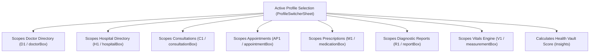
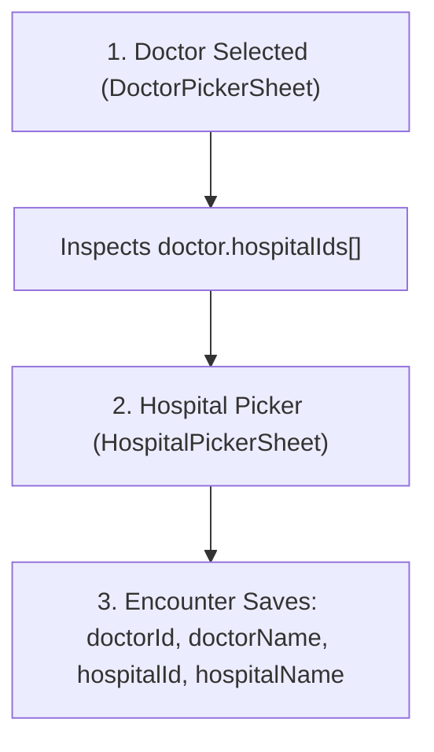
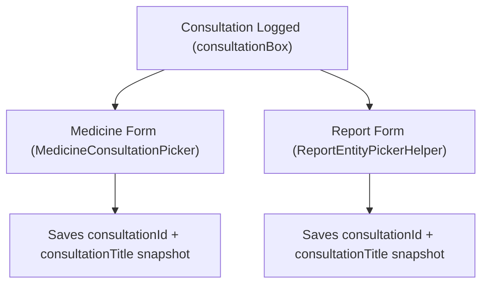

# MediCrate – Phase 3B.4.3.0: Dropdown, Picker, Selection & Reference Data Inventory

> **Document Status:** Complete & Verified  
> **Audit Date:** November 9, 2026  
> **Source Evidence:** `/home/blackhat/Documents/Reubro/medivalut/lib/`  
> **Master Reference Workbook:** `api_audit/medivault_backend_api_requirements_CROSSCHECKED.xlsx`  
> **Target Platform:** MediCrate Supabase Architecture  

---

## 1. Executive Summary

This inventory establishes an exhaustive, field-by-field catalogue of every dropdown, picker sheet, modal selector, chip selector, popup menu, and reference-data element in the MediVault application.

### Key Architectural Discoveries

1. **Separation of Concerns:** Selection controls in MediVault fall into three primary categories:
   - **Hardcoded Client Enums (16 sets):** Controlled clinical vocabularies defined directly in Dart code (e.g. blood groups, report categories, medicine forms, frequency schedules).
   - **Server-Driven Reference Data (1 API):** `GET /api/v1/medical-departments` (`MD1`) supplies standard medical specialties, cached locally in Hive `userBox`.
   - **Database-Backed Scoped Entity Pickers (6 Pickers):** Dynamic pickers for active profiles, doctors, hospitals, appointments, consultations, and clinician hospital affiliations.
2. **Dependent Dropdown Chains:** Clinical forms enforce hierarchical relational dependencies. For instance, selecting an active family profile scopes all subsequent doctor, hospital, consultation, and appointment pickers. In consultations and appointments, selecting a doctor filters or links to practicing hospital facilities.
3. **Historical Text Snapshots:** When an entity is selected from a picker (such as a Doctor or Hospital in a Consultation), the application stores both the foreign key (`doctor_id`) and an immutable text snapshot (`doctor_name`). This guarantees historical clinical integrity even if the referenced entity is subsequently deleted or modified.

---

## 2. Categorized Dropdown & Selection Sources

```
┌────────────────────────────────────────────────────────────────────────┐
│               DROPDOWN & SELECTION CONTROLS HIERARCHY                  │
├────────────────────────────────────────────────────────────────────────┤
│ 1. HARDCODED ENUMS (16 Sets)                                           │
│    • Gender (Male, Female, Others)                                     │
│    • Blood Groups (A+, A-, B+, B-, AB+, AB-, O+, O-)                   │
│    • Relationship Types (Self, Father, Mother, Spouse, etc.)           │
│    • Healthcare Facility Types (Hospital, Clinic, Lab, etc.)           │
│    • Diagnostic Report Categories (8 Categories)                       │
│    • Prescription Forms (Tablet, Capsule, Syrup, etc.)                 │
│    • Prescription Frequencies (Once daily, Twice daily, etc.)          │
│    • Appointment Statuses (upcoming, completed, cancelled, missed)     │
│    • Blood Glucose Contexts (fasting, random)                          │
│    • Vital Types & Standard Clinical Units (7 Types)                   │
│    • Theme Modes (System, Light, Dark)                                 │
│    • Currency Preference (INR, USD, EUR, GBP, AED, SAR)                │
│    • List Sort & Filter Controls (Vitals, Reports, Timeline, Insights) │
│                                                                        │
│ 2. SERVER-DRIVEN REFERENCE DATA (1 Endpoint)                           │
│    • Medical Departments Reference (MD1: GET /medical-departments)     │
│                                                                        │
│ 3. DATABASE-BACKED SCOPED ENTITY PICKERS (6 Pickers)                   │
│    • Profile Switcher (ProfileModel)                                   │
│    • Doctor Picker Sheet (DoctorModel)                                 │
│    • Hospital Picker Sheet (HospitalModel)                             │
│    • Practicing Hospitals Multi-Select (hospital_ids[])                │
│    • Appointment Picker Sheet (AppointmentModel)                       │
│    • Consultation Picker Sheet (ConsultationModel)                     │
└────────────────────────────────────────────────────────────────────────┘
```

---

## 3. Exhaustive Dropdown, Picker & Reference Data Inventory Table

| Screen / Feature | Field Name | Presentation Control | Data Source & Provenance | API Endpoint | Documented Laravel Controller | Database Table / Model | Response / Source Fields | Storage Format | Dependency Chain | Clinical Record Validation | Offline Cache Mechanism | MediCrate Migration Status | Supabase Requirement |
| :--- | :--- | :--- | :--- | :--- | :--- | :--- | :--- | :--- | :--- | :--- | :--- | :--- | :--- |
| **Sign Up** (`SignUpScreen`) | Gender | `GenderChipSelector` (`ChoiceChip`) | Hardcoded enum | N/A (Client Enum) | N/A | `users.gender`, `profiles.gender` | `['Male', 'Female', 'Prefer not to say']` | String (`Male` \| `Female` \| `Prefer not to say`) | None (Root Account) | Optional | Memory | `PRESENT_AND_FUNCTIONAL` | Map to `public.profiles.gender` |
| **Sign Up** (`SignUpScreen`) | Date of Birth | `DobPickerField` (`showDatePicker`) | Client DatePicker | N/A | N/A | `profiles.date_of_birth` | System calendar | ISO Date string (`YYYY-MM-DD`) | None | Optional | Memory | `PRESENT_AND_FUNCTIONAL` | Map to `public.profiles.date_of_birth` |
| **Profile** (`ProfileFormDialog`) | Relationship | `DropdownButtonFormField<String>` | Hardcoded enum (`ProfileRelationships.familyMemberValues`) | N/A (Client Enum) | N/A | `profiles.relationship` | `Father, Mother, Spouse, Son, Daughter, Brother, Sister, Grandfather, Grandmother, Guardian, Other` | String (`Father`, etc.) | If `Other`, activates `relationshipOther` text input | Required for family members | Memory | `PRESENT_AND_FUNCTIONAL` | Map to `public.profiles.relationship` |
| **Profile** (`ProfileDemographicsInputSection`) | Gender | `DropdownButtonFormField<String>` | Hardcoded enum | N/A (Client Enum) | N/A | `profiles.gender` | `['Male', 'Female', 'Others']` | String (`Male` \| `Female` \| `Others`) | None | Optional | Memory | `PRESENT_AND_FUNCTIONAL` | Map to `public.profiles.gender` |
| **Profile** (`ProfileDemographicsInputSection`) | Blood Group | `DropdownButtonFormField<String>` | Hardcoded enum (`ProfileDemographicsInputSection.bloodGroups`) | N/A (Client Enum) | N/A | `profiles.blood_group` | `['A+', 'A-', 'B+', 'B-', 'AB+', 'AB-', 'O+', 'O-']` | String (`A+`, `O-`, etc.) | None | Optional (Contributes to Health Vault Score) | Memory | `PRESENT_AND_FUNCTIONAL` | Map to `public.profiles.blood_group` |
| **Profile** (`ProfileFormDialog`) | Date of Birth | Date Picker Tile (`showDatePicker`) | Client DatePicker | N/A | N/A | `profiles.date_of_birth` | System calendar | ISO Date string (`YYYY-MM-DD`) | None | Optional | Memory | `PRESENT_AND_FUNCTIONAL` | Map to `public.profiles.date_of_birth` |
| **Profile Switcher** (`ProfileSwitcherSheet`) | Active Profile | `AppBottomSheet` modal list | Local Hive `profileBox` / Remote `F1` | `GET /api/v1/family-members` | `FamilyMemberController@index` | `profiles` (`ProfileModel`) | `profile_id`, `full_name`, `relationship`, `avatar_url`, `is_primary` | Profile identifier (`String profileId`) | **Master Scope:** Scopes all medical data throughout app | Mandatory for clinical data entry | Hive `profileBox` | `PRESENT_AND_FUNCTIONAL` | Scopes PostgREST queries by `profile_id` |
| **Hospitals** (`HospitalFormFields`) | Facility Type | `DropdownButtonFormField<String>` | Hardcoded enum (`HospitalFormFields.facilityTypes`) | N/A (Client Enum) | N/A | `hospitals.type` | `['Hospital', 'Clinic', 'Lab', 'Diagnostic Center']` | String (`Hospital`, etc.) | None | Defaults to `'Hospital'` | Memory | `PRESENT_AND_FUNCTIONAL` | Map to `public.hospitals.type` |
| **Doctors** (`AddEditDoctorScreen`) | Practicing Hospitals | `HospitalSelectionSheet` (Multi-select checklist) | Local Hive `hospitalBox` / Remote `H1` | `GET /api/v1/hospitals?profile_id={id}` | `HospitalController@index` | `hospitals` (`HospitalModel`) | `id`, `name`, `type`, `address`, `phone` | Array of hospital IDs (`List<String> hospitalIds`) | Scoped to active `profile_id` | Optional | Hive `hospitalBox` | `PRESENT_AND_FUNCTIONAL` | M:N join table `public.doctor_hospitals` |
| **Consultations** (`NewConsultationScreen`) | Doctor | `DoctorPickerSheet` (Browse / Create view) | Local Hive `doctorBox` / Remote `D1` | `GET /api/v1/doctors?profile_id={id}` | `DoctorController@index` | `doctors` (`DoctorModel`) | `id`, `name`, `specialty`, `phone`, `email` | Stores `doctorId` AND snapshot `doctorName` | Scoped to active `profile_id`. Auto-filters affiliated hospitals | Required (Name snapshot is mandatory) | Hive `doctorBox` | `PRESENT_AND_FUNCTIONAL` | Map to `public.consultations.doctor_id` + `doctor_name` |
| **Consultations** (`NewConsultationScreen`) | Hospital / Clinic | `HospitalPickerSheet` (Browse / Create view) | Local Hive `hospitalBox` / Remote `H1` | `GET /api/v1/hospitals?profile_id={id}` | `HospitalController@index` | `hospitals` (`HospitalModel`) | `id`, `name`, `type`, `address` | Stores `hospitalId` AND snapshot `hospitalName` | Scoped to active `profile_id`. Prioritizes doctor's hospitals | Optional | Hive `hospitalBox` | `PRESENT_AND_FUNCTIONAL` | Map to `public.consultations.hospital_id` + `hospital_name` |
| **Consultations** (`NewConsultationScreen`) | Medical Department | `MedicalDepartmentPickerSheet` (Searchable sheet) | **Server-Driven Reference API** (`MD1`) + Hive Cache | `GET /api/v1/medical-departments` | `MedicalDepartmentController@index` | `medical_departments` (`MedicalDepartmentModel`) | `id`, `name` | Department name string (`CARDIOLOGY`, etc.) | Independent lookup; sorted alphabetically ('OTHERS' at end) | Optional | Hive `userBox` (`medical_departments_reference_cache`) | `PRESENT_AND_FUNCTIONAL` | PostgREST lookup table `public.medical_departments` |
| **Consultations** (`NewConsultationScreen`) | Linked Appointment | `AppointmentPickerSheet` | Local Hive `appointmentBox` / Remote `AP1` | `GET /api/v1/appointments?profile_id={id}` | `AppointmentController@index` | `appointments` (`AppointmentModel`) | `id`, `doctor_name`, `hospital_name`, `appointment_date` | String ID (`appointmentId`) | Scoped to active `profile_id` | Optional | Hive `appointmentBox` | `PRESENT_AND_FUNCTIONAL` | Map to `public.consultations.appointment_id` |
| **Consultations** (`NewConsultationScreen`) | Follow-up Required | Switch / Checkbox | Boolean flag | N/A | N/A | `consultations.is_follow_up_required` | `true` \| `false` | Boolean (`0` \| `1`) | If true, displays Date/Time picker & notes | Optional | Memory | `PRESENT_AND_FUNCTIONAL` | Map to `public.consultations.is_follow_up_required` |
| **Appointments** (`AddEditAppointmentScreen`) | Doctor | `DoctorPickerSheet` (Browse / Create) | Local Hive `doctorBox` / Remote `D1` | `GET /api/v1/doctors?profile_id={id}` | `DoctorController@index` | `doctors` (`DoctorModel`) | `id`, `name`, `specialty` | Stores `doctorId` AND snapshot `doctorName` | Scoped to active `profile_id` | Required | Hive `doctorBox` | `PRESENT_AND_FUNCTIONAL` | Map to `public.appointments.doctor_id` + `doctor_name` |
| **Appointments** (`AddEditAppointmentScreen`) | Hospital / Facility | `HospitalPickerSheet` (Browse / Create) | Local Hive `hospitalBox` / Remote `H1` | `GET /api/v1/hospitals?profile_id={id}` | `HospitalController@index` | `hospitals` (`HospitalModel`) | `id`, `name`, `address` | Stores `hospitalId` AND snapshot `hospitalName` | Scoped to active `profile_id` | Optional | Hive `hospitalBox` | `PRESENT_AND_FUNCTIONAL` | Map to `public.appointments.hospital_id` + `hospital_name` |
| **Appointments** (`AddEditAppointmentScreen`) | Medical Department | `MedicalDepartmentPickerSheet` | **Server-Driven Reference API** (`MD1`) + Hive Cache | `GET /api/v1/medical-departments` | `MedicalDepartmentController@index` | `medical_departments` | `id`, `name` | Stores `departmentId` AND `department` name | Scoped to active `profile_id` | Optional | Hive `userBox` cache | `PRESENT_AND_FUNCTIONAL` | PostgREST table `public.medical_departments` |
| **Appointments** (`AppointmentsFilterHeader`) | Appointment Status Tabs | Filter Chips | Hardcoded enum | `GET /api/v1/appointments?status={s}` | `AppointmentController@index` | `appointments.status` | `['ALL', 'UPCOMING', 'COMPLETED', 'CANCELLED', 'MISSED']` | String (`upcoming`, `completed`, `cancelled`, `missed`) | Filters appointment list | Required | Memory | `PRESENT_AND_FUNCTIONAL` | Map to `public.appointments.status` |
| **Medicines** (`MedicineChipsSelector`) | Medicine Form | `ChoiceChip` group | Hardcoded enum (`medicineForms`) | N/A (Client Enum) | N/A | `medicines.form` | `['Tablet', 'Capsule', 'Syrup', 'Inhaler', 'Injection', 'Cream', 'Drops', 'Other']` | String (`Tablet`, etc.) | None | Optional | Memory | `PRESENT_AND_FUNCTIONAL` | Map to `public.prescriptions.form` |
| **Medicines** (`MedicineChipsSelector`) | Frequency | `ChoiceChip` group | Hardcoded enum (`medicineFrequencies`) | N/A (Client Enum) | N/A | `medicines.frequency` | `['Once daily', 'Twice daily', 'Three times daily', 'As needed', 'Other']` | String (`Twice daily`, etc.) | Drives local pill alarm schedule | Required | Memory | `PRESENT_AND_FUNCTIONAL` | Map to `public.prescriptions.frequency` |
| **Medicines** (`MedicineConsultationPicker`) | Prescribing Consultation | `ConsultationPickerSheet` | Local Hive `consultationBox` / Remote `C1` | `GET /api/v1/consultations?profile_id={id}` | `ConsultationController@index` | `consultations` (`ConsultationModel`) | `id`, `diagnosis`, `doctor_name`, `consultation_date` | Stores `consultationId` AND snapshot `consultationTitle` | Scoped to active `profile_id` | Optional | Hive `consultationBox` | `PRESENT_AND_FUNCTIONAL` | Map to `public.prescriptions.consultation_id` |
| **Reports** (`ReportCategoryChips`) | Report Category | `ChoiceChip` group | Hardcoded enum (`ReportCategoryChips.categories`) | `GET /api/v1/reports?category={c}` | `ReportController@index` | `reports.category` | `['LAB TEST', 'IMAGING', 'PRESCRIPTION', 'DISCHARGE', 'CERTIFICATE', 'VACCINATION', 'REFERRAL', 'OTHER']` | String (`LAB TEST`, etc.) | None | Required (Category is mandatory) | Memory | `PRESENT_AND_FUNCTIONAL` | Map to `public.reports.category` |
| **Reports** (`ReportEntityPickerHelper`) | Linked Consultation | `ConsultationPickerSheet` | Local Hive `consultationBox` / Remote `C1` | `GET /api/v1/consultations?profile_id={id}` | `ConsultationController@index` | `consultations` (`ConsultationModel`) | `id`, `diagnosis`, `doctor_name`, `consultation_date` | Stores `consultationId` AND snapshot `consultationTitle` | Scoped to active `profile_id` | Optional | Hive `consultationBox` | `PRESENT_AND_FUNCTIONAL` | Map to `public.reports.consultation_id` |
| **Reports** (`ReportExpenseSection`) | Expense Payment Status | Choice Chips | Hardcoded enum | N/A | N/A | `report_expenses.status` | `['paid', 'pending']` | String (`paid` \| `pending`) | Embedded in report creation | Optional | Memory | `PRESENT_AND_FUNCTIONAL` | Map to `public.report_expenses.status` |
| **Reports** (`ReportsSortDropdown`) | Report Sort Order | `PopupMenuButton<String>` | Hardcoded enum | Client sort | N/A | Client memory | `['Newest First', 'Oldest First', 'Title (A-Z)', 'Title (Z-A)']` | Sort key string | Client-side list ordering | N/A | Memory | `PRESENT_AND_FUNCTIONAL` | PostgREST `order()` query parameter |
| **Vitals** (`AddMeasurementTypeScreen`) | Vital Type | Selection Grid / Card Tiles | Hardcoded enum (`MeasurementTypes`) | `POST /api/v1/vitals` | `VitalController@store` | `measurements.measurement_type` | `['bp', 'glucose', 'heart_rate', 'spo2', 'temperature', 'respiratory_rate', 'bmi']` | String (`bp`, `glucose`, etc.) | Dictates input fields, units, and validation rules | Required | Memory | `PRESENT_AND_FUNCTIONAL` | Map to `public.measurements.type` |
| **Vitals** (`BloodGlucoseInputField`) | Glucose Context | Choice Chips | Hardcoded enum | `POST /api/v1/vitals` | `VitalController@store` | `measurements.context` | `['fasting', 'random']` | String (`fasting` \| `random`) | Displayed only for Blood Glucose | Required when type = `glucose` | Memory | `PRESENT_AND_FUNCTIONAL` | Map to `public.measurements.context` |
| **Vitals** (`AddMeasurementFormScreen`) | BMI Source | Button Action ("LOG CURRENT BMI") | Client formula from Profile | `POST /api/v1/vitals` (`type: "bmi"`) | `VitalController@store` | `measurements.primary_value` | Calculated: $\text{weight} / (\text{height}/100)^2$ | Numeric snapshot (`DECIMAL(5,2)`) | Derived from active profile height/weight | **Immutable historical snapshot rule** | Hive `measurementBox` | `PRESENT_AND_FUNCTIONAL` | Map to `public.measurements` with immutable snapshot trigger |
| **Vitals** (`VitalsSortPickerSheet`) | Vitals Sort Order | `AppBottomSheet` radio list | Hardcoded enum | Client sort | N/A | Client memory | `['Newest First', 'Oldest First', 'Value: High to Low', 'Value: Low to High']` | Enum string (`date_desc`, etc.) | Client-side list ordering | N/A | Memory | `PRESENT_AND_FUNCTIONAL` | PostgREST `order()` parameter |
| **Vitals** (`VitalFilterChipsBar`) | Vital Type Filter | `FilterChip` bar | Hardcoded enum | `GET /api/v1/vitals?type={t}` | `VitalController@index` | `measurements.measurement_type` | `['ALL', 'BP', 'GLUCOSE', 'HEART RATE', 'SPO2', 'TEMPERATURE', 'RESPIRATORY RATE', 'BMI']` | String (`bp`, etc.) | Filters vitals list | N/A | Memory | `PRESENT_AND_FUNCTIONAL` | PostgREST filter `type=eq.{t}` |
| **Timeline** (`TimelineCategoryChipsBar`) | Timeline Category | `ChoiceChip` bar | Hardcoded enum | `GET /api/v1/timeline?category={c}` | `TimelineController@index` | Virtual union | `['ALL', 'Consultations', 'Reports', 'Medicines', 'Measurements', 'Appointments', 'Expenses', 'Doctors', 'Hospitals']` | Filter string | Filters longitudinal timeline feed | N/A | Memory | `PRESENT_AND_FUNCTIONAL` | Client-side Hive union query |
| **Timeline** (`TimelineDateRangeSortRow`) | Timeline Date Range | `PopupMenuButton<String>` | Hardcoded enum | Client filter | N/A | Client memory | `['All Time', 'Last 7 Days', 'Last 30 Days', 'Last 3 Months', 'Last 6 Months', 'This Year']` | Date range enum | Date cutoff filtering | N/A | Memory | `PRESENT_AND_FUNCTIONAL` | Client-side date comparison |
| **Insights** (`InsightsTimeFilterChips`) | Insights Lookback Period | `ChoiceChip` bar | Hardcoded enum | Client calculation | N/A | Client memory | `['7D', '30D', '90D', '1Y', 'ALL']` | Lookback enum | Dictates trend calculation window | N/A | Memory | `PRESENT_AND_FUNCTIONAL` | Client-side Hive time window calculation |
| **Doctor Summary** (`DoctorSummaryDateFilterCard`) | Summary Date Range | `ChoiceChip` group | Hardcoded enum | Client filter | N/A | Client memory | `['ALL TIME', 'LAST 30 DAYS', 'LAST 3 MONTHS', 'LAST 6 MONTHS', 'THIS YEAR', 'CUSTOM RANGE']` | Date range enum | Dictates records exported to sanitized PDF | N/A | Memory | `PRESENT_AND_FUNCTIONAL` | Client-side PDF generation |
| **Global Search** (`GlobalSearchCategoryFilterBar`) | Search Category Filter | Filter Chips | Hardcoded enum | Client search | N/A | Virtual search | `['ALL', 'Consultations', 'Doctors', 'Hospitals', 'Medicines', 'Reports', 'Vitals', 'Appointments']` | Module filter | Scopes cross-module text queries | N/A | Memory | `PRESENT_AND_FUNCTIONAL` | Client-side multi-box query |
| **Settings** (`AppearanceSettingsScreen`) | Theme Mode | Radio / Segmented List | Hardcoded enum | N/A (Local preference) | N/A | Hive `settingsBox` | `['System Default', 'Light Mode', 'Dark Mode']` | String preference | Updates app-wide Material 3 theme | N/A | Hive `settingsBox` | `PRESENT_AND_FUNCTIONAL` | Stored locally in Hive `settingsBox` |
| **Settings** (`CurrencySettingsScreen`) | Currency Preference | Radio list | Hardcoded enum | N/A (Local preference) | N/A | Hive `settingsBox` | `['INR (₹)', 'USD ($)', 'EUR (€)', 'GBP (£)', 'AED (د.إ)', 'SAR (﷼)']` | Currency code string | Formats medical fees and expense totals | N/A | Hive `settingsBox` | `PRESENT_AND_FUNCTIONAL` | Stored locally in Hive `settingsBox` |

---

## 4. Detailed Dependent Dropdown Chains

### Dependency Chain 1: Multi-Profile Root Scoping

- **Rule:** Every medical record created or queried MUST inherit `profile_id` from the active profile. Switching profiles immediately filters all list views, charts, and pickers.

### Dependency Chain 2: Consultation Clinician & Facility Linkage

- **Rule:** When a doctor is selected in a consultation, the hospital picker prioritizes facilities affiliated with that clinician. Regardless of future edits to the doctor or hospital profiles, the consultation retains immutable string copies of `doctor_name` and `hospital_name`.

### Dependency Chain 3: Prescription & Report Consultation Linkage

- **Rule:** Prescriptions and lab reports can be linked to an encounter. If the parent consultation is subsequently deleted, the linked medicine or report retains the historical `consultation_title` snapshot to maintain medical context.

---

## 5. Supabase Schema Alignment for Dropdown Data

To support these dropdowns and selection controls in Supabase:

1. **Reference Lookup Table (`public.medical_departments`):**
   - Populated with initial seed data matching `MD1`.
   - Read-only to authenticated users (`SELECT` permitted, mutating operations restricted to admin).
2. **Clinician Affiliations (`public.doctor_hospitals`):**
   - Implements the M:N relationship between doctors and hospitals, replacing the comma-separated or JSON array storage used in legacy MySQL.
3. **Check Constraints on Enumerated Columns:**
   - Enforce database-level check constraints for all hardcoded enums (e.g., `gender IN ('Male', 'Female', 'Others')`, `type IN ('bp', 'glucose', 'heart_rate', 'spo2', 'temperature', 'respiratory_rate', 'bmi')`, `status IN ('upcoming', 'completed', 'cancelled', 'missed')`).
